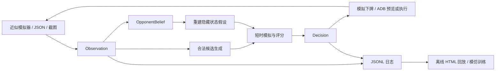

# 架构与接口



## 文件职责

| 文件 | 作用 |
| --- | --- |
| `state.py` | 数据类、序列化、观测校验、动作合法性 |
| `cards.py` / `data/cards.json` | 卡牌目录、默认卡组、明确标记为近似的战斗参数 |
| `simulator.py` | 确定性环境、旋转视角、手牌轮转、单位运动与攻击、结局 |
| `belief.py` | 圣水区间、可确认出牌历史、已见卡牌、轮转约束 |
| `policy.py` | 随机策略、规则策略、前瞻搜索、可解释候选排名 |
| `perception.py` | 图像解码、模板匹配、字形数字 OCR、检测与跟踪 |
| `synthetic.py` | 生成合成视觉测试数据，不能用于真实游戏识别 |
| `controller.py` | ADB 截图与 taps、ROI 坐标映射、dry-run、时效检查 |
| `learning.py` | 线性候选模仿训练和模型推理 |
| `experiments.py` / `cli.py` | 对局、配对评估、战术样例、运行入口 |
| `replay.py` / `viewer.html` | 生成自包含、无需网络的对局回放 |
| `paths.py` | 对项目生成文件执行目录边界检查 |

## Observation

完整可用样例在 `examples/giant.json`。team 0 表示从当前视角看到的我方，team 1 表示对手。

| 字段 | 含义 |
| --- | --- |
| time | 对局已进行秒数，必须单调递增 |
| elixir | 我方可见圣水，0–10 |
| hand | 四个受支持 card id |
| next_card | 可见的下一张卡或 null |
| units | `Entity` 列表，轨迹 ID 不重复 |
| towers | 六座唯一 ID 的 `Tower`，被拆的塔也保留 hp=0 |
| events | `play` 是可靠出牌，`seen` 是弱类别证据；包含 team/card/time/id |
| confidence | 当前各识别分数最小值，仅是门限分数，并非校准概率 |
| in_battle | 是否在对局内 |
| source | simulator 或 screen |

观测要求有效卡牌、有限坐标、合理塔血和唯一轨迹。不能用未知卡牌顶替合法手牌。真实模式塔等级需要通过配置填写 `max_hp`，默认 2500/4000 只是模拟值。

## Decision

```json
{
  "action": {"slot": 0, "x": 4, "y": 23.8},
  "card": "mini_pekka",
  "reason": "迷你皮卡：8秒前瞻，在22个合法候选中评分最高",
  "elapsed_ms": 23.0,
  "rankings": [],
  "belief": {"elixir_interval": [0, 10]}
}
```

`slot=-1` 表示等待。`rankings` 保留前五个候选及两个假设的分值。最高分可以为负；它表示在当前局势下更好的动作，不表示获胜概率。

## JSONL 对局日志

每个决策帧记录 `seed, seat, observation, decision, opponent_action`。末帧记录终局 observation 和 metrics。策略只消费 observation；opponent_action 用于回放和分析，不输入我方策略。对手隐藏手牌不会进入 observation。

日志文件用于：重建结果、比较战术、定位非法动作、训练模仿模型。回放把日志内嵌到 HTML，转义 `<` 防止文字结束 script 块；页面不拉取远程脚本或资源。

## 确定性与同时行动的范围

起手由独立 `random.Random(seed)` 生成。模拟 tick 按固定实体顺序推进移动，伤害累计后结算。实体移动与法术下牌仍按固定处理顺序执行，存在简化的顺序偏差，不能视为精确的同时博弈引擎。因此评估交替座位，并为所有策略复用同一组起手种子和对手。

模拟 tick 默认 0.25 秒；搜索为速度使用 0.5 秒。搜索中的轨迹与真实环境 tick 可能不同。暂停直到固定 match duration，按拆塔数优先、存活塔归一化总血量次之判断，明确不同于官方加时和决胜规则。

## 文件边界

核心输出、输入引用和模型路径均在项目根目录内解析。`.venv`、pip 缓存、临时目录、Ultralytics/Torch 缓存和未来 ADB 用户目录都配置为项目内路径。没有运行 adb 或创建外部环境。已存在的系统 Python/Node/git 是只读使用的运行工具。
