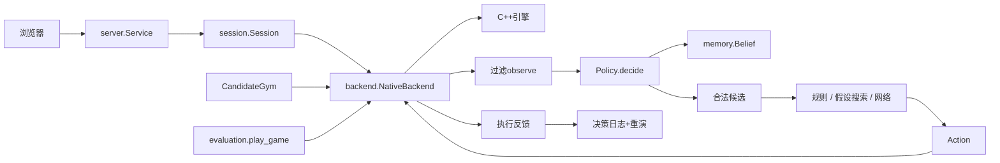

# 架构与一次真正执行的决策

主平台royale_lab，旧基线royale_ai独立保留在baseline/mvp_v0_1。浏览器、无界面评估和Gym都调用同一NativeBackend。

## 一次观察到一次执行

1. Session.advance每10tick触发策略。先读取双方观测，再分别决策，再提交动作，后提交者不会看到本轮对手刚选的牌。
2. NativeBackend.observe归一化玩家视角：己方team0在下方。玩家1用 `(17-x,33-y)`旋转、左右塔slot互换。棋盘18×34，坐标0..17/0..33。
3. 观测仅有己方手牌/下一张/圣水/卡组/冷却与公共单位/塔/确认事件。隐藏敌方手牌、圣水、队列、RNG/未来事件不进入obs；敌单位内部技能冷却等也被过滤。
4. Belief依据公开费用和恢复计算圣水区间、跟踪轮转。Mirror/形态费用由可公开推知的执行事件记录。英雄特殊周期仍近似，像素不完整历史不能取得窄区间。
5. raw_candidates生成WAIT、卡槽+落点、技能；backend.legal使用实际can_play。网络mask与策略使用同一候选结果。离散候选不穷举连续落点。
6. Decision包含action、理由、候选分数、耗时、belief。SearchPolicy从观测和显式敌方假设重建全新模型；没有真实backend引用，不复制真实隐藏全状态。
7. apply调用C++ direct_play/技能，返回接受/拒绝及前后手牌和圣水差。只有接受动作进入journal。相同玩家command_id去重；delay在指定tick边界重验并执行。
8. advance推进实际战斗。Session供UI，CandidateGym训练，play_game评估；三者共享物理后端，不使用另一个动画模型。

## 数据与保存

| 对象 | 实际入口 | 内容 |
|---|---|---|
| Action | contracts.py | wait/card/ability、slot、x/y、delay_ticks |
| Decision | contracts.py | action/reason/card_id/elapsed_ms/rankings/belief |
| 可见观测 | backend.observe | 自己HUD、公共实体/塔/事件、合法动作 |
| 调试全状态 | backend.oracle | 双方players+实体详细状态，只供UI/测试/调试 |
| 内存快照 | snapshot/restore | C++深拷贝、事件、延迟队列、去重状态 |
| 磁盘局势 | export_snapshot/load_snapshot | version/seed/decks/tick/接受journal/pending，确定性重演 |

不匹配版本拒绝加载；重放执行动作不需要再次运行旧策略，也不使用pickle。runtime.local限制文件位于项目内。保存session和决策记录会占空间，归档前保留需要的失败局势。

## HTTP协议

仅绑定127.0.0.1，限制外来Origin和1MB请求。GET `/`、`/api/health`、`/api/catalog`、`/api/state?session=ID`。POST `/api/new`、advance/action/snapshot/restore/load/fork/export/close。

创建：`{"seed":7,"controllers":["human","greedy"],"max_ticks":3000}`。下牌：`{"session":"ID","player":0,"action":{"kind":"card","slot":0,"x":3,"y":8},"command_id":"first"}`。feedback.status有accepted/rejected/wait/queued。断连后可state查询并重发同command_id；服务进程重启恢复依赖已保存JSON，而非自动持久化全部session。

API是研究协议，不能连接官方客户端。UI的全状态不可直接给主策略。像素接口pixels.py缺HUD/追踪/校准直接拒绝，真实感知尚待验证。
