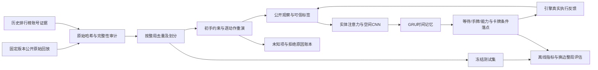

# Arena Lab：整局数据、公开战场观察与模仿策略

这是独立于 `royale_ai`、`royale_lab`、`royale_phase2`、`royale_phase3` 的研究系统，代码位于 `arena_lab/`。旧引擎、模型、Windows 入口及历史结果保留。新系统的结果不能计入旧平台的验收，也不能直接等同于国际服实力。

本次目标是把训练环境、专家数据和闭环策略放在一条可审计的链路上。代码能运行、数据有高手身份、重演能对齐、策略棋力提升，是四个独立结论。实际结果与下一阶段门槛见[交付与差距报告](ARENA_LAB_RESULTS_20261113_ZH.md)。详细实现见[数据说明](../arena_lab/DATA_ZH.md)与[模型说明](../arena_lab/MODEL_ZH.md)。

默认复现流程使用完整固定快照 `full-v2`：574 份来源整局、682 个认证老师席位，严格排除 3 个未知卡牌局后重建为 571 局、679 个老师序列。首轮压缩前缀的 212 局作为历史入口保留。完整数据已经冻结；完整权重和回放的发布、训练与评估是否完成，以结果报告中的实际证据为准。

## 系统如何工作



训练使用完整对局按时间前进，分段反向传播以控制内存。每个批次通道沿同一局延续记忆；换局才清零，批次填充不会贡献损失。训练集中的等待与出手不平衡通过明确记录的权重处理，验证和测试仍按自然分布计分。只用验证集选择 checkpoint，冻结权重后才读取测试结果。

策略同时输入：

- 可见单位、建筑、塔、法术、弹道的身份、位置、生命和公开状态；隐藏敌军不进入观察。
- 己方当前手牌、下一张牌、卡组、圣水、能力状态及公共时钟和塔状态。
- 公开几何与己方已知资源计算的动作候选范围。原生执行回执才是动作真正成功的依据。

实体注意力保留单位身份和属性，空间 CNN 描述布局，GRU 连接连续观察。动作空间包含等待、四个手牌位置、三个能力按钮；四张牌分别预测落点分布，能力不计算落点损失。离线和闭环共用同一个模型、解码器及 checkpoint 加载代码。

这些输入是**模拟器的公开状态投影**。目前没有把手机截图识别、遮挡检测、血条像素误差和触控延迟接入这条链路，不能称作已经完成屏幕端到端 AI。

## 环境选择与版本

两套候选引擎均已安装、锁定版本并跑过完整局，还在仅有 NumPy 的独立环境验证了依赖闭包。主训练使用 RoyaleSim；crforge 用于独立机制对照，其观察词表与规则版本不能直接套用当前权重。

| 环境 | 主要作用 | 需独立核验的条件 |
|---|---|---|
| RoyaleSim / RoyaleGym | 可本地复现的历史规则研究、观察与模仿闭环 | 卡表版本、公开字段、实际动作执行、与来源日期的关系 |
| crforge | 较新规则、双边环境与机制对照 | Java、固定 commit、固定数据表、SeatView 和反馈语义 |

版本标识包含引擎、卡表、二进制或来源哈希、观察 schema 和配置。模型不能跨不兼容环境直接加载。源回放未提供的客户端 build、卡等、进化配置和随机种子保留未知；某日期相近或某卡存在，均不足以证明逐局等价。

吞吐必须分别报告环境步进、策略推理和完整采样链路。完整采样包含 reset、双方决策、观察、动作执行及日志开销。自然终局、超时截断和异常单独计数，不能把失败局从分母中删掉，也不能把短暂纯步进速度当整局产能。

## 为什么专家身份和战场真值必须分别核验

Cochon 的回放库以排行榜为采集入口，随后会扩展对手账号，因此“来自该数据集”不等于“由高手打出”。本轮通过公开历史前 100 榜单中的账号标签逐局匹配，保留排名证据、证据日期和老师所在席位。对手没有相应证据时，其操作不会自动成为专家标签。

原始时间线保留双方卡组、出牌时刻、坐标、能力事件和终局皇冠。整局保存的意义是能审计开局、循环、对手行为与收尾；不能只抽取漂亮的出牌片段。来源中的未知字段不会因归一化而变成默认事实。

**命令时间线不包含真实战场实体状态。** 运行重演后得到的是在指定引擎、初始条件和机制假设下的模拟状态。未知形态、未知能力、初手歧义、动作拒绝、终局提前或结果偏差都必须进入重建质量账本。是否能够以这些状态监督策略，必须根据实际重建覆盖率决定，不能仅依据原始数据量。

数据按整局划分；双边视角、相同来源、重建变体不能跨训练、验证、测试集。NPZ 仅加载数值数组，禁止 pickle。训练入口核对文件哈希、观察尺寸、时间顺序、卡牌词表、合法动作和位置标签。

本轮初手推断使用了整局后续出牌约束，从 1,680 个“初手集合＋后四张顺序”类别中选择相容假设，通常仍有多个解。这是利用事后信息构造的模拟条件，不能视为从当时截图因果恢复的初手。动作前观察不直接输入未来命令，但其初始条件受未来约束；该限制随数据和 checkpoint 保存。

## 运行入口

在仓库根目录调用解释器，避免依赖终端的激活状态：

```bash
.venv-cloud/bin/python -m arena_lab --help
.venv-cloud/bin/python -m arena_lab bootstrap install
.venv-cloud/bin/python -m arena_lab bootstrap check
.venv-cloud/bin/python -m arena_lab bootstrap install-crforge
.venv-cloud/bin/python -m arena_lab benchmark --backend royalesim --seed 1729 --games 2 --decision-ticks 10 --card-level 16 --output outputs/arena-local/environment.json
.venv-cloud/bin/python -m arena_lab benchmark --backend crforge --seed 1729 --games 2 --decision-ticks 10 --card-level 16 --output outputs/arena-local/crforge.json
```

依赖安装到 `.cache/arena-lab/`，不覆盖原 `.venv-cloud` 和 Windows 环境。主机数值依赖沿用 `requirements-codespaces.txt` 与 `requirements-codespaces-ml.txt`。首次安装需要网络，此后的模型推理和模拟对局不访问官方游戏服务。

获取、重建、训练和评估接受明确的输入与新输出目录。以下默认流程取得完整固定快照，先保存完整重建，再为实验排除此前已用于模型测试评分的 27 个 test 原局。它们继续留在完整 index 中，不进入新训练、验证或正式测试；新测试只保留 37 个未用于首轮测试评分的原局、43 个老师序列。

完整归档是 **534,361,487 字节**，逐文件 manifest 为 10,731,198 字节。归档中的全部 raw 原文展开累计约 4.75 GB，但获取器流式扫描 tar，只保存匹配的原文，不会把这 4.75 GB 全量解包。当前一次完整获取与重建约占 0.75 GB：归档及 manifest 约 545 MB、选取原文/规范化/来源索引约 66 MB、679 份派生 NPZ 与审计 JSON 约 129 MB。这些是磁盘文件合计，不含内存中的逐局数组、训练和评估记录。两套已安装后端的 `.cache/arena-lab/` 当前另占约 1 GiB；评估 trace 与重复实验会另增空间。所有目录均在仓库内。

```bash
.venv-cloud/bin/python -m arena_lab.data_sources fetch --full --output-dir data/arena-local/full-v2
.venv-cloud/bin/python -m arena_lab.replay_data --source-index data/arena-local/full-v2/cochon-historical-top100-full-v2/source-index.json --destination data/arena-local/full-v2/derived-base-default6-v1
.venv-cloud/bin/python -m arena_lab audit --index data/arena-local/full-v2/derived-base-default6-v1/index.json
.venv-cloud/bin/python -m arena_lab.experiment --index data/arena-local/full-v2/derived-base-default6-v1/index.json --previous configs/arena-lab/previously-evaluated-test-v1.json --output data/arena-local/full-v2/experiment-index.json
.venv-cloud/bin/python -m arena_lab audit --index data/arena-local/full-v2/experiment-index.json
.venv-cloud/bin/python -m arena_lab train --index data/arena-local/full-v2/experiment-index.json --output outputs/arena-local/full-v2/train --epochs 4 --batch-size 4 --sequence 32 --learning-rate 0.0003 --weight-decay 0.0001 --position-loss-weight 1.0 --play-weight-cap 8.0 --seed 1729 --threads 2
.venv-cloud/bin/python -m arena_lab evaluate --checkpoint outputs/arena-local/full-v2/train/best.pt --suite configs/arena-lab/evaluation-suite-full-v2.json --output outputs/arena-local/full-v2/evaluation
.venv-cloud/bin/python -m arena_lab view --evaluation outputs/arena-local/full-v2/evaluation --variant model --episode 0 --output outputs/arena-local/full-v2/replay.html
.venv-cloud/bin/python -m arena_lab.policy_benchmark --checkpoint outputs/arena-local/full-v2/train/best.pt --output outputs/arena-local/full-v2/policy-benchmark.json
```

已冻结的完整重建输入为 `data/arena-lab/full-v2/derived-base-default6-v1/index.json`。上面的 `arena-local/full-v2` 留作新复现实验；派生目录、实验 index 与训练输出应使用新路径，已有文件不覆盖。`arena_lab.experiment` 核对旧 test 的原局指纹、source ID 和原始 SHA，按固定身份排除，不按分数选样本。

完整轮的超参数与对照原则预先保存在 [`experiment-full-v2.json`](../configs/arena-lab/experiment-full-v2.json)，上面的训练参数与其一致。闭环使用 [`evaluation-suite-full-v2.json`](../configs/arena-lab/evaluation-suite-full-v2.json)：24 个换边/卡组/种子/对手条件，4 种策略变体，共 96 局。套件按每局 reset 明确使用等级和塔等级 16、基础形态、随机初手，不能仅根据环境构造器的默认等级 11 判断实际评估配置。它与重建中的 `shuffle=0` 事后约束开局分别记录。

上面的命令在训练完成后从该次运行的 `best.pt` 继续评估。本次实际完整轮训练已经完成，正式输入为 `data/arena-lab/full-v2/derived-base-default6-v1/unseen-test-index.json`；全部 96 局自然结束，具体成绩见结果报告。

## 直接运行完整轮权重

不重新下载训练数据也能运行已交付权重。先完成模拟依赖与主机 Torch 安装，再运行：

```bash
.venv-cloud/bin/python -m arena_lab evaluate --checkpoint arena_lab/artifacts/imitation-full-v2.pt --suite configs/arena-lab/evaluation-suite-full-v2.json --output outputs/arena-local/full-v2-pretrained
.venv-cloud/bin/python -m arena_lab view --evaluation outputs/arena-local/full-v2-pretrained --variant model --episode 0 --output outputs/arena-local/full-v2-pretrained.html
```

约 1 MB 的[真实训练权重清单](../arena_lab/artifacts/imitation-full-v2.json)绑定 SHA256、3,361 次训练更新、数据与测试排除指纹。加载通过 `weights_only=True` 检查纯张量、环境身份及观察协议。它仍是棋力未达标的研究模型，不能直接用于不同版本或 crforge。

可直接打开[完整轮固定对局回放](../arena_lab/artifacts/replay-full-v2.html)。它保存 model 第 0 局的 108 个公开观察帧，原局长 214.65 秒、54 次部署全部执行，未按胜负挑选。真实 Chromium 已验证播放、单步、拖动、实体详情和法术血量不适用等 7 项检查，JavaScript 错误和外部网络请求均为 0。需要 Codespaces 预览时，运行下方相同的静态服务器，访问 `/replay-full-v2.html`。该页面展示模拟器公开状态，不能称为官方游戏录屏。

新旧权重的同场对照也可独立复现：先跑上面的完整模型评估，再执行：

```bash
.venv-cloud/bin/python -m arena_lab evaluate --checkpoint arena_lab/artifacts/imitation-v1.pt --suite configs/arena-lab/evaluation-suite-v1-reference.json --output outputs/arena-local/v1-reference
.venv-cloud/bin/python -m arena_lab.compare_evaluations --candidate outputs/arena-local/full-v2-pretrained --reference outputs/arena-local/v1-reference --output outputs/arena-local/full-v2-versus-v1.json
```

比较工具核对完整案例、环境、动作解码及证据哈希；失败和截断单列，不能丢弃后宣称胜率提升。

## 首轮历史入口与已有产物

首轮使用固定快照的约 139.99 MB 压缩前缀及 10.73 MB manifest，合计约 144 MiB 下载；并非完整归档。其 212 局重建输入是 `data/arena-lab/derived-base-default6-v2/index.json`，原始 236 个老师 NPZ 在完整重建中逐字节保留一致。首轮结果在 `outputs/arena-lab-20261113/`，预先声明的配置为 `configs/arena-lab/experiment-v1.json` 与 `configs/arena-lab/evaluation-suite-v1.json`。如需单独复现这段历史数据，使用新的历史目录：

```bash
.venv-cloud/bin/python -m arena_lab.data_sources fetch --output-dir data/arena-local/prefix-v1
.venv-cloud/bin/python -m arena_lab.replay_data --source-index data/arena-local/prefix-v1/cochon-historical-top100-v1/source-index.json --destination data/arena-local/prefix-v1/derived
```

只想加载已交付的**首轮历史权重**运行完整对局时，无需重新下载或重建训练数据。在安装模拟依赖和主机 Torch 后运行：

```bash
.venv-cloud/bin/python -m arena_lab evaluate --checkpoint arena_lab/artifacts/imitation-v1.pt --suite configs/arena-lab/evaluation-suite-v1.json --output outputs/arena-local/pretrained-evaluation
.venv-cloud/bin/python -m arena_lab view --evaluation outputs/arena-local/pretrained-evaluation --variant model --episode 0 --output outputs/arena-local/pretrained-replay.html
```

权重的 [SHA256 清单](../arena_lab/artifacts/imitation-v1.json)同时记录未达标结论。加载使用 `weights_only=True`，检查环境身份、观察协议、模型结构和有限数值；不能把 crforge 配置直接用于该 RoyaleSim 权重。

回放 HTML 只展示策略实际收到的公开观察，包含时间、手牌、圣水、选择动作和实体血量；它不是官方游戏录屏。采样频率、模型是否经过训练以及记录是否受体积上限截断，均在页面显示。

随仓库提供的[已训练模型回放](../arena_lab/artifacts/replay-v1.html)是固定评估第 0 局，支持下载后用浏览器直接打开，不需要网络。Codespaces 中也可只服务该产物目录，再打开私有转发端口的 `/replay-v1.html`：

```bash
.venv-cloud/bin/python -m http.server 8773 --bind 0.0.0.0 --directory arena_lab/artifacts
```

该首轮页面显示 2 秒间隔采样的 90 帧，不插造帧间过程；它通过了实际 Chromium 的播放、单步和拖动检查。这项验收对应 `replay-v1.html`，完整轮页面需要独立记录。当前可视化只验收 Royale public-v2，crforge 的额外未知血量字段布局会被显式拒绝。

## 如何判读结果与接下来的重点

离线总准确率容易被大量等待帧抬高，因此要同时看全等待基线、出手精确率和召回率、出牌选择、条件落点误差以及完整动作命中率。训练 loss 下降只能证明优化器学到了数据中的模式。

闭环使用预先声明的卡组、随机种子和双边换位，对比模型、同权重去掉实体、合法随机策略和公开战场规则策略。规则策略会防守可见入侵、保留圣水、选择弱侧进攻，实力未经过天梯校准。必须在每种对手下分别报告胜负、执行失败和吞吐；打赢等待或简单脚本不构成天梯高手证据。

后续优先级由实验瓶颈决定，但不能跳过以下依赖关系：

1. 先减少原局与模拟世界的偏差：取得带明确版本、卡等、形态、初手和能力归属的完整数据，做逐机制和逐局对齐。
2. 增加专家数量、卡组与对手分布，保留跨玩家、跨时间和跨卡组的独立评估，避免仅记住某一种循环。
3. 在可靠模仿初始化之后引入对手池、自博弈和策略晋升门槛。优化真实完整对局回报，不能依靠可刷取的局部奖励宣布变强。
4. 将屏幕感知、动作延迟和执行恢复接入同一公开观察接口，先用录屏离线验证，再对受控完整对局做端到端验收。
5. 规模扩张以实测采样速度、训练利用率和验证收益为依据。当前 CPU 测量不外推为 GPU、并行集群或官方客户端的速度。
