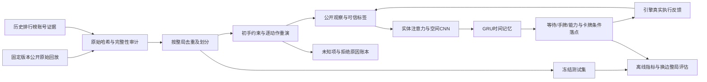

# Arena Lab：整局数据、公开战场观察与模仿策略

这是独立于 `royale_ai`、`royale_lab`、`royale_phase2`、`royale_phase3` 的研究系统，代码位于 `arena_lab/`。旧引擎、模型、Windows 入口及历史结果保留。新系统的结果不能计入旧平台的验收，也不能直接等同于国际服实力。

本次目标是把训练环境、专家数据和闭环策略放在一条可审计的链路上。代码能运行、数据有高手身份、重演能对齐、策略棋力提升，是四个独立结论。实际结果与下一阶段门槛见[交付与差距报告](ARENA_LAB_RESULTS_20261113_ZH.md)。详细实现见[数据说明](../arena_lab/DATA_ZH.md)与[模型说明](../arena_lab/MODEL_ZH.md)。

## 系统如何工作



训练使用完整对局按时间前进，分段反向传播以控制内存。每个批次通道沿同一局延续记忆；换局才清零，批次填充不会贡献损失。训练集中的等待与出手不平衡通过明确记录的权重处理，验证和测试仍按自然分布计分。只用验证集选择 checkpoint，冻结权重后才读取测试结果。

策略同时输入：

- 可见单位、建筑、塔、法术、弹道的身份、位置、生命和公开状态；隐藏敌军不进入观察。
- 己方当前手牌、下一张牌、卡组、圣水、能力状态及公共时钟和塔状态。
- 公开几何与己方已知资源计算的动作候选范围。原生执行回执才是动作真正成功的依据。

实体注意力保留单位身份和属性，空间 CNN 描述布局，GRU 连接连续观察。动作空间包含等待、四个手牌位置、三个能力按钮；四张牌分别预测落点分布，能力不计算落点损失。离线和闭环共用同一个模型、解码器及 checkpoint 加载代码。

这些输入是**模拟器的公开状态投影**。目前没有把手机截图识别、遮挡检测、血条像素误差和触控延迟接入这条链路，不能称作已经完成屏幕端到端 AI。

## 环境选择与版本

两套候选引擎均已安装、锁定版本并跑过完整局，还在仅有 NumPy 的独立环境验证了依赖闭包。主训练使用 RoyaleSim；crforge 用于独立机制对照，其观察词表与规则版本不能直接套用当前权重。

| 环境 | 主要作用 | 需独立核验的条件 |
|---|---|---|
| RoyaleSim / RoyaleGym | 可本地复现的历史规则研究、观察与模仿闭环 | 卡表版本、公开字段、实际动作执行、与来源日期的关系 |
| crforge | 较新规则、双边环境与机制对照 | Java、固定 commit、固定数据表、SeatView 和反馈语义 |

版本标识包含引擎、卡表、二进制或来源哈希、观察 schema 和配置。模型不能跨不兼容环境直接加载。源回放未提供的客户端 build、卡等、进化配置和随机种子保留未知；某日期相近或某卡存在，均不足以证明逐局等价。

吞吐必须分别报告环境步进、策略推理和完整采样链路。完整采样包含 reset、双方决策、观察、动作执行及日志开销。自然终局、超时截断和异常单独计数，不能把失败局从分母中删掉，也不能把短暂纯步进速度当整局产能。

## 为什么专家身份和战场真值必须分别核验

Cochon 的回放库以排行榜为采集入口，随后会扩展对手账号，因此“来自该数据集”不等于“由高手打出”。本轮通过公开历史前 100 榜单中的账号标签逐局匹配，保留排名证据、证据日期和老师所在席位。对手没有相应证据时，其操作不会自动成为专家标签。

原始时间线保留双方卡组、出牌时刻、坐标、能力事件和终局皇冠。整局保存的意义是能审计开局、循环、对手行为与收尾；不能只抽取漂亮的出牌片段。来源中的未知字段不会因归一化而变成默认事实。

**命令时间线不包含真实战场实体状态。** 运行重演后得到的是在指定引擎、初始条件和机制假设下的模拟状态。未知形态、未知能力、初手歧义、动作拒绝、终局提前或结果偏差都必须进入重建质量账本。是否能够以这些状态监督策略，必须根据实际重建覆盖率决定，不能仅依据原始数据量。

数据按整局划分；双边视角、相同来源、重建变体不能跨训练、验证、测试集。NPZ 仅加载数值数组，禁止 pickle。训练入口核对文件哈希、观察尺寸、时间顺序、卡牌词表、合法动作和位置标签。

本轮初手推断使用了整局后续出牌约束，从 1,680 个“初手集合＋后四张顺序”类别中选择相容假设，通常仍有多个解。这是利用事后信息构造的模拟条件，不能视为从当时截图因果恢复的初手。动作前观察不直接输入未来命令，但其初始条件受未来约束；该限制随数据和 checkpoint 保存。

## 运行入口

在仓库根目录调用解释器，避免依赖终端的激活状态：

```bash
.venv-cloud/bin/python -m arena_lab --help
.venv-cloud/bin/python -m arena_lab bootstrap install
.venv-cloud/bin/python -m arena_lab bootstrap check
.venv-cloud/bin/python -m arena_lab bootstrap install-crforge
.venv-cloud/bin/python -m arena_lab benchmark --backend royalesim --seed 1729 --games 2 --decision-ticks 10 --output outputs/arena-local/environment.json
.venv-cloud/bin/python -m arena_lab benchmark --backend crforge --seed 1729 --games 2 --decision-ticks 10 --output outputs/arena-local/crforge.json
```

依赖安装到 `.cache/arena-lab/`，不覆盖原 `.venv-cloud` 和 Windows 环境。主机数值依赖沿用 `requirements-codespaces.txt` 与 `requirements-codespaces-ml.txt`。首次安装需要网络，此后的模型推理和模拟对局不访问官方游戏服务。

获取、重建、训练和评估接受明确的输入与新输出目录。以下命令从固定公开源下载约 144 MiB 数据；首次模拟器及 Java 缓存另占约 1 GiB。原始记录与实验结果均保存在仓库内：

```bash
.venv-cloud/bin/python -m arena_lab.data_sources fetch --output-dir data/arena-local
.venv-cloud/bin/python -m arena_lab.replay_data --source-index data/arena-local/cochon-historical-top100-v1/source-index.json --destination data/arena-local/derived
.venv-cloud/bin/python -m arena_lab audit --index data/arena-local/derived/index.json
.venv-cloud/bin/python -m arena_lab train --index data/arena-local/derived/index.json --output outputs/arena-local/train --epochs 4 --batch-size 4 --sequence 32 --threads 2
.venv-cloud/bin/python -m arena_lab evaluate --checkpoint outputs/arena-local/train/best.pt --suite configs/arena-lab/evaluation-suite-v1.json --output outputs/arena-local/evaluation
.venv-cloud/bin/python -m arena_lab view --evaluation outputs/arena-local/evaluation --variant model --episode 0 --output outputs/arena-local/replay.html
.venv-cloud/bin/python -m arena_lab.policy_benchmark --checkpoint outputs/arena-local/train/best.pt --output outputs/arena-local/policy-benchmark.json
```

已实际训练的输入是 `data/arena-lab/derived-base-default6-v2/index.json`，首轮结果在 `outputs/arena-lab-20261113/`。上面的 `arena-local` 留作新复现实验。每次新实验使用新目录，保留既有证据。首轮选模及对照原则提前保存在 `configs/arena-lab/experiment-v1.json`，96 局矩阵保存在 `configs/arena-lab/evaluation-suite-v1.json`。

只想加载交付权重运行完整对局时，无需重新下载或重建训练数据。在安装模拟依赖和主机 Torch 后运行：

```bash
.venv-cloud/bin/python -m arena_lab evaluate --checkpoint arena_lab/artifacts/imitation-v1.pt --suite configs/arena-lab/evaluation-suite-v1.json --output outputs/arena-local/pretrained-evaluation
.venv-cloud/bin/python -m arena_lab view --evaluation outputs/arena-local/pretrained-evaluation --variant model --episode 0 --output outputs/arena-local/pretrained-replay.html
```

权重的 [SHA256 清单](../arena_lab/artifacts/imitation-v1.json)同时记录未达标结论。加载使用 `weights_only=True`，检查环境身份、观察协议、模型结构和有限数值；不能把 crforge 配置直接用于该 RoyaleSim 权重。

回放 HTML 只展示策略实际收到的公开观察，包含时间、手牌、圣水、选择动作和实体血量；它不是官方游戏录屏。采样频率、模型是否经过训练以及记录是否受体积上限截断，均在页面显示。

随仓库提供的[已训练模型回放](../arena_lab/artifacts/replay-v1.html)是固定评估第 0 局，支持下载后用浏览器直接打开，不需要网络。Codespaces 中也可只服务该产物目录，再打开私有转发端口的 `/replay-v1.html`：

```bash
.venv-cloud/bin/python -m http.server 8773 --bind 0.0.0.0 --directory arena_lab/artifacts
```

该页面显示 2 秒间隔采样的 90 帧，不插造帧间过程；它通过了实际 Chromium 的播放、单步和拖动检查。当前可视化只验收 Royale public-v2，crforge 的额外未知血量字段布局会被显式拒绝。

## 如何判读结果与接下来的重点

离线总准确率容易被大量等待帧抬高，因此要同时看全等待基线、出手精确率和召回率、出牌选择、条件落点误差以及完整动作命中率。训练 loss 下降只能证明优化器学到了数据中的模式。

闭环使用预先声明的卡组、随机种子和双边换位，对比模型、同权重去掉实体、合法随机策略和公开战场规则策略。规则策略会防守可见入侵、保留圣水、选择弱侧进攻，实力未经过天梯校准。必须在每种对手下分别报告胜负、执行失败和吞吐；打赢等待或简单脚本不构成天梯高手证据。

后续优先级由实验瓶颈决定，但不能跳过以下依赖关系：

1. 先减少原局与模拟世界的偏差：取得带明确版本、卡等、形态、初手和能力归属的完整数据，做逐机制和逐局对齐。
2. 增加专家数量、卡组与对手分布，保留跨玩家、跨时间和跨卡组的独立评估，避免仅记住某一种循环。
3. 在可靠模仿初始化之后引入对手池、自博弈和策略晋升门槛。优化真实完整对局回报，不能依靠可刷取的局部奖励宣布变强。
4. 将屏幕感知、动作延迟和执行恢复接入同一公开观察接口，先用录屏离线验证，再对受控完整对局做端到端验收。
5. 规模扩张以实测采样速度、训练利用率和验证收益为依据。当前 CPU 测量不外推为 GPU、并行集群或官方客户端的速度。
