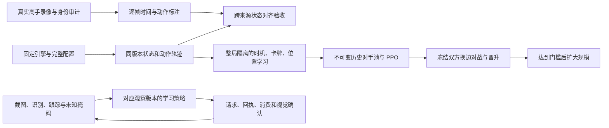

# 配对战场、时序学习、联赛与截图闭环交付

本轮从 `9f6efce` 继续开发。实验编号沿用开始时的 UTC 2026-11-13；北京时间 2026-11-14 至 15 日继续验证与收尾。`arena_lab/` 本轮轨迹与训练使用固定的 RoyaleSim `0.1.51`／RoyaleGym `0.1.29`；原生截图路径使用现有固定版本 Android／Null’s Royale。两者的成功指标不能互相代替。原平台、模型和失败证据均保留。

可直接使用的交付包括四份已训练权重、配对数据采集与重放核验、高手录屏下载／审计清单、联赛训练和晋升工具、截图控制入口、可播放整局回放，以及随 Git 保存的结果证据。它是可运行、可审计的研究系统；**尚未达到国际服高手实战能力**。

| 用户要求 | 已完成的实物与验证 | 仍未通过的门槛 |
|---|---|---|
| 同版本配对与状态对齐 | 130 局完整模拟器轨迹，配置／状态／动作逐步重放核对；70 局有排名证据的人类录像 | 人类录像的精确版本、完整配置和消费真值未齐，不能作为同版本高手真值 |
| 时机、选卡、落点与独立测试 | 数值时序、联合分类、缺测像素模型均实际训练；整局隔离、阈值冻结和消融完成 | 时序结构未胜过联合分类；像素策略过度行动，完整对局棋力偏弱 |
| 对手池、自博弈和晋升 | 历史池、24 局 PPO 训练、450 局冻结对照、断点恢复及便携验证器 | PPO 未达到晋升条件，保留初始参照；晋升前不扩大训练规模 |
| 截图、追踪、延迟和确认 | 固定布局检测／跟踪、缺测策略、原生 RPC 与物理 ADB 入口、分级回执 | 物理设备尚未接入；当前原生尝试和实时门槛分别见第 4 节 |

## 四个问题怎样形成闭环



数据采集、学习、联赛和截图控制的主要接口已实现；图中的跨来源高手真值对齐仍未通过，真实设备验收也须依据下面的实测状态判断。

## 1. 数据：先证明每一个字段来自哪里

上轮只有高手出牌事件，在假设配置下重放会产生看似合理、实际可能错误的战场。本轮把来源分开保存：

| 数据 | 本轮实际取得 | 能证明的范围 |
|---|---|---|
| 同版本配对实体轨迹 | 80 局，88,828 个双方观察，11,699 次确认出牌 | 每个观察前后状态、配置、初手、动作请求和消费时刻，均可从全新引擎逐步重放核对 |
| 面向原生 8 卡的模拟器迁移数据 | 50 局，48,952 个双方观察，4,088 次确认出牌 | 同样通过状态重放；来源仍是模拟器规则教师 |
| 人类高手录屏 | 实际下载 91 局；其中 70 局有可读的录制时排名 | 70 局逐局核对开场、结尾画面与媒体时间，68 局包含最终结果横幅，另 2 局止于加时决胜皇冠 |

70 局高手子集中 67 局双方均有可读排名，137 个可读选手位置中有 51 个前 100、86 个第 101–200。排名指录制时画面，不能代表当前排名。保留 50／10／10 整局划分；原始 91 局未因筛选删除。当前覆盖核对不是逐帧动作标注，也尚未证明中间没有丢帧或编辑。

实际 MP4 PTS 与画面倒计时的时钟抽查支持约 4 倍回放，抽查区间关系是 **游戏时间差约等于视频时间差乘 4**；尚未逐段证明全部录像恒定倍速。来源 README 的除法说明以及 sidecar 的名义 60 fps／墙钟 duration 均不能直接当真值。审计保留逐帧来源哈希。

目前人类录像仍缺精确客户端构建、完整形态／等级与初始状态、可确认的动作消费日志。因此 **70 局高手视频和 130 局同版本规则教师数据，不能合称 200 局同版本高手配对数据**。强高手模仿门槛保持未通过。解决这项缺口的具体路径是：在同一已知版本上采集人类整局，或先给录像补充画面动作、卡组形态与时钟标注，再用可证伪的中间状态对齐逐项验证；不能只比最终胜负。

数据下载、来源筛选、恢复和核对命令见 [配对数据说明](../arena_lab/PAIRED_DATA_ZH.md)。原始视频、轨迹、日志保存在 `outputs/arena-next-20261113/`；Git 只收录固定清单、小型审计、代码和审查过的模型。

## 2. 学习：时间、卡牌和位置各自承担明确任务

每个监督样本记录观察 tick、请求 tick、确认 tick、真实经过 tick 和下一决策时长。禁止把未来窗口里的一次动作贴在更早的观察上。循环网络先预测该时间段内是否行动，再条件选卡、再条件选位置；在线解码和离线评分使用同一分布与冻结阈值。

模型保留实体编码、空间位置和 GRU 历史。时间概率用生存形式 `P(行动)=1-exp(-rate×dt)`，循环输入另含真实经过时间。训练中保留自然 WAIT 分布，按整局保留上下文，不靠复制出牌帧提高表面召回。

80 局划分为 60 train／10 validation／10 test。train 内再留 6 局用于模型选择；validation 分为 5 局校准、5 局独立检查；最终 10 局只在模型和阈值冻结后评分。旧的 27／37 局 test 不参与本轮选择。

新测试集共有 10,840 个有效时间点，其中 1,425 个为真实出牌标签。结果如下：

| 指标 | 时间策略 | 同预算联合分类 | 时间策略移除战场实体 |
|---|---:|---:|---:|
| 出牌时机 precision | 69.98% | 76.87% | 25.21% |
| 出牌时机 recall | 86.39% | 86.04% | 76.42% |
| 真实出牌标签上的完整动作命中率 | 40.21% | 43.93% | 11.93% |
| 给定真实卡牌的落点平均误差 | 1.00 格 | 0.96 格 | 6.21 格 |

完整动作命中要求该真实出牌时间点的行动、手牌槽和落点格同时正确，三列分别命中 573／626／170 次，分母均为 1,425；它不是“全部预测行动中有多少完整正确”的 precision。时机 precision 的分母则是全部预测行动，三列分别预测 1,759／1,595／4,319 次。

这证明它使用战场并能模仿当前教师，不证明超过高手。**新时序结构未胜过联合分类基线**：完整动作命中率差为 −3.72 个百分点，按整局 bootstrap 的 95% 区间为 [−5.98, −1.13] 个百分点。数据、时间标签和评估接口的修复值得保留，网络复杂化本身不能当作收益；也不能将与上轮混有数据、预算、版本差异的结果归因成某一个因素。具体对照见 [时序训练说明](../arena_lab/TIMING_ZH.md)。

训练支持逐轮事务检查点，保存优化器、随机数与分组身份。第一次环境重建后，数值时序训练从第 7 轮恢复；之后又观察到旧训练／验收进程消失、PID 1 启动时间更新，像素训练从第 10 轮恢复。两次原因都未证实，当前 cgroup 的 OOM 计数不能解释上一容器的退出；不能把恢复成功写成系统重建根因已修复。原日志、检查点和不完整对局证据保留，停机时间不计入训练吞吐。

## 3. 自博弈：提高棋力必须由外部对战证明

历史池按权重 SHA256 固定成员，保留规则、随机、模仿基础模型和每轮 PPO 快照。训练对手以 25% 均匀覆盖加 75% 平滑失败率平方抽样；评估结果不回流训练抽样统计。

PPO 实际更新 actor 和公开观察 critic，使用终局奖励与明确声明的塔血势能塑形。折扣按游戏秒数定义；自然终局与预算截断采用不同 bootstrap；每个优化轮重新按当前参数重放整局循环状态。中断恢复连同对手池、优化器和 RNG 一起校验。

晋升提前冻结为每个模型 150 场：三类对手，各 25 个种子、双方换边。每类对手要求得分至少 55%、种子簇配对平均提升至少 5 个百分点、精确符号检验通过多重比较校正，且所有对局自然结束，动作消费完整、拒绝率不高于 1%。未通过就保留基础模型，不扩大训练规模来掩盖结果。

实现、运行命令与恢复实验证据见 [历史对手、自博弈与晋升](../arena_lab/LEAGUE_ZH.md)。

本轮预声明的 3 轮 × 8 局训练已完成：24/24 自然终局、11,761 个环境控制步、1,510 次消费、0 拒绝，88.43 秒，6 次实际 PPO 优化器更新。训练内 20 胜不能替代独立对战结果；没有因联合分类测试表现更好而事后改动已声明的 PPO 初始化或晋升案例。

正式 450 局已完成，全部自然终局，共确认消费 31,916 次，0 拒绝、0 故障、0 截断：

| 冻结策略 | 胜／平／负 | 是否据此晋升 |
|---|---:|---|
| 时间模仿基础模型 | 86／1／63 | 初始参照，不是已证明的强冠军 |
| 同预算联合分类 | 84／0／66 | 只作预声明诊断，不替换基础模型 |
| 3 轮 PPO 候选 | 85／1／64 | **未通过** |

PPO 对随机对手得分 90%，较基础模型提升 2 个百分点；对规则对手得分 30%，下降 4 个百分点；对时间模仿对手得分 51%，变化为 0。三组都未通过预设改善幅度与显著性门槛，因此历史池保留初始参照。离线动作准确率较好的联合分类也没有转化成这组对战中的更高总得分，说明不能用单步模仿指标替代整局策略质量。

这次只包含 6 次 PPO 更新，结果不足以否定 PPO 方法本身；它证明当前配置尚未带来可验收的提升。下一步应在开发集检查等待过多／过早行动、关键卡覆盖和防守失败，先改善教师与状态覆盖，再拿新的封存对手和种子验收。不得反复利用这 450 局调参直到过线。

第二次环境中断前 PPO 已留下 100 局；原件保留，恢复后完整重跑该 150 局组。重复的 100 局除墙钟耗时外，所有已保存逐局回执完全一致。它们是恢复验证的重复计算，**不是新增 100 个独立样本**。正式三组各自实测约 232–241 控制步／秒，不含停机、中断重算和环境启动时间。

## 4. 截图闭环：未知保持未知，延迟和回执纳入状态

截图路径包含固定模型哈希的单位检测、手牌模板识别、保守圣水下界、跟踪 ID 生命周期、场景就绪门槛和动作账本。请求提交、传输 ack、原生消费和画面确认分别记录；缺回执保持 unknown，不自动重复出牌。

旧数值模型需要精确 HP／时钟等输入，不能直接把截图缺测填 0 后调用。本轮新增 `arena-masked-pixel-v3`：每个字段带 known mask，仅学习和使用目前截图能取得的部分。未校准的阵营也保持未知。它从独立 50 局数据投影训练，是向截图迁移的候选，尚未获得真实检测噪声分布上的训练保证。

该模型已完成 12 轮、2,756 次优化器更新，权重为 `arena_lab/artifacts/pixel-masked-v1.pt`。新测试集有 8,879 个有效时间点、467 个可观察出牌标签；另有 275 次来源出牌因输入缺测／候选动作限制而排除，没有改标成 WAIT。冻结测试的时机 precision 为 **27.30%**、recall 为 **85.01%**，在真实出牌标签上的完整动作命中率为 **47.11%**，给定真实卡牌的位置误差 **1.48 格**。移除单位后，完整动作命中降到 24.20%、位置误差升到 5.26 格，说明它使用了战场信息。

但它预测了 1,454 次出牌，相比 467 个有效真实动作，**过早或多余行动仍然严重**；不能只用 47.11% 的条件命中率称为优秀策略。这个观察版本还缺阵营、塔血、时钟和可靠检测误差模型，后续要先补独立感知标注与时间观察，并在开发集处理等待／出牌的取舍，再用全新测试验收；本轮没有根据这次 test 调阈值。

预先留出的 40 场闭环对局也已完成：40/40 自然终局，对随机对手 19/20 胜，对拥有普通公开数值观察的规则对手 3/20 胜；1,142 次请求中确认消费 1,092 次、拒绝 50 次。**4.38% 拒绝率高于 1% 的可靠性门槛**，且对规则对手明显偏弱。独立的两局交付 smoke 另有 83 次消费、6 次拒绝；其通过仅表示模型可加载、能完成整局且账本完整，不表示已达到低拒绝或实机门槛。40 局实测 14,955 控制步／61.90 秒，约 241.59 控制步／秒，属于模拟器投影输入的吞吐。

为定位问题，另用 seed 930001–930003、双方换边做了 6 局开发诊断，未改冻结模型和测试结果。238 次请求中有 14 次拒绝：2 次 `TOO_EARLY` 在 tick 80，12 次 `GAME_OVER` 在 tick 6000–6160 的停止部署／决胜结算阶段。这组诊断没有费用、动态占位或几何拒绝。它指出下一项具体修复应是**可验证的开局、可部署与结算阶段观察，以及与之对应的动作门控**；不能直接把模拟器内部阶段字段偷偷加给截图 actor，也不能据此改写原 40 局的拒绝统计。未校准的真实阶段保持未知，设备遇到未确认动作会停止继续提交。

慢速 Android 中，墙钟秒数不等于游戏秒数。截图墙钟用于延迟报告；只有控制器自身已确认的推进回执可提供逻辑经过 tick。逻辑时间未知时清空循环记忆并记录退化路径。不能用后台完整状态填充 actor 的缺测。

物理设备入口 `arena_lab.device_live` 已连接截图、同一识别器／学习策略、两次点击和后续截图，但**在首个出牌尝试后停止**。目前缺少独立消费证据，手牌和圣水画面即使一致也只记为视觉支持，`game_consumed` 保持 unknown。这是用于标定的有界入口，尚不是可连续运行的手机作战代理；实际物理设备调用为 0。后续必须先取得明确设备、校准观察时钟和动作确认，再开放下一次请求。

11 月 14 日的软件 Android 恢复已完成：655 个安装文件哈希匹配，随后约 65.55 秒内的 9 次身份／内容稳定检查通过。真实 raw 与持久 raw 各采 3 次，暂停状态始终为 tick 90，但画面从黑屏变化为 VS 入场动画，直接说明“截图前后状态不变”还不等于“画面已与状态对齐”。两个路径的小样本中位耗时分别约 2.77／4.45 秒，不能宣布持久连接提速或实时验收通过。

随后实际加载交付像素权重，完成 **13 帧、12 个决策窗口、tick 90→210** 的新实验。耗时 210.83 秒，所有画面均未通过场景就绪门槛，动作全部为 WAIT；**请求 0、消费 0、没有自然终局**。画面可见 VS 遮挡后的单位移动，但手牌与圣水 HUD 不可用。这证明了真实截图进入模型和保守等待路径，尚未证明闭环作战。原实验保留在 `outputs/arena-next-20261113/device-pixel-short-20261114/`，[13 帧便携审计](audits/arena_next_20261113/device/short_pixel_20261114.json)随 Git 保存；不得把它计为已会出牌或完整实机对局。现有 `advance-native` 实际会在推进期间解除暂停，故不能仅依据暂停时速度为零就认定 UI 阻塞原因；场景复用和显示时间来源还需用新运行区分。

11 月 15 日修复了一个明确的多余同步点：没有模型出牌请求的 WAIT 窗口改成单次推进 10 tick；有请求时仍先推进 1 tick、读取独立消费回执，再补剩余 9 tick。策略始终每 10 tick 决策，未用增大观察跨度或跳过入场来换取结果。回归覆盖等待跨度、确认顺序与终局缩短；实际显示效果另用新 app、单场景和独立 seed 验证，修复本身不等于已经证明 VS 遮挡原因。

新 app 的首个默认速度实验仍是 13 帧、12 次 WAIT，耗时 301.30 秒，未出现可用 HUD。接着在同一 app 的新场景、独立 seed 20261123 上，按预声明的 24 个窗口预算测试原生速度 0.25；reset 与初始 tick 90 不变，控制跨度仍为 10 tick。**这次从帧编号 6（从 0 计数）／tick 150 起取得战场与 HUD，随后模型自主请求巨人和弓箭手，分别在 tick 151、171 确认原生消费**。帧编号 6–12 共 7 帧通过场景就绪；12 个已完成窗口为 10 WAIT、2 次出牌，0 拒绝。首笔另有手牌轮转／圣水下降的视觉支持，第二笔手牌视觉确认仍未知，不能统称两笔均完成独立视觉确认。

当前容器 PID 1 的启动时间为 02:11:15 UTC，旧 QEMU、ADB 和实验进程均已消失；最后落盘停在 02:06:40 UTC。原报告仍为 `running`，原件保留，**只有计划 24 个窗口中的 12 个和 13 帧完成，不能记作实验正常完成**。原因未证实，不归因为 OOM。已保存前缀的 tick 为 90→210，首末截图跨度 310.64 秒，截图中位耗时约 2.92 秒、单窗口推进中位约 20.47 秒；不满足实时要求，也没有自然终局。这已提供真实截图→识别／跟踪→学习策略→请求→消费→后续截图的短段证据，尚非完整设备作战验收。不同 seed、场景和运行条件同时变化，不能仅凭这一次成功认定 0.25 是 VS 问题的因果修复。

新克隆也可直接核对 [短段审计摘要](audits/arena_next_20261113/device/render_20261115/summary.json)、[原始战场截图](audits/arena_next_20261113/device/render_20261115/quarter-frame12.png)与同目录的两笔请求／回执。便携包保留 3 张未经修改的 PNG，完整 13 帧仍在本机原目录，字节与哈希对应关系随包保存。

只读协议审查进一步找到具体时间域差异：此前默认速度场景的日志中，一次 full update 的输入 delta 为 8.461454 秒，但逻辑时钟实际收到 0.1 秒；固定二进制反汇编也显示时钟调用前有 0.1 秒上限，后续另一组件更新仍接收未钳的 delta 和乘速度后的 delta。该组件的用途与 VS 动画调用链尚未确认，因此这里只提出可检验的时间域错配假设，不宣称找到过场根因。下一次原生修改应使用独立探针版本测调用顺序、delta 与画面状态，再做相同 seed／配置的对照。偏移、原指令、日志来源和哈希见 [渲染时序协议审查](audits/arena_next_20261113/device/render_timing_protocol_review_20261115.json)。

原生实际运行记录、恢复步骤和具体未通过项见 [截图与设备闭环](../arena_lab/VISION_ZH.md)；模型接口见 [缺测观察与截图策略](../arena_lab/PIXEL_MODEL_ZH.md)。软件 Android、物理设备和官方在线客户端分别验收。

## 性能口径与复现

新克隆先按仓库云端依赖安装主解释器，再安装独立模拟器。无需先重训，可以直接校验交付权重并让每个模型双方换边完成整局：

```bash
.venv-cloud/bin/python -m arena_lab bootstrap install
.venv-cloud/bin/python -m arena_lab check-delivery --output outputs/my-delivery-check
```

此命令校验 `arena_lab/artifacts/` 中每份权重的 SHA256、有限数值和训练元数据，从模型内的完整配置构建对应观察版本，输出逐局记录、动作消费与拒绝、终局和实测速度。它是功能复现检查，不能用少量 smoke 对局替代正式晋升。输出目录必须全新，重复运行使用另一目录；没有检查通过就不会仅凭权重文件存在宣布成功。

也可以直接打开 [新联合分类模型的完整对局回放](../arena_lab/artifacts/aligned-joint-replay.html)：固定 seed 950001，对规则对手，251.45 秒游戏时间、60 次模型出牌、0 拒绝，最终落败。回放包含 252 个采样时刻，支持播放、暂停与定位。它显示模拟器公开观察，不是原版战场录像；保留这个预先指定样本，没有换成一场胜局来展示。

固定依赖、引擎与模型哈希随配置保存。当前环境为 4 vCPU、16 GiB、无 GPU。80 局全新配对采集含压缩和独立重放耗时 434.86 秒，约 102.13 个联合控制步／秒；这个速度包含审计，且受到当时并行负载影响。时间策略 12 轮纯训练累计 974.53 秒，约 741.36 个有效标签／秒；训练加 monitor／校准／测试为 1,087.87 秒，不含容器重建的停机间隔。

50 局迁移数据恢复会话中有 37 局复用、13 局新采，不能用全部 50 局除以恢复会话时间声称新采集吞吐。更正记录保留原报告及解释。

缺测像素策略使用 1 个 CPU 线程，12 轮纯训练累计 1,177.34 秒，约 268.54 个有效标签／秒；训练加 monitor／校准／测试累计 1,332.09 秒，不含恢复启动的数据重审计与停机时间。这里是含同机短时其他负载的实测，不是独占峰值，也不是摄像头／截图吞吐。

```bash
.venv-cloud/bin/python -m arena_lab bootstrap install
.venv-cloud/bin/python -m arena_lab collect-paired \
  --output outputs/my-paired --train 60 --validation 10 --test 10 \
  --seed-start 2026111300
.venv-cloud/bin/python -m arena_lab train-timing \
  --index outputs/my-paired/index.json --output outputs/my-timing \
  --epochs 12 --threads 2
.venv-cloud/bin/python -m arena_lab selfplay \
  --checkpoint outputs/my-timing/best.pt \
  --plan configs/arena-lab/selfplay-next-v1.json --output outputs/my-selfplay
.venv-cloud/bin/python -m unittest discover -s tests_cloud -p 'test_arena*.py' -v
```

复现已发表实验可以使用原种子；新研究必须另留未读过的验收集，不能反复在同一个 test 上选择模型。

主分支 `5803952` 的干净 GitHub 环境验证通过：Arena CI 运行 167 项测试（3 项可选检查跳过），Portable CI 运行 630 项测试（80 项可选检查跳过）。四份模型均通过哈希与训练元数据校验，交付检查完成 8/8 局自然终局，571 次尝试 = 565 次执行 + 6 次拒绝；拒绝全部来自像素模型。这个通过状态只指交付可复现与账本完整，不抵消像素模型可靠性未达标的结论。证据见 [主分支 CI 与四模型检查](audits/arena_next_20261113/ci-main-5803952.json)；此前的开发和主线检查均保留在同一审计目录。最后的资产、模型、设备证据与文档链接复核见 [收尾核验](audits/arena_next_20261113/release-review-20261115.json)。

## 与可实战的高手 AI 还有哪些差距，如何逐项消除

下面的顺序按实际依赖安排，不以增加训练量代替前置问题。已定位的接口错误已经修复；尚未证明根因的问题保留诊断入口和失败证据，不把候选解释写成修复成功。

| 问题与证据 | 本轮已经处理 | 下一步具体修改与放行依据 |
|---|---|---|
| 事件可能被贴到早于请求的观察；录像倍速解释错误 | `paired_data.py`／`alignment.py` 将前后状态、请求和消费分开核验；录像保留 PTS 与时钟锚点，拒绝假造 tick | 补同一已知构建的人类来源和逐动作时间区间；中间战场锚点、配置与实体对应全部可核验后，才标记为高手配对 |
| 模型可能靠频繁出牌提高 recall，或在锁定／结算期提交 | `timing.py`／`timing_training.py` 统一时间分布与在线解码；冻结阈值；另立开发诊断，不回改 test | 在开发标注中补可见阶段、可靠经过时间与真实误检；重训后用全新整局同时验时机、完整动作、有效消费和拒绝率，不能只选一个指标 |
| 自博弈提升没有独立证据 | `league.py`／`selfplay.py` 固定历史权重身份、抽样、恢复与晋升；实际拒绝未达标的 PPO 候选 | 先补强教师和多样对手、按失败类型做开发消融；新版本对手与封存种子必须通过预声明晋升，再扩规模 |
| 逻辑 tick 前进但截图仍有 VS，且截图耗时为秒级 | `device.py` 绑定暂停状态与帧哈希；验证回执；消除 WAIT 多余同步；保持固定控制跨度与未知就绪状态 | 将逻辑更新、过场／呈现时钟与截图刷新分开定位；必要时在独立的版本化诊断探针中记录顺序和 delta，再修呈现同步。真正取得新鲜 HUD 后，才验完整作战与端到端分位延迟 |
| tap 返回成功无法证明卡牌消费 | `device_live.py`／动作账本在提交前落盘、未知不重发、首尝试后停止 | 在明确接入的设备上用手牌轮转、圣水、部署显现建立独立确认标定；消费未知必须先消歧，达到可持续确认后才开放连续作战 |

最后两项需要能实际运行并观测的设备条件；现有 CPU 软件 Android 可用于离线定位，不能凭接口测试补出物理实战结果。已有历史哈希锁定运行时保持不变；如需原生遥测修改，应另建探针版本、重新计算身份并保存前后对照。

### 第一优先：把高手像素变成可信的序列监督

70 局录像解决了“有没有可核对的人类高手整局”问题，尚未解决“每个动作发生时的真实战场是什么”。应先建立独立标注片段和字段覆盖表，逐项标出开局配置、手牌变化、出牌类型与位置、单位出现／消失、阵营、塔血和时钟。无法看清的标签保留区间或 unknown。

约 4 倍速的录像，若实际帧率为 60 fps，每帧已对应约 67 ms 游戏时间；实际帧间隔必须按 MP4 PTS 读取，不能照 sidecar 的名义帧率强行标成精确 50 ms tick。动作时刻应从手牌变化、圣水变化、部署动画和实体首次出现形成区间，再用多个可见锚点校准 PTS；回放加速切换、开场演出和结算动画分别处理。真实录像中的状态用于监督和拒绝错误重建，不能让模拟器自己生成答案再验自己。

需要另行采集同一已知客户端构建和完整配置的人类录屏，才有机会通过强“同版本高手配对”门槛。当前 130 局自采规则轨迹只能证明数据管线和学习过程正常。Xbow 全集仅 5 次、技能标签为 0 等覆盖缺口仍应成为训练资格表中的失败项，而非依靠复制样本补齐。

### 第二优先：先测感知和动作可靠性，再让策略承担误差

目前真实画面开发诊断只有少量可比单位，不能据此推出检测精度。应将完整对局按来源隔离，标注来袭、拥挤、遮挡、死亡、形态变化和技能片段，分别测类别 precision／recall、位置误差、跟踪身份错误及手牌识别。修好检测器后，把真实误检、漏检和置信度分布加入训练，保留未知类型单位的位置，避免模型把漏识别当空战场。

动作确认必须建立从请求到“手牌轮转／圣水变化／预期单位或法术出现”的闭环。离线 RPC 的 consumed 只能验收离线路径；物理设备的 tap 返回成功还需画面确认。超时未知动作不能盲目重发，需先重新观察并排除重复部署。

已定位的开局锁定与结算拒绝应先在开发集修复：从可见时钟、开场／结算画面和自身确认回执识别可部署阶段，未知阶段保守等待；模拟器内部阶段只供审计。修复后冻结模型与门控，在新的整局和种子上重新验收，要求自然终局、请求账本完整、拒绝率不高于 1%，并同时报告时机 precision／recall 与真实出牌标签上的完整动作命中率，避免靠一直等待降低拒绝率。原 40 局与 450 局结果继续保留，不作为新验收集。

当前数值模型以 0.5 秒固定节拍训练，部署严格使用同一窗口。下一阶段若目标为更及时的 200 ms 控制预算，须重新训练并验收该节拍，逐项测截图、识别、推理、发送和动作显现的端到端分位延迟。慢速 TCG 的秒级截图无法用降低报告口径解决；暂停推进能用于诊断，不能代替实时设备验收。

### 第三优先：用多样强对手提高策略，而不是无限模仿弱教师

本轮自博弈只验证了训练和晋升基础设施。下一阶段应先在开发对局中分析失败类型，例如漏防、亏圣水、过早投入和落点误差，再加入可追溯的强策略／搜索教师和不同卡组历史快照。奖励塑形同时记录原始终局分数，防止模型只刷塔血势能。

只有在新的封存对局中通过晋升，才扩大采集和训练预算；对手池保留弱、中、强及不同打法，避免只会针对单一规则对手。每代新验收要预留新的种子和对手版本，不能对同一 150 场反复开发直到通过。联合分类和显式时序网络继续作为对照，选型依据开发集与独立实战，而不是结构名称。

### 第四优先：逐机制校验模拟器到真实客户端的迁移

固定版本和确定性重放解决的是可复现性，未证明官方交互等价。需在同一配置的真实画面上逐项验证移动、索敌、攻击节奏、碰撞、部署延迟、建筑、法术、进化和英雄能力，再决定哪些模拟器数据可以进入正式训练。不同版本的数据分开建表，不能仅靠卡牌名字相同就混合。

这四项按依赖顺序推进：先建立可证明的真实监督与感知，再校验动作闭环和迁移，最后扩大有晋升证据的训练。完整方案保留这些门槛；本轮没有用缩小指标定义来宣布已经达到国际服高手水平。

## 主分支与协作基准

北京时间 2026-11-14 收尾时重新拉取远端，发现 `main` 从此前观察的 `9f6efce` 回到旧祖先 `ceec6b9`；原因与操作者未知。该提交已在本轮分支历史中，没有发现朋友新增的重构提交或待合并 PR。同步时保留全部提交，只允许普通快进推送；若远端出现分叉则先合并新工作，不强制覆盖。观察证据见 [远端核对记录](audits/arena_next_20261113/remote-sync-20261114.json)。后续开发以同步后的 `main` 为共同基准，各引擎、模型和验收范围仍按本文分别记录。
