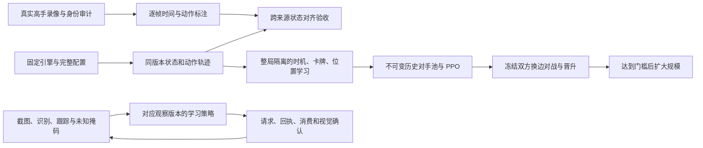

# 配对战场、时序学习、联赛与截图闭环交付

本轮从 `9f6efce` 继续开发。`arena_lab/` 使用固定版本 RoyaleSim；原生截图路径使用现有固定版本 Android／Null’s Royale。两者的成功指标不能互相代替。原平台、模型和失败证据均保留。

## 四个问题怎样形成闭环



图中的接口已实现；跨来源高手真值对齐和真实设备验收必须依据下面的实测状态判断，不能因接口存在而认定完成。

## 1. 数据：先证明每一个字段来自哪里

上轮只有高手出牌事件，在假设配置下重放会产生看似合理、实际可能错误的战场。本轮把来源分开保存：

| 数据 | 本轮实际取得 | 能证明的范围 |
|---|---|---|
| 同版本配对实体轨迹 | 80 局，88,828 个双方观察，11,699 次确认出牌 | 每个观察前后状态、配置、初手、动作请求和消费时刻，均可从全新引擎逐步重放核对 |
| 原生固定 8 卡迁移数据 | 50 局，48,952 个双方观察，4,088 次确认出牌 | 同样通过状态重放；来源仍是模拟器规则教师 |
| 人类高手录屏 | 实际下载 91 局；其中 70 局有可读的录制时排名 | 70 局逐局核对完整开场到决胜结算，68 局包含最终结果横幅，另 2 局止于加时决胜皇冠 |

70 局高手子集中 67 局双方均有可读排名，137 个可读选手位置中有 51 个前 100、86 个第 101–200。排名指录制时画面，不能代表当前排名。保留 50／10／10 整局划分；原始 91 局未因筛选删除。

原视频为约 4 倍回放。通过实际 MP4 PTS 与画面倒计时核对，关系是 **游戏时间差约等于视频时间差乘 4**。来源 README 的除法说明以及 sidecar 的名义 60 fps／墙钟 duration 均不能直接当真值。审计保留逐帧来源哈希。

目前人类录像仍缺精确客户端构建、完整形态／等级与初始状态、可确认的动作消费日志。因此 **70 局高手视频和 130 局同版本规则教师数据，不能合称 200 局同版本高手配对数据**。强高手模仿门槛保持未通过。解决这项缺口的具体路径是：在同一已知版本上采集人类整局，或先给录像补充画面动作、卡组形态与时钟标注，再用可证伪的中间状态对齐逐项验证；不能只比最终胜负。

数据下载、来源筛选、恢复和核对命令见 [配对数据说明](../arena_lab/PAIRED_DATA_ZH.md)。原始视频、轨迹、日志保存在 `outputs/arena-next-20261113/`；Git 只收录固定清单、小型审计、代码和审查过的模型。

## 2. 学习：时间、卡牌和位置各自承担明确任务

每个监督样本记录观察 tick、请求 tick、确认 tick、真实经过 tick 和下一决策时长。禁止把未来窗口里的一次动作贴在更早的观察上。循环网络先预测该时间段内是否行动，再条件选卡、再条件选位置；在线解码和离线评分使用同一分布与冻结阈值。

模型保留实体编码、空间位置和 GRU 历史。时间概率用生存形式 `P(行动)=1-exp(-rate×dt)`，循环输入另含真实经过时间。训练中保留自然 WAIT 分布，按整局保留上下文，不靠复制出牌帧提高表面召回。

80 局划分为 60 train／10 validation／10 test。train 内再留 6 局用于模型选择；validation 分为 5 局校准、5 局独立检查；最终 10 局只在模型和阈值冻结后评分。旧的 27／37 局 test 不参与本轮选择。

候选在新测试集的 1,425 次真实动作上：

| 指标 | 时间策略 | 同预算联合分类 | 时间策略移除战场实体 |
|---|---:|---:|---:|
| 出牌时机 precision | 69.98% | 76.87% | 25.21% |
| 出牌时机 recall | 86.39% | 86.04% | 76.42% |
| 完整动作精确率 | 40.21% | 43.93% | 11.93% |
| 给定真实卡牌的落点平均误差 | 1.00 格 | 0.96 格 | 6.21 格 |

这证明它使用战场并能模仿当前教师，不证明超过高手。**新时序结构未胜过联合分类基线**：完整动作差为 −3.72 个百分点，按整局 bootstrap 的 95% 区间为 [−5.98, −1.13] 个百分点。数据、时间标签和评估接口的修复值得保留，网络复杂化本身不能当作收益；也不能将与上轮混有数据、预算、版本差异的结果归因成某一个因素。具体对照见 [时序训练说明](../arena_lab/TIMING_ZH.md)。

训练支持逐轮事务检查点，保存优化器、随机数与分组身份。容器本轮发生一次重建，训练从第 7 轮保存点恢复；其原因未证实，不能把恢复成功写成系统重建根因已修复。

## 3. 自博弈：提高棋力必须由外部对战证明

历史池按权重 SHA256 固定成员，保留规则、随机、模仿基础模型和每轮 PPO 快照。训练对手以 25% 均匀覆盖加 75% 平滑失败率平方抽样；评估结果不回流训练抽样统计。

PPO 实际更新 actor 和公开观察 critic，使用终局奖励与明确声明的塔血势能塑形。折扣按游戏秒数定义；自然终局与预算截断采用不同 bootstrap；每个优化轮重新按当前参数重放整局循环状态。中断恢复连同对手池、优化器和 RNG 一起校验。

晋升提前冻结为每个模型 150 场：三类对手，各 25 个种子、双方换边。每类对手要求得分至少 55%、种子簇配对平均提升至少 5 个百分点、精确符号检验通过多重比较校正，且所有对局自然结束，动作消费完整、拒绝率不高于 1%。未通过就保留基础模型，不扩大训练规模来掩盖结果。

实现、运行命令与恢复实验证据见 [历史对手、自博弈与晋升](../arena_lab/LEAGUE_ZH.md)。

本轮预声明的 3 轮 × 8 局训练已完成：24/24 自然终局、11,761 个环境控制步、1,510 次消费、0 拒绝，88.43 秒，6 次实际 PPO 优化器更新。训练内 20 胜不能替代独立对战结果；没有因联合分类测试表现更好而事后改动已声明的 PPO 初始化或晋升案例。

## 4. 截图闭环：未知保持未知，延迟和回执纳入状态

截图路径包含固定模型哈希的单位检测、手牌模板识别、保守圣水下界、跟踪 ID 生命周期、场景就绪门槛和动作账本。请求提交、传输 ack、原生消费和画面确认分别记录；缺回执保持 unknown，不自动重复出牌。

旧数值模型需要精确 HP／时钟等输入，不能直接把截图缺测填 0 后调用。本轮新增 `arena-masked-pixel-v3`：每个字段带 known mask，仅学习和使用目前截图能取得的部分。未校准的阵营也保持未知。它从独立 50 局数据投影训练，是向截图迁移的候选，尚未获得真实检测噪声分布上的训练保证。

慢速 Android 中，墙钟秒数不等于游戏秒数。截图墙钟用于延迟报告；只有控制器自身已确认的推进回执可提供逻辑经过 tick。逻辑时间未知时清空循环记忆并记录退化路径。不能用后台完整状态填充 actor 的缺测。

原生实际运行记录、恢复步骤和具体未通过项见 [截图与设备闭环](../arena_lab/VISION_ZH.md)；模型接口见 [缺测观察与截图策略](../arena_lab/PIXEL_MODEL_ZH.md)。软件 Android、物理设备和官方在线客户端分别验收。

## 性能口径与复现

固定依赖、引擎与模型哈希随配置保存。当前环境为 4 vCPU、16 GiB、无 GPU。80 局全新配对采集含压缩和独立重放耗时 434.86 秒，约 102.13 个联合控制步／秒；这个速度包含审计，且受到当时并行负载影响。时间策略 12 轮纯训练累计 974.53 秒，约 741.36 个有效标签／秒；训练加 monitor／校准／测试为 1,087.87 秒，不含容器重建的停机间隔。

50 局迁移数据恢复会话中有 37 局复用、13 局新采，不能用全部 50 局除以恢复会话时间声称新采集吞吐。更正记录保留原报告及解释。

```bash
.venv-cloud/bin/python -m arena_lab bootstrap install
.venv-cloud/bin/python -m arena_lab collect-paired \
  --output outputs/my-paired --train 60 --validation 10 --test 10 \
  --seed-start 2026111300
.venv-cloud/bin/python -m arena_lab train-timing \
  --index outputs/my-paired/index.json --output outputs/my-timing \
  --epochs 12 --threads 2
.venv-cloud/bin/python -m arena_lab selfplay \
  --checkpoint outputs/my-timing/best.pt \
  --plan configs/arena-lab/selfplay-next-v1.json --output outputs/my-selfplay
.venv-cloud/bin/python -m unittest discover -s tests_cloud -p 'test_arena*.py' -v
```

复现已发表实验可以使用原种子；新研究必须另留未读过的验收集，不能反复在同一个 test 上选择模型。

## 与可实战的高手 AI 还有哪些差距，如何逐项消除

### 第一优先：把高手像素变成可信的序列监督

70 局录像解决了“有没有可核对的人类高手整局”问题，尚未解决“每个动作发生时的真实战场是什么”。应先建立独立标注片段和字段覆盖表，逐项标出开局配置、手牌变化、出牌类型与位置、单位出现／消失、阵营、塔血和时钟。无法看清的标签保留区间或 unknown。

约 4 倍速、约 60 fps 的录像在游戏时间上每帧已约 67 ms，不能强行标成精确 50 ms tick。动作时刻应从手牌变化、圣水变化、部署动画和实体首次出现形成区间，再用多个可见锚点校准 PTS；回放加速切换、开场演出和结算动画分别处理。真实录像中的状态用于监督和拒绝错误重建，不能让模拟器自己生成答案再验自己。

需要另行采集同一已知客户端构建和完整配置的人类录屏，才有机会通过强“同版本高手配对”门槛。当前 130 局自采规则轨迹只能证明数据管线和学习过程正常。Xbow 全集仅 5 次、技能标签为 0 等覆盖缺口仍应成为训练资格表中的失败项，而非依靠复制样本补齐。

### 第二优先：先测感知和动作可靠性，再让策略承担误差

目前真实画面开发诊断只有少量可比单位，不能据此推出检测精度。应将完整对局按来源隔离，标注来袭、拥挤、遮挡、死亡、形态变化和技能片段，分别测类别 precision／recall、位置误差、跟踪身份错误及手牌识别。修好检测器后，把真实误检、漏检和置信度分布加入训练，保留未知类型单位的位置，避免模型把漏识别当空战场。

动作确认必须建立从请求到“手牌轮转／圣水变化／预期单位或法术出现”的闭环。离线 RPC 的 consumed 只能验收离线路径；物理设备的 tap 返回成功还需画面确认。超时未知动作不能盲目重发，需先重新观察并排除重复部署。

当前数值模型以 0.5 秒固定节拍训练，部署严格使用同一窗口。下一阶段若目标为更及时的 200 ms 控制预算，须重新训练并验收该节拍，逐项测截图、识别、推理、发送和动作显现的端到端分位延迟。慢速 TCG 的秒级截图无法用降低报告口径解决；暂停推进能用于诊断，不能代替实时设备验收。

### 第三优先：用多样强对手提高策略，而不是无限模仿弱教师

本轮自博弈只验证了训练和晋升基础设施。下一阶段应先在开发对局中分析失败类型，例如漏防、亏圣水、过早投入和落点误差，再加入可追溯的强策略／搜索教师和不同卡组历史快照。奖励塑形同时记录原始终局分数，防止模型只刷塔血势能。

只有在新的封存对局中通过晋升，才扩大采集和训练预算；对手池保留弱、中、强及不同打法，避免只会针对单一规则对手。每代新验收要预留新的种子和对手版本，不能对同一 150 场反复开发直到通过。联合分类和显式时序网络继续作为对照，选型依据开发集与独立实战，而不是结构名称。

### 第四优先：逐机制校验模拟器到真实客户端的迁移

固定版本和确定性重放解决的是可复现性，未证明官方交互等价。需在同一配置的真实画面上逐项验证移动、索敌、攻击节奏、碰撞、部署延迟、建筑、法术、进化和英雄能力，再决定哪些模拟器数据可以进入正式训练。不同版本的数据分开建表，不能仅靠卡牌名字相同就混合。

这四项按依赖顺序推进：先建立可证明的真实监督与感知，再校验动作闭环和迁移，最后扩大有晋升证据的训练。完整方案保留这些门槛；本轮没有用缩小指标定义来宣布已经达到国际服高手水平。
