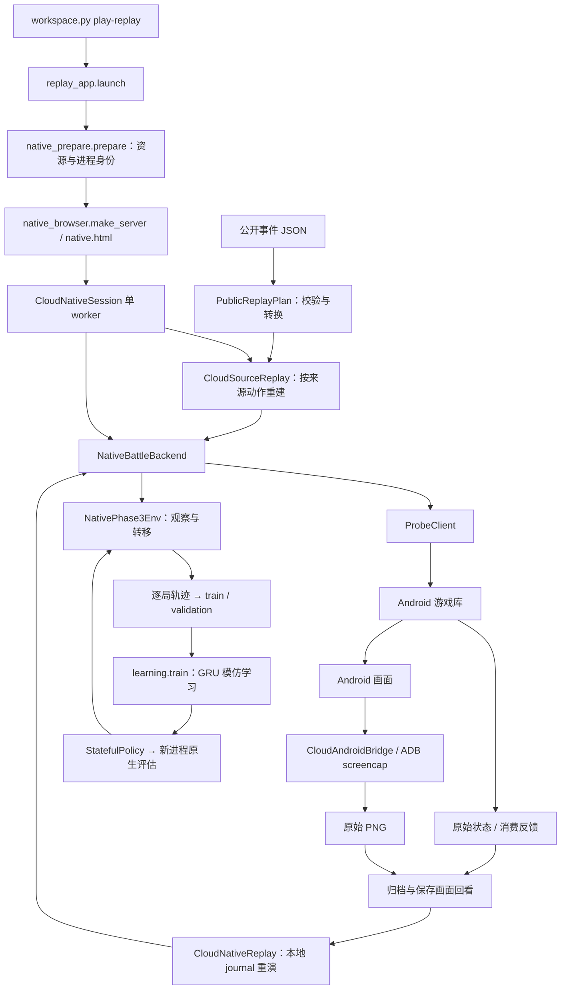

# 开发交接与读码入口（2026-10-24）

当前共同基线是 `dev/main-start-20261020`。本次先保存已有实现和验证结果，后续以理解代码、逐步复现和小范围修改为主。下面区分实现、实际运行证据与未验收部分；没有安排新的训练或整局实验。

仓库：[Guanyu1006/Game-AI-for-Clash-Royale](https://github.com/Guanyu1006/Game-AI-for-Clash-Royale/tree/dev/main-start-20261020)。Git 中保存的[交接证据摘要](audits/development_handoff_20261024.json)包含原报告路径、SHA256 和有限结论。文档中指向 `outputs/` 的完整日志／图片保留在原 Codespace，全新克隆通常没有这些文件。

## 当前进度

| 内容 | 有哪些证据 | 仍需理解或验证 |
|---|---|---|
| 离线研究工作台 | 环境检查、保存观测推理、NumPy／GRU 训练与重新加载已有检查 | 模型训练成功不能推出棋力提升 |
| 原生数值训练闭环 | 10 月 20 日：4 场采集、2 轮 GRU 训练、新进程 2 场评估；6 场自然终局、2424 条转移、202 次控制方消费 | 有限八卡实验；不是原生 PPO／大规模自博弈验收 |
| 公开 JSON → 原生画面 | 10 月 24 日：92 条事件样本的前 7 条执行并确认消费，初始 tick 90、暂停 tick 670 | 其余 85 条、自然终局和前后向原生重演尚未完成验收 |
| 浏览器操作与保存 | 真实页面跑通导入、打开、播放、暂停、保存；7 帧只读回看不改变原生时钟；APNG 导出通过 | 来源自动执行不能替代浏览器人工下牌验收；Windows scrcpy 未在用户本机验收 |
| 完整回放保真 | 已实现本地 journal 重演和检查点比较；有接口检查 | 公开 JSON 缺少原局 RNG／初手等信息，重建含明确假设；没有官方原局完全等价结论 |
| 画面与观察 | 已看到真实单位和塔血变化；保存 Android 原始 PNG | 7 帧是稀疏采样；精确像素与 tick 对齐、整局流畅画面、普通单位公平可见性仍未认证 |

本次交接重新运行可移植检查：391 项，0 失败、0 错误、1 项浏览器检查默认跳过；随后单独运行该 Chromium 检查，通过 7 个页面流程断言。运行范围是接口与保存数据，没有新增原生对局验收。结果及日志哈希见交接证据摘要。另修正离线锁测试，让它使用独立临时锁文件，避免和正在运行的原生页面争用生产会话锁。

此前的宿主低内存 SIGTERM、Android ANR 和后续局部成功均保留。历史报告只说明对应日期与实验范围，不能将其中的“当时 VM 已停止”等描述当成当前服务状态。

## 先分清四套代码

| 目录 | 负责什么 |
|---|---|
| `royale_ai/` | 早期 12 卡 Python 近似模拟器；云端近似沙盒复用它 |
| `royale_lab/` | 保留的社区 C++ 近似引擎与历史 PPO 等实验；需要其编译扩展 |
| `royale_phase2/` | 固定版本 Null’s Royale 原生后端、HTTP 会话、公开对局转换、截图和回放 |
| `royale_phase3/` | 公平观测投影、时序数据、GRU 模仿学习、原生采集与模型评估 |

原生战斗物理由 Android 内的固定版本游戏库执行，Python 负责观测、命令编排与记录。近似模拟器与原生引擎具有各自的状态、动作和验收，不能直接互换模型。

## 从入口顺着调用链读



图表示源码连接关系；各路径的实际验收范围以上表和证据摘要为准。

| 阅读顺序 | 源码与函数 | 先弄清的问题 |
|---|---|---|
| 1 | [workspace.py](../tools/cloud/workspace.py) `main`；[replay_app.py](../tools/cloud/replay_app.py) `launch` | 命令转交给谁？何时会准备／恢复 Android？为什么启动入口不自动建局或播放？ |
| 2 | [native_browser.py](../tools/cloud/native_browser.py) `make_server/import_source`；[native.html](../tools/cloud/native.html) | 文件字节如何上传？POST 返回任务编号后，页面如何等待真正完成？ |
| 3 | [cloud_native.py](../royale_phase2/cloud_native.py) `CloudNativeSession.submit/_worker` | 为什么只有一个控制 worker？GET 状态为什么不推进游戏？ |
| 4 | [public_replay.py](../royale_phase2/public_replay.py) `PublicReplayPlan`；[cloud_source.py](../royale_phase2/cloud_source.py) `CloudSourceReplay.start/seek` | 来源事件如何变成原生时间和坐标？哪些初始条件是假设？ |
| 5 | [backend.py](../royale_phase2/backend.py) `NativeBattleBackend`；[probe.py](../royale_phase2/probe.py) `ProbeClient.request` | 请求、登记、注入、实际卡牌消费有何区别？失败为什么不能自动重发？ |
| 6 | [cloud_frames.py](../royale_phase2/cloud_frames.py) `CloudAndroidBridge.capture/validate_frame_index/export_apng` | PNG 怎么保存与关联状态？离线看图片和重新运行引擎有什么区别？ |
| 7 | [cloud_replay.py](../royale_phase2/cloud_replay.py) `NativeReplaySource/CloudNativeReplay.seek` | 本地实际执行 journal 如何重演、回退并比较检查点？ |
| 8 | [native_env.py](../royale_phase3/native_env.py) `NativePhase3Env.reset/step`；[native_loop.py](../royale_phase3/native_loop.py) | 动作前观测、消费反馈、下一观测、终局和逐局轨迹如何关联？ |
| 9 | [learning.py](../royale_phase3/learning.py) `SmallPolicy/train/StatefulPolicy` | GRU 怎样使用历史，怎样模仿 teacher，怎样保存并加载模型？ |

原理与完整操作解释继续读[原生闭环教程](NATIVE_LOOP_ZH.md)，页面按钮和资源条件读[原生视觉指南](NATIVE_VISUAL_ZH.md)。建议先用一个已保存样本从入口跟到输出，能解释每一步后再改代码。

## 两人怎样继续开发

另一位开发者先保存自己未提交的工作，再获取这次共同基线；以下操作适用于其自己的干净工作区：

```bash
git fetch origin
git switch --track origin/dev/main-start-20261020
git switch -c dev/yourname-reading-notes
```

如果本地已有该分支，使用 `git switch dev/main-start-20261020`，再 `git pull --ff-only`。有分叉或未提交修改时先核对，不用强制重置。双方从共同基线各开分支，小提交并通过 pull request 互相检查，合并前说明修改目的、复现命令与验收范围。一个原生实例只交给一个控制者；同一时刻运行浏览器、原生训练器或回放控制器中的一个。

先做不启动 Android 的检查：

```bash
.venv-cloud/bin/python tools/cloud/workspace.py doctor
.venv-cloud/bin/python tools/cloud/workspace.py test
.venv-cloud/bin/python tools/cloud/workspace.py play-replay --help
```

解释器不存在时，按 [Codespaces 配置指南](GITHUB_CODESPACES_ZH.md)执行仓库 bootstrap。需要实际打开原生页面时再运行 `play-replay`；它会准备／复用 Android，不能把它当成无副作用的查看源码命令。

Git 同步源码、测试、文档和既有审查过的 `shared_assets/`。虚拟环境、`.cache/`、VM 安装磁盘、APK／游戏动态库与更新资源、完整 `outputs/`、后续模型及媒体留在原机器。本次没有重新打包它们；新 Codespace 不会因克隆代码而拥有原生运行资源。`connection.json` 绑定具体运行进程，不能跨机照搬。需要两人同时运行原生实验时，应先准备并核验各自的独立 Android 实例。

## 接下来按理解推进

先各自画出“一个按钮或命令 → 哪个函数 → 输入是什么 → 输出保存在哪”的小图，共同确认术语。随后用一次有限操作验证自己的理解，每次只处理一个问题并保留输出。整局 92 事件、自然终局、原生前后向重演、人工下牌与 Windows 镜像作为后续独立验收项，不在本次上传时自动执行。
