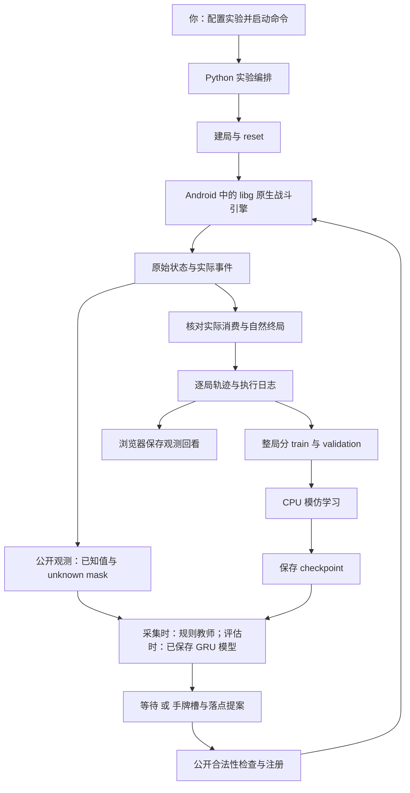
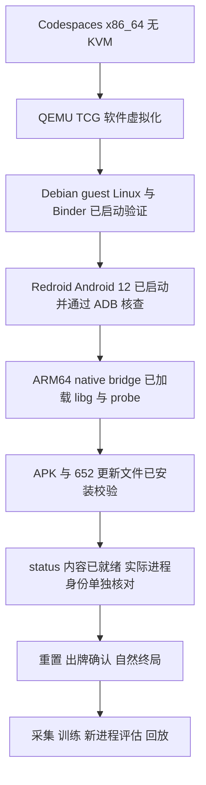
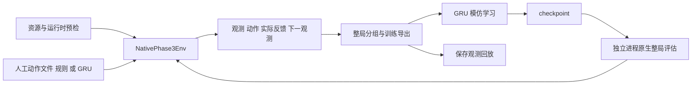

# 从零操作原生实验、训练与回放

> **协作阅读提示（2026-10-24）：** 当前代码总览、最新部分对局画面验收和两人分支操作见[开发交接](DEVELOPMENT_HANDOFF_20261024_ZH.md)。本文保留历史数值实验与原理说明，其中的服务状态属于当次检查。

> 新增原生画面、浏览器操作和日志重演入口见[原生视觉操作指南](NATIVE_VISUAL_ZH.md)。下面的 8771 页面仍是 fair 数值观测／近似沙盒；新增 8772 功能与它分别验收。

本指南以当前分支 `dev/main-start-20261020` 的代码和保存工件为准。2026-10-24 复查时，虚拟机和 8771 页面服务均未运行；2026-10-20 的六局验收工件仍在。**历史运行成功、当前服务运行、模型棋力是三个不同问题。** 本次讲解没有重新启动 VM 或训练。

先按目的阅读：[查看已有对局](#路线一查看已有对局不启动-android) → [只训练已有数据](#路线二用已有原生数据训练不启动-android) → [生成新的原生闭环实验](#路线三启动原生引擎完成一次新实验) → [从基础理解训练](#训练到底怎样发生从基础解释)。资源重建与历史证据放在后半部分。

## 先辨认系统里的四个角色

| 角色 | 负责什么 | 当前实际情况 |
|---|---|---|
| 游戏引擎 | 给定对局状态和动作，计算移动、伤害、圣水、终局等下一状态 | 固定版本 Null’s Royale 客户端的 ARM64 `libg`，通过离线探针控制 |
| Android 运行环境 | 让这份 Android 库能在当前机器上执行 | Codespaces → QEMU TCG 软件虚拟机 → Android 12／Binder → ARM64 native bridge |
| AI 策略／训练器 | 策略决定怎么下牌；训练器根据示范调整网络参数 | 本次是小型 GRU 的监督模仿学习；原生引擎本身不被训练 |
| 回放／可视化 | 展示已经保存的数据或画面 | 已验收的是公开数值观测回看；右侧人工沙盒另用 Python 近似引擎 |

**这里接入的不是 Supercell 官方发布的模拟器或训练 SDK。** [FirstLight 固定版本说明](https://github.com/Jaasssoooonnnnn/FirstLight_CR/blob/3ade158c52bf33de3ffcea600ce380946b7de0d8/docs/getting_started.md)指定的是 Null’s Royale APK 15.535.13、更新 15.535.86，以及离线补丁／探针。我们的运行资源也经过单独指纹绑定；原生库实际执行，不代表已证明官方所有版本、卡牌和交互等价。



图中的循环分两种速度：**对局内循环**每约 0.5 秒游戏时间观察、决策、推进一次；**实验循环**先采集几场，再离线训练，再让新模型进入新的对局。不是每出一张牌就更新一次网络。

当前开发分支为 `dev/main-start-20261020`，解释器为 `.venv-cloud/bin/python`。本次 Codespaces 原生小规模闭环已实机通过：4 场采集、2 轮 GRU 训练、新进程加载后 2 场评估，6/6 自然终局，2424 条转移、24194 个推进 tick、202 次控制方实际消费。 [闭环原始报告](../outputs/native_loop_20261020/native-run-002/report.json) 的 `native_closed_loop_verified=true`，[独立验收](../outputs/native_loop_20261020/native-run-002-acceptance/report.json)核对六局状态、短步终局、连续轨迹、generation 1–6 与模型引用。此前中断局单独保留，不计入这六局。当前 VM 已按进程身份保护正常停止，保存模型／数据／回放均保留；再次运行需启动 VM 并刷新身份。实现、原生验收与棋力分别报告。

本次已经尝试获取实际资源，并非只检查缺失。原生库、固定探针、163 个基础逻辑资源、9 个固定来源目录均已逐项匹配原哈希并恢复；项目内 adb 已安装并实际运行，初始设备列表为空。整包 APK 已下载，但其哈希与锁定原包不同，保留在 `.partial` 中供组件审计，没有替换历史清单或将其当作原锁定整包。更新资源的取得及首次网络失败详见下述资源证据。

固定更新资源现已全部恢复：651 个 paired content 文件和 1 个 fingerprint，共 124,875,056 字节，652/652 逐项强哈希与大小复核通过。首次 CDN 超时现场保留，第二次有限恢复完成；没有修改原资源清单。

Linux 离线候选 APK 已实际构建并完成签名、最终 DEX 补丁、ZIP CRC 和原生组件检查；新包 794,792,236 字节，SHA256 为 `993a0d798688885143468faf5f1aed6d35a59c6d17b835b22597ee6acc0d6ae5`。它使用独立的运行版本清单，828 项运行资产全部校验通过，原清单保持不变；已在项目内 Android 安装并逐项核对；[当前恢复进程身份](../outputs/native_loop_20261020/identity-check-005/report.json)已通过实际 ADB 采集与逐项核对；原生建局、消费、终局与重置已另行实测，静态构建不是这些结论的依据。

## 路线一：查看已有对局，不启动 Android

在 VS Code 菜单 **Terminal → New Terminal** 打开 Bash 终端，进入仓库并检查环境：

```bash
cd /workspaces/Game-AI-for-Clash-Royale
git branch --show-current
.venv-cloud/bin/python tools/cloud/workspace.py doctor
```

分支应为 `dev/main-start-20261020`。doctor 的 Python 应来自 `.venv-cloud`；宿主 native-check 报没有 Binder／KVM，与历史 guest Android 验收是不同层次的检查。接着启动保存观测页面：

```bash
.venv-cloud/bin/python tools/cloud/workspace.py serve --host 127.0.0.1 --port 8771 \
  --replay-metadata outputs/native_loop_20261020/native-run-002/recollected_dataset/metadata.json
```

操作顺序：

1. 保持这个终端运行；在 VS Code 下方 **Ports／端口** 找到 8771，打开转发链接，访问 `/research`。端口保持 Private。
2. 左侧选择 episode／owner。owner 是本局记录的控制方；没有采集的另一方视角不能凭空切出。
3. 用前后单步和进度条查看手牌、圣水、塔、公开出牌历史、当前监督标签；后退时不会混入未来历史。
4. 若要人工练习下牌，使用右侧近似沙盒；这次操作不会控制左侧历史对局或 Android 原生引擎。
5. 在服务终端按 `Ctrl+C` 停止。更换 metadata 需停止旧服务再启动；目前页面不能直接切换数据源文件。

| 想看的内容 | `--replay-metadata` 路径 |
|---|---|
| 4 场规则教师采集，1465 行 | `outputs/native_loop_20261020/native-run-002/dataset/metadata.json` |
| 新模型实际评估的 2 场，959 行 | `outputs/native_loop_20261020/native-run-002/recollected_dataset/metadata.json` |

**目前不能“完美复看原版游戏的每一帧”。** 页面读取动作前的公开数值向量，普通单位因可见性未认证仍为 unknown；没有保存的兵种画面、特效与像素无法从这些数字完整重建。控制间隔通常 10 tick，原始状态也只在推进节点保存，并非完整 20 Hz 视频。最后一个 actor tick 6140 后，原生引擎在 6148 自然终局；最后一张观测不是终局截图，最终胜负需看该局 `native_result.json`／`journal.json`／`states.jsonl`。

“保存观测回看”“用动作日志重新驱动引擎”“原生画面视频”是不同功能。完整画面复看还需原生 renderer 实测、画面捕获、tick 对齐与完整落盘；交互式回退或分叉还需确定性重演验收。`--rendered` 只是请求渲染的选项，不能替代这些验收。

## 路线二：用已有原生数据训练，不启动 Android

这条路线只让 CPU 读保存文件和更新网络参数，不会生成新对局。输出目录必须换新名字；若下面的名字已有结果，改成 `002` 等新编号，保留旧工件。

```bash
.venv-cloud/bin/python tools/native_loop.py train \
  --metadata outputs/native_loop_20261020/native-run-002/dataset/train_validation/metadata.json \
  --output outputs/cloud/native-training-20261024-001 \
  --epochs 2 --hidden 32 --play-weight 8
```

完成后查看新目录 `report.json`：`completed=true`、`completed_epochs=2`、`fresh_native_environment_steps=0`；应存在 `epoch-0002.json` 及它引用的 NPZ 权重。末轮 checkpoint 包含 best_model，推理加载的是按 validation 选出的模型，不保证就是末轮参数。

再用独立进程检查保存模型在 validation 上的预测：

```bash
.venv-cloud/bin/python tools/cloud/workspace.py evaluate-gru \
  --checkpoint outputs/cloud/native-training-20261024-001/epoch-0002.json \
  --metadata outputs/native_loop_20261020/native-run-002/dataset/train_validation/metadata.json \
  --split validation \
  --output outputs/cloud/native-training-20261024-001-validation.json
```

这里验证的是“保存模型能否重新加载、能否预测留出的示范”，还没有让它进入新对局。不要把 `workspace.py train-gru` 的默认历史 pilot 数据误认成当前四局新数据；也不要直接拿两局 `recollected_dataset` 再训：它目前没有独立 validation，训练器会拒绝。

## 路线三：启动原生引擎，完成一次新实验

以下命令针对**当前仍保留资源、已安装 VM 磁盘的 Codespace**。Git 克隆不会包含 APK、游戏更新、VM 磁盘及这些历史 outputs；全新 Codespace 先按[软件 Android 指南](SOFTWARE_ANDROID_TCG_ZH.md)重建，不能复制不存在的恢复路径。本节是供你选择执行的操作说明，本次文档核查未执行这些启动命令。

### 第 1 步：为本次实验建独立目录

在同一个 Bash 终端连续执行。后面一直用 `LAB_RUN` 指向本次实验，换终端时需重新设置环境变量。

```bash
export LAB_RUN="outputs/cloud/native-experiment-$(date -u +%Y%m%dT%H%M%SZ)"
mkdir "$LAB_RUN"
```

这里只创建父目录；不要提前创建 `start`、`loop`、`identity-check` 等子目录，工具会自行建立并拒绝覆盖历史。

### 第 2 步：恢复已安装的软件 Android

```bash
nice -n 10 .venv-cloud/bin/python tools/cloud/software_android_vm.py start \
  --cache .cache/native-tools/android-recovery-001 \
  --output outputs/cloud/avm --vcpus 1 --timeout-multiplier 10 \
  --resume-attempt outputs/cloud/avm/20261020T134453.037427Z-vm
```

上述 attempt 是 2026-10-24 核实的已停止记录。后续再次恢复，应使用本次 start 输出的新 attempt；停止后可只读查询最后一次记录的路径：

```bash
.venv-cloud/bin/python -c 'import json; print(json.load(open(".cache/native-tools/android-recovery-001/active-vm.json"))["attempt"])'
```

这条记录不证明进程还活着。下面的 `status` 用来检查**正在运行**的实例；VM 已停止时它会拒绝查询旧 PID：

```bash
.venv-cloud/bin/python tools/cloud/software_android_vm.py status \
  --cache .cache/native-tools/android-recovery-001
```

保留 `nice 10`、1 vCPU 和磁盘复用，避免软件翻译占满小机器或再次复制大盘。start 返回仅表示 QEMU 已启动，不表示 Android、游戏内容或对局就绪。不要同时启动第二台 VM 或另一个原生控制者。

### 第 3 步：显式启动 ADB，并确认 Android 完成启动

```bash
.cache/native-tools/bin/adb -P 5038 start-server
.cache/native-tools/bin/adb -P 5038 connect 127.0.0.1:15555
.cache/native-tools/bin/adb -P 5038 -s 127.0.0.1:15555 get-state
.cache/native-tools/bin/adb -P 5038 -s 127.0.0.1:15555 shell getprop sys.boot_completed
```

后两条分别应返回 `device` 和 `1`。刚启动时连接拒绝／启动值为空，可等候后重试这些检查；不要越过它们继续。5038 是仓库使用的 ADB server，15555 是 guest adbd 转发端口。后续工具会检查既有 daemon，不会替你启动它。

### 第 4 步：启动游戏与 probe 转发

```bash
.venv-cloud/bin/python tools/cloud/native_start.py start \
  --manifest outputs/native_loop_20261020/local-runtime-version-001.json \
  --serial 127.0.0.1:15555 --adb .cache/native-tools/bin/adb \
  --adb-port 5038 --root-shell su0 --confirm-immersive --forward \
  --output "$LAB_RUN/start"
```

`su0` 使用 guest 的 `su 0`，不需要 `adb root`。`--confirm-immersive` 只确认 Android 12 系统全屏引导。启动回执需包含应用运行、PID 存在及转发成功；RPC 经本地 26789 转发到游戏内 probe。

### 第 5 步：确认游戏内容真正就绪

```bash
.venv-cloud/bin/python tools/cloud/native_start.py check \
  --manifest outputs/native_loop_20261020/local-runtime-version-001.json \
  --serial 127.0.0.1:15555 --adb .cache/native-tools/bin/adb \
  --adb-port 5038 --root-shell su0 --probe-status \
  --output "$LAB_RUN/readiness-001"
```

打开 `$LAB_RUN/readiness-001/report.json`，必须确认 `probe_status.coldReady=true`、`probe_status.contentReady=true`。**退出码 0 只表示应用运行且 status 可达，不保证内容就绪。** 尚未建局时 `ready=false`、`matchReady=false`、`configured=false`、`nativeTick=-1` 可以是正常状态，不要拿这些值当内容加载判据。

软件环境历史冷启动约 7 分半钟，速度会变。若尚未 contentReady，等候后换 `readiness-002` 再检查；此命令会验证 828 项资产，不要每秒重复。尚无自动、有预算的 readiness 等待入口。报错时先读回执和 stderr，不要反复重发状态不明的出牌或重置命令。

### 第 6 步：采集本次进程身份并创建连接

```bash
.venv-cloud/bin/python tools/cloud/native_identity.py \
  --manifest outputs/native_loop_20261020/local-runtime-version-001.json \
  --serial 127.0.0.1:15555 --adb .cache/native-tools/bin/adb \
  --adb-port 5038 --root-shell su0 \
  --identity-output "$LAB_RUN/identity.json" \
  --output "$LAB_RUN/identity-check"
```

先查看 `$LAB_RUN/identity-check/report.json`，确认 `status=verified_runtime_identity`、`identity_written=true` 且文件核对通过，再创建连接；不要在只保存身份内容的 `identity.json` 中寻找这两个状态字段：

```bash
.venv-cloud/bin/python tools/cloud/native_connection.py init \
  --manifest outputs/native_loop_20261020/local-runtime-version-001.json \
  --identity "$LAB_RUN/identity.json" --timeout 60 \
  --output "$LAB_RUN/connection.json"

export ROYALE_NATIVE_CONNECTION="$LAB_RUN/connection.json"

.venv-cloud/bin/python tools/cloud/native_connection.py check \
  --connect --output "$LAB_RUN/connection-check.json"
```

身份成功判据是 `verified_runtime_identity`、`identity_written=true`，更新文件逐项核对通过；连接检查需 `ready=true`。身份核对历史约 173 秒，失败时不能跳过。保存回执只证明采集时的进程；应用／VM 重启、包或 update 改变后必须重新采集，不能沿用旧 PID 文件。连接检查仍未创建对局。

### 第 7 步：执行有限的“采集—训练—新局评估”

```bash
nice -n 10 .venv-cloud/bin/python tools/native_loop.py run \
  --output "$LAB_RUN/loop" --games 4 --evaluation-games 2 \
  --epochs 2 --hidden 32 --play-weight 8 --seed 610000 \
  --max-tick 7200 --wall-seconds 900
```

执行顺序固定为：4 场规则教师采集 → 按整局划分 → 训练 2 epoch → 保存模型 → **新进程加载模型** → 2 场换边评估 → 导出模型轨迹。`run` 至少需要 4 场采集，不能减为 1 场却仍要求独立验证。

`7200 tick / 20 Hz = 360 秒`是游戏时间上限；`900 秒`是**每局**现实时间预算。2 epoch 是把训练集学习两遍，不是再打两局。历史整条实验为十几分钟量级，加冷启动／身份检查更久，不保证固定耗时。可另开终端查看 `loop/report.json`、各阶段 stdout/stderr 及 `collection/game-000/result.json` 等逐局进度；阶段 report 的 `active_game_ref` 指向当前局，不要在同一实例启动第二个控制者。

最终验收看 `loop/report.json` 的 `status=completed`、`native_closed_loop_verified=true`，并核对所有请求局自然终局、新进程加载、模型实际 `card_consumed`。仅进程退出 0、模型文件存在、RPC 成功或时间上限到达，都不能单独证明完整闭环。

### 第 8 步：停止 VM，回看本次模型对局

```bash
.venv-cloud/bin/python tools/cloud/software_android_vm.py stop \
  --cache .cache/native-tools/android-recovery-001

.venv-cloud/bin/python tools/cloud/workspace.py serve \
  --host 127.0.0.1 --port 8771 \
  --replay-metadata "$LAB_RUN/loop/recollected_dataset/metadata.json"
```

stop 回执需 `process_exited=true`、`ports_released=true`；它不关闭独立 ADB daemon。看回放不需要 VM。若已运行路线一的页面，先在原服务终端 `Ctrl+C`。换终端时重新设置相同 `LAB_RUN`，或写完整路径。结束页面再按 `Ctrl+C`。

### 已有新模型，如何直接让它打新局

如果你已经按路线二训练好模型，就不必为了试模型再采集和训练一遍。完成路线三**第 1—6 步**后，用下面两条命令替代第 7 步，加载你自己的 checkpoint，并导出它的新对局：

```bash
.venv-cloud/bin/python tools/native_loop.py evaluate \
  --checkpoint outputs/cloud/native-training-20261024-001/epoch-0002.json \
  --output "$LAB_RUN/evaluate-existing" --games 2 --seed 620000 \
  --opponent cycle --max-tick 7200 --wall-seconds 900
```

先看 `$LAB_RUN/evaluate-existing/report.json`，确认 `status=completed`、`natural_terminal_games=2`，并分别检查消费、截断与失败；若评估失败，保留现场，不假设下一步已成功。

```bash
.venv-cloud/bin/python tools/native_loop.py export \
  --source "$LAB_RUN/evaluate-existing" \
  --output "$LAB_RUN/evaluate-existing-dataset"
```

然后按第 8 步停止 VM；启动回放时将 `--replay-metadata` 改为 `"$LAB_RUN/evaluate-existing-dataset/metadata.json"`。你的模型若用了不同输出目录，也要替换 checkpoint 路径。版本指纹或观测 profile 不匹配时应重新核实来源，不能跳过加载检查。

### 每次实验的文件放在哪里

```text
$LAB_RUN/
  start/、readiness-001/、identity-check/  启动与身份日志
  identity.json、connection.json         本次进程与连接
  loop/
    configuration.json、report.json      预算与最终验收
    01-collect.stdout.log                采集阶段日志
    collection/game-000/result.json      第一局进度与完成状态
    collection/game-000/transitions.jsonl 逐步输入、提案与反馈
    collection/game-000/native/          states、journal、native_result 等
    dataset/                            规则教师数据，含 train_validation/
    model-input/                        学习器实际收到的隔离数据
    model/                              配置、曲线、report、checkpoint 与 NPZ
    evaluation/game-*/                   保存模型进入新局的原始证据
    recollected_dataset/metadata.json    新模型的保存观测回放入口
```

逐局目录从 `game-000` 起编号，evaluation 同样包含逐局 result、transitions 与 native 子目录。失败批次保留现场和分母；当前没有按已完成阶段自动续跑整批的完整入口，不要删旧目录或重放结果未知的动作来假装继续。

## 训练到底怎样发生：从基础解释

### 1. 先把“游戏状态”与“AI 看到的东西”分开

游戏状态 `s_t` 是引擎内部世界，例如实体、HP、坐标、圣水、计时及隐藏变量。原生引擎可抽象为 `s_(t+1) = F(s_t, 双方动作, 时间推进)`。这里的 `F` 由 `libg` 执行；Python 环境负责发命令、收状态和记录，不另写一套战斗物理。

AI 输入是观察 `o_t = P(s_t, 已有公开历史)`。投影 `P` 只允许经过约束的玩家信息。原始采集能读到某字段，不意味着公平策略可以读它。当前 fair 模式**排除所有尚未认证可见的非塔实体**：不能声称模型已经看见每只兵的位置和血量；缺失槽的零值与 mask 表示 unknown，不表示场上真的没有兵。

当前 GRU C 将下面的输入拼成 **713 个数**，不是直接读取截图：

| 部分 | 维数 | 内容与限制 |
|---|---:|---|
| 当前公开 HUD | 96 | 时钟、己方圣水、四个手牌槽、双方皇冠与六塔状态，含已知性 mask |
| 普通实体预留 | 16×23=368 | 当前 fair 模式排除非塔实体，预留槽不代表已观测到普通单位 |
| 最近公开出牌事件 | 16×14=224 | 哪方、何时、哪张卡、费用及 mask；没有实际落点 |
| 公开历史推断 belief | 15 | 对手资源区间、公开频率和时间等；当前资源修正未知时区间保守为 `[0,10]`，未得到精确对手手牌或下一张 |
| 上次实际消费动作 | 5 | WAIT／四个手牌槽的 one-hot 编码 |
| 上次执行反馈 | 4 | 请求出牌、确认消费、边界拒绝、有回执但未消费 |
| 实际时间间隔 | 1 | 当前观察距上一观察的 `dt_ticks/20`；本次动作推进的间隔另记在 transition，终局可短步 |

前 3 项合计 688；`688+15+5+4+1=713`。具体编码见 [observation.py](../royale_phase3/observation.py) `encode_observation`、[belief.py](../royale_phase3/belief.py) `encode_belief` 与 [learning.py](../royale_phase3/learning.py) `actor_vector`。

### 2. AI 的一次动作只是一个提案

动作可以写成 `a_t = (类别, x, y)`：类别 0 为 WAIT，类别 1—4 对应**当前手牌槽** 0—3，槽内卡会轮转，不是固定四种卡。出牌才需要落点。

例如某时刻槽 0 是己方可负担的兵种，模型提出 `action_index=1, xy_native=[3500,11000]`。环境先检查公开手牌、费用和部署区域，再把卡牌与时刻注册给引擎；推进后核对实际事件与手牌等变化，只有 `card_consumed=true` 才认为这张牌真正打出。owner 0 的普通兵种保守提案在上半场，owner 1 在下半场；坐标不是截图像素。

动作检查分三层：

1. **类别 mask**：WAIT 总可选；有支持的手牌且己方圣水足够，才开放相应槽。
2. **落点约束**：普通兵／建筑保守限制己方半场，法术允许全场。这不是特殊机制、占位、所有卡牌的完整合法性 oracle。
3. **原生消费确认**：注册成功／RPC 成功不够，必须等实际消费证据。被拒绝或未确认动作保留原记录并排除相应监督，不能改写成教师有意 WAIT。

### 3. 先有人示范，才有这次模仿学习的“答案”

本次教师是 `PublicTeacher('random')`，不是人类高手：随机选手牌，买不起就等，有概率主动等待，落点采用简单候选线。对手使用 cycle／random。采集阶段不需要训练好的网络，教师先在原生引擎里打局，保存每一步：

```text
当前观察 o_t、教师提案、合法性与实际消费反馈、
实际 dt、下一观察 o_(t+1)、reward、terminated、truncated、版本与局身份
```

这是一条 transition；连续很多条组成 trajectory／episode。20 Hz 表示引擎每 tick 0.05 秒；策略通常每 10 tick=0.5 秒决定一次，0.5 秒游戏时间不保证只用 0.5 秒现实时间。实际原生 reset 后本批初始 tick 为 90；动作请求计划在下一 tick 执行，实际执行与消费以原生反馈为准；终局可能不足 10 tick。

`terminated` 表示引擎自然结算；当前 `max_tick` 上限导致 `truncated`。`wall-seconds` 现实时间预算超限则抛出 TimeoutError，并记录整局 `failed`，不是普通 tick 截断。胜负、tick 截断、现实预算失败和进程故障必须分开。新局要重置事件历史、belief、执行反馈和网络隐状态，防止上一局信息混入。

### 4. 为什么按整局划分数据

同一局相邻两帧很相似。把它们随机散进 train 和 validation，会让验证集泄漏训练局的上下文。当前先按整局分组，同局双方／配对局保持同组，排除重复，再给学习器物理隔离的 train／validation 文件，不传 test。

本批 4 场采集得到：train 为 3 局 1113 行，validation 为 1 局 352 行。train 用来求梯度；validation 用来检查未参加参数更新的整局并选权重；test 是预留的最终冻结评估用途，本批没有分配 test 局，因此没有 test 样本，也未进行 test 评估。validation 也不是独立官方真值或新局胜率。

### 5. 神经网络怎样把观察变成动作

本次实际网络见 [configuration.json](../outputs/native_loop_20261020/native-run-002/model/configuration.json)：

```text
713 维输入 → Linear(713,32) → tanh → GRU(32,32)
                                           ├─ 动作头：5 个分数
                                           └─ 位置头：2 个 0～1 连续数
```

Linear 是一组可学习的加权求和；tanh 增加非线性，使网络不只会线性相加。GRU 可以理解为带两个门的 **32 格记事本**：更新门决定保留多少旧记忆，重置门决定候选记忆参考多少旧状态。它每步读新观察，输出新的隐藏记忆 `h_t`，使同一张手牌在不同历史下可以得到不同决策。

动作头给出五个 logits；对不允许的槽加 mask，训练时可用 softmax 理解成概率。部署直接取允许项中的最大分数，与取最大概率等价，不进行搜索。位置头的两个 sigmoid 输出经公开部署区域映射到原生坐标：x 为 0—17999，y 为 0—31999，再按卡牌类别与 owner 限定区域。

**本次 variant C 的落点是二维连续回归，不是 576 类分类。** 数据格式中的 18×32=576 格用于通用标签／约束及 D/E 的格点头，不能据此说本次 C 输出 576 个落点。网络共 29,415 个参数，world／opponent／hazard 辅助头均未启用。

### 6. 损失函数为什么会使网络改变

教师给“应该选哪个槽／等候”和“应该放哪里”；网络先预测，再计算与这些答案的差距。当前实际损失为：

```text
L = 加权动作交叉熵 + 有效出牌上的归一化坐标均方误差
动作交叉熵：希望教师类别的预测概率更高，基本项是 -log p(教师类别)
位置均方误差：希望预测坐标接近示范坐标，单个落点为 ((x-x*)²+(y-y*)²)/2
```

等待标签很多，因此实际 train 的 WAIT 类权重 1，四个出牌类各 8；实现采用标准加权平均。位置损失只在符合监督条件、已证实消费的出牌行上计算。**当前位置监督使用教师请求的坐标；引擎实际部署点未知。** 它学的是已消费动作的提案落点，不能宣称取得了真实部署点真值。WAIT 没有出牌落点，不应硬填坐标来训练。

反向传播按链式法则算出每个参数对损失的梯度；Adam 根据梯度与过去的统计调整参数，学习率为 0.001，梯度范数裁剪为 1。直观地说，是小幅调整 29,415 个“旋钮”，使同类输入更接近示范操作。不是把整盘对局背成一串固定脚本，也没有修改 libg 的游戏规则。

训练窗口长 32 行，名义 16 秒；每窗最多额外取前 8 行、名义 4 秒做 burn-in，恢复短期上下文但不算梯度，再对学习窗反传。每 batch 8 窗，窗口不跨局；每 epoch 按自然时序覆盖训练行，每个有效标签仅参与一次损失，无效标签与 padding 不计损失，没有把出牌行重复抽样。训练梯度不会跨越整盘历史；部署时则按本局连续保留 hidden，新局／换 owner 清空。

epoch 是把训练集学习一遍，batch 是一次参数更新处理的一组窗口，checkpoint 是可重新加载的参数及恢复信息。每 epoch 在完整 validation 时序上计算指标，按最低动作 NLL 选 best_model；检查点采用 JSON+NPZ 保存，不用 pickle。

### 7. 这和强化学习、自博弈有什么区别

| 方法 | 更新参数的依据 | 本次原生实验是否做了 |
|---|---|---|
| 行为克隆 BC | “这个观察下，教师做了什么”，用分类／回归损失模仿 | 是，GRU C、2 epoch |
| 强化学习，如 PPO | 策略自己尝试，从回报估计 value／advantage，再优化策略目标 | 否；当前记录 reward／discount，但本次损失不使用它们 |
| 自博弈 | 当前／历史策略互相对战，并配合明确的学习和评估流程 | 本次不是；评估对手仍是简单规则策略 |
| 世界模型／想象训练 | 学下一状态动力学，并在经过验证的模型中规划或生成训练 | 本次未启用，不能把引擎或 GRU 记忆叫作已训练的世界模型 |

仓库保留的 `royale_lab` 近似引擎 PPO 是另一套历史实验，其结果不能证明这个原生闭环做过 PPO。本次 `run` 完成一轮“采集→训练→新局评估→重采导出”，**不会自动把评估数据再训练第二轮**。

### 8. 怎样判断训练有没有用

先分别问三个问题：

- **管道能运行吗？** 新权重保存、独立进程加载、原生真正消费动作、自然终局和重置均有证据；这部分本批已通过。
- **模仿得好吗？** 看事件 precision／recall、卡槽正确率、坐标误差，不能只看大量 WAIT 混出的准确率。
- **对战变强了吗？** 需冻结比较方法、更多独立对局和合适对手，并报告胜负、截断及失败。本批没有证明提升。

例如本批 validation 准确率约 83.8%，但 352 行中 325 行是 WAIT，始终 WAIT 就有约 92.3%；不能把 83.8% 当强 AI。模型预测 72 次出牌，时间窗内匹配 27 次，precision 0.375；时间匹配的槽位正确率约 0.519。两场原生评估的 90 次消费证明动作进入引擎，不证明 90 次都是好决策。原始数值见 [模型报告](../outputs/native_loop_20261020/native-run-002/model/report.json)。

## 当前环境与运行门槛

宿主为 x86_64、2 vCPU，没有 `/dev/kvm` 或宿主 Binder，用户没有外部原生主机。安装 adb 增加的是设备控制工具；下载 libg 增加的是 Android ARM64 游戏库，二者本身不会创建可运行的 Android 系统。

FirstLight 的 [Linux AVD 路线](https://github.com/Jaasssoooonnnnn/FirstLight_CR/blob/3ade158c52bf33de3ffcea600ce380946b7de0d8/docs/training.md#6-prepare-a-linux-avd) 要求 KVM、root adbd、可运行 ARM64 库的镜像、安装并完成匹配更新的游戏、离线 APK 及 probe。当前宿主不具备这条受支持的直接运行路径。

已在本仓库实际启动 QEMU TCG 软件虚拟机：Debian Linux／Binder 验证后，官方 Redroid 12 镜像也完成真实启动。ADB 实际读到 `sys.boot_completed=1`、存活的 system_server 和 SurfaceFlinger，`su 0` shell 为 UID0；[Android 启动回执](../outputs/native_loop_20261020/software_runtime/attempt-003/android-boot-report.json)保留前期挂载、权限、网络和 FUSE 排障证据。镜像的 ARM64 native bridge 已实际加载 libg 和 probe，原生 status 可达。恢复后的 [内容就绪回执](../outputs/native_loop_20261020/android-window-after-confirm-001/report.json) 实际返回 coldReady/contentReady=true，configured=false、steps=0；随后已完成实际身份与六局闭环验收；该只读状态是此前的准备快照。

这条软件路线的实际分层如下。它运行的游戏库仍是 Android ARM64 原生库；QEMU 和 native bridge 负责运行环境与指令翻译，不替代游戏战斗物理。Linux／Binder、Android 启动、游戏库加载与内容就绪已有实际证据，对局与训练闭环继续单独验收。新 Codespace 的准备、启停和来源锁见[软件 Android 操作指南](SOFTWARE_ANDROID_TCG_ZH.md)。



原生后端继续逐字节核对固定资源和 Android 进程身份回执。下载了部分组件、TCP 端口可达或复制历史身份 JSON，都不等于实际消费、自然终局和重置已经验证。

## 已接通的代码路径



该图描述现有调用连接，当前资源、实际进程身份及内容就绪门槛已通过，六局有限闭环已有实际运行证据。它沿用 FirstLight 共享环境、观测／动作契约和模型加载的思路；当前交付的是小规模模仿学习循环，不是已经验收的原生自博弈 PPO。

| 调用环节 | 真实源码与函数 | 输入 → 输出 |
|---|---|---|
| 资源版本 | [native_version.py](../tools/cloud/native_version.py) `create_runtime_version` | 成功构建回执、原固定资源 → 独立运行清单及 fingerprint；不改历史清单 |
| 实例身份 | [native_identity.py](../tools/cloud/native_identity.py) `collect_identity` | 显式设备、清单、实际进程 maps 与文件 → 身份回执或带日志的 unavailable |
| 原生预检 | [native_loop.py](../royale_phase3/native_loop.py) `runtime_preflight` | 连接设置、资产和身份 → readiness；`connect=True` 只查询 status |
| 建局与观测 | [native_env.py](../royale_phase3/native_env.py) `reset`、`_observe` | seed → 原生状态、公开投影、history／belief／mask；reset 清空历史与记忆 |
| 策略 | [learning.py](../royale_phase3/learning.py) `StatefulPolicy.load/predict` | 版本匹配 checkpoint、当前 actor 行与循环隐状态 → 动作索引和原生坐标提案 |
| 执行动作 | 同一 `NativePhase3Env.step` | 提案 → 边界校验、双方注册、原生推进、实际反馈、下一行、reward、terminated／truncated |
| 轨迹与导出 | 同一 `native_loop.py` `make_transition/export_trajectories` | 动作前后行及消费证据 → JSONL 转移 → 按整局分组的 metadata／rows；拒绝和 unknown 不伪装成功 |
| 训练 | `train_offline` → 同一 `learning.py` `train` | 独立 train／validation 视图 → GRU 权重、优化器、曲线和验证报告；不将 test 交给学习器 |
| 闭环评估 | `run_loop` → `_child` → `run_batch` | 新 checkpoint → 新进程加载、实际原生整局与再次导出；失败保留分母 |
| 保存观测回放 | [replay.py](../tools/cloud/replay.py) `ReplaySession.reset/seek/state` | 指定导出、episode／owner／index → 公开数值示意；不是原生截图或活动引擎回滚 |

| 入口 | 实际作用 |
|---|---|
| `tools/cloud/native_resources.py` | 固定资源获取、完整性检查、逐组件恢复、项目内 adb；不启动 Android |
| `tools/cloud/native_content.py` | 固定更新资源的零网络检查和显式预算下载 |
| `tools/cloud/build_native_apk.py` | 仓库内 Linux 工具链、离线候选 APK 构建和签名／静态检查 |
| `tools/cloud/native_payload.py` | 校验清单、9 个目录和 652 个资源后调用既有打包器生成更新 tar；不操作 Android |
| `tools/cloud/install_native_runtime.py` | 默认生成安装计划；显式 execute 才安装指定 Android 的 APK/update 并核对，保留旧 update |
| `tools/cloud/native_start.py` | 显式 start、forward、probe-status；可选确认 Android 12 全屏系统引导，不创建对局 |
| `tools/cloud/native_version.py` | 为通过检查的新构建建立独立运行资源清单；不改历史清单，不认证 Android 执行 |
| `royale_phase2/connection.py` | 显式 loopback 连接设置、严格资源与身份检查；可接用户建立的 SSH 转发 |
| `royale_phase3/native_env.py` | 现有真实原生 reset/observe/step，10 tick 控制间隔；没有另写战斗物理 |
| `royale_phase3/native_loop.py` | 串行采集、转移记录、导出、训练与独立进程评估编排 |
| `tools/native_loop.py` | `doctor / collect / export / train / evaluate / run` 命令 |
| `tools/cloud/workspace.py` | `native-loop`、`native-connection` 透传；支持选择新导出数据进行回放 |

初始化优先保留已有本地运行配置；缺少历史实验目录时使用 [经过哈希检查的静态模板](../configs/native/README.md)。模板只构造新局，不包含历史动作或物理替代实现。自选连接清单也传给公开 belief，避免连接与观测各自使用不同版本配置。

轨迹逐步记录动作前输入、下一输入、策略／checkpoint 身份、请求、注册、实际注入／消费反馈、奖励、dt、自然终止与时间截断。拒绝或未确认出牌不伪装成明确 WAIT 监督；请求坐标不冒充实际部署坐标。相同配置的换边对局归入同一 split，语义重复局排除；训练器接收物理隔离的 train/validation 文件。

## 在当前 Codespaces 中复查资源

在仓库根目录执行：

```bash
.venv-cloud/bin/python tools/cloud/native_resources.py inspect
.venv-cloud/bin/python tools/cloud/native_content.py inspect
.cache/native-tools/bin/adb version
.venv-cloud/bin/python tools/cloud/workspace.py native-connection check
```

未设置 ROYALE_NATIVE_CONNECTION 时，最后一条检查默认历史清单 `data/phase2/version_manifest.json`，可能返回 unavailable；它不连接 RPC，也不代表新独立版本失败。选择下述新连接后，本地文件和保存身份可返回 ready_assets；实时连接和实机验收另读对应报告。历史哈希未改写。

新 Codespace 可按需重复取得已经核实的小型组件：

```bash
.venv-cloud/bin/python tools/cloud/native_resources.py fetch probe
.venv-cloud/bin/python tools/cloud/native_resources.py fetch-catalogs
.venv-cloud/bin/python tools/cloud/native_resources.py install-adb
```

整包下载需要显式字节预算：

```bash
.venv-cloud/bin/python tools/cloud/native_resources.py fetch apk --max-bytes 850000000
.venv-cloud/bin/python tools/cloud/native_resources.py extract-apk
```

当前发布者 URL 返回的整包哈希不同，第一条会保留候选并报告失败。第二条只恢复逐个哈希完全匹配的锁定组件，不将候选整包变成批准 APK。已有不同文件与下载失败现场保留。

固定更新的重复获取入口为：

```bash
.venv-cloud/bin/python tools/cloud/native_content.py fetch \
  --output outputs/cloud/native-content-001 --max-mib 160 --workers 2
```

已有匹配文件只复核；不同文件不覆盖；连续网络失败停止并保留现场。fingerprint 的 CDN 原文与历史锁定 JSON 表示分别核对精确哈希，不以 SHA1 或版本字符串代替。

Linux 离线 APK 构建入口为：

```bash
.venv-cloud/bin/python tools/cloud/build_native_apk.py \
  --output outputs/cloud/native-apk-001 --tool-budget-mib 300
```

工具在仓库内准备有来源校验的 OpenJDK／Apktool／apksig，使用 Linux aapt2，不调用旧 Windows 包装器。输入候选先复核固定组件；输出核对 libg、probe、ZIP CRC、签名和最终 DEX 内的离线补丁。只有静态检查全部通过才生成 `.build.json`。新 APK 有自己的签名与哈希，不会伪装成历史锁定包；仍需真实 Android 安装与运行验证。

新构建可以创建单独的运行版本：

```bash
.venv-cloud/bin/python tools/cloud/native_version.py \
  --build-receipt outputs/cloud/native-apk-001/offline-native-candidate.build.json \
  --output outputs/cloud/native-version-001.json
```

此入口再次核对构建工件及原生库、探针和全部游戏资源，保留原清单不变。该独立清单只认证运行资产身份，不认证历史数据集；其新 fingerprint 要求重新采集版本绑定轨迹，旧 checkpoint 不直接冒充兼容。当前 Android 进程身份回执仍为必需，资产清单通过也不能使原生运行字段变成 true。

当前工作区已生成 `outputs/native_loop_20261020/local-runtime-version-001.json` 和 `local-connection-003.json`。要选择这个独立构建，可执行：

```bash
export ROYALE_NATIVE_CONNECTION=outputs/native_loop_20261020/local-connection-003.json
.venv-cloud/bin/python tools/cloud/workspace.py native-connection check
```

运行资产缺失数为 0、版本校验通过；身份是否通过必须以最新采集回执为准。不要复制历史回执使其变成通过。实际设备就绪后由 [只读身份采集入口](NATIVE_CONNECTION_ZH.md) 核对安装 APK、进程映射及全部更新文件。

项目内 adb 使用独立工具路径和 5038 daemon 端口；正常 `version` 不连接设备。当前实际设备为软件 VM 的 `127.0.0.1:15555`，ADB server 端口为 5038；设备连接与系统启动已有证据，仍不等于原生对局验收。全部下载、工具、库、输出留在仓库内，没有全局安装或接受 SDK 许可。

## 重建环境时的安装与历史恢复参考

当前已有已安装磁盘，不需要重装或重复下载；日常启动按前文路线三，包含 ADB daemon／连接与 contentReady 判据。磁盘仍保留时使用 resume-attempt，磁盘丢失的新环境需重建。下文 `local-connection-003.json` 等是历史回执，不代替新身份。整个 VS Code／Codespaces 窗口的两次中断核查、已知事实与减负措施见 [窗口中断报告](WINDOW_RESTART_20261020_ZH.md)。只观察到远程容器／进程重建，根因尚未证实。

新环境按资源、构建、版本、软件 Android 顺序准备后，生成更新包并审阅安装计划：

```bash
.venv-cloud/bin/python tools/cloud/native_payload.py \
  --manifest outputs/cloud/native-version-001.json --output outputs/cloud/native-payload-001
.venv-cloud/bin/python tools/cloud/install_native_runtime.py \
  --serial 127.0.0.1:15555 --adb .cache/native-tools/bin/adb --adb-port 5038 --root-shell su0 \
  --apk outputs/cloud/native-apk-001/offline-native-candidate.apk \
  --build-report outputs/cloud/native-apk-001/offline-native-candidate.build.json \
  --payload outputs/cloud/native-payload-001/runtime-update.tar \
  --payload-receipt outputs/cloud/native-payload-001/runtime-update.tar.json \
  --output outputs/cloud/native-install-plan-001
```

默认计划不发 ADB 命令。确认输入后使用新的 output 目录并加 `--execute`；它只安装，不启动游戏，也不创建对局。已有游戏正在运行时拒绝安装。当前实验实际使用只读 9p 共享目录替代大包 ADB push，实际安装回执为 `android-install-001/report.json`；[通用 payload 包装入口也已实际执行通过](../outputs/native_loop_20261020/payload-cli-001/report.json)，生成 125,655,040 字节 tar；与此前安装使用的包分别保留，不重复安装。

启动指定游戏、保持亮屏并建立原生端口转发：

```bash
.venv-cloud/bin/python tools/cloud/native_start.py start \
  --manifest outputs/native_loop_20261020/local-runtime-version-001.json \
  --serial 127.0.0.1:15555 --adb .cache/native-tools/bin/adb --adb-port 5038 --root-shell su0 \
  --confirm-immersive --forward --output outputs/cloud/native-start-001
```

`--confirm-immersive` 仅显式确认 Android 12 用户 0 的系统全屏引导；记录前后设置，不保证焦点或内容就绪。已有进程不重复启动，PID 缺失有有限次轮询。软件 Android 的初始化本次实际约 7 分半钟，设备/进程存在与 contentReady 分开判断，不应把第一次早到的 status 或尚无 assets.scdb 映射当作游戏崩溃；可以在新 output 用 `check --probe-status` 再查询一次。status 只读，不能证明建局、下牌或终局。本次恢复 [readiness-wait-recovery-002](../outputs/native_loop_20261020/readiness-wait-recovery-002/report.json) 在北京时间 21:59:32 自然返回 contentReady=true；EGL 警告同样出现于此前成功运行，不把它直接定性为致命错误。

内容就绪后采集当前进程身份，校验 maps、APK、libg、probe 和全部更新文件：

```bash
.venv-cloud/bin/python tools/cloud/native_identity.py \
  --manifest outputs/native_loop_20261020/local-runtime-version-001.json \
  --serial 127.0.0.1:15555 --adb .cache/native-tools/bin/adb --adb-port 5038 --root-shell su0 \
  --identity-output outputs/cloud/native-identity-new.json \
  --output outputs/cloud/native-identity-001
```

随后创建绑定该身份的连接设置（已有同名配置不覆盖）：

```bash
.venv-cloud/bin/python tools/cloud/native_connection.py init \
  --manifest outputs/native_loop_20261020/local-runtime-version-001.json \
  --identity outputs/cloud/native-identity-new.json --timeout 60 \
  --output outputs/cloud/native-connection-new.json
export ROYALE_NATIVE_CONNECTION=outputs/cloud/native-connection-new.json
```

已有身份不覆盖；进程、包或 update 改变后应使用新 identity-output，并在新连接设置显式选择它。保存的回执是采集时证据，不能冒充实时远端认证。实际身份完成前不要进入原生采集。首次 identity-check-003 属于旧进程；恢复后 [identity-check-005](../outputs/native_loop_20261020/identity-check-005/report.json) 对 PID 1814、进程启动 ticks 40182 和全部文件重新核对通过，耗时约 173 秒。它是本轮运行前证据；VM 停止后不能把旧 PID 当作当前运行实例。

## 本次新原生数据的实际训练

`native-run-002` 已完成 4 场新原生采集和 2 轮 GRU 训练：3 个整局／1113 条 train、1 个整局／352 条 validation，无 test 输入。模型为 GRU variant C、29,415 参数，真实优化约 5.19 秒，保存到 [epoch-0002.json](../outputs/native_loop_20261020/native-run-002/model/epoch-0002.json)，描述文件 SHA256 为 `4fc21b84a6a5bc5023cbf02d826d209604c37a252df779f5f819e5d4582f9680`。这批数据绑定新构建版本，未重标旧 pilot 模型。

验证按预先 10 tick 容差匹配 27/27 个保存出牌事件，但预测出牌 72 次，precision 0.375；匹配时槽位正确率约 0.519，平均落点距离误差约 7639 原生坐标单位。较高出牌召回不等于动作准确或对战能力；本次只验证平台训练与重新加载链路。[独立进程原生评估](../outputs/native_loop_20261020/native-run-002/evaluation/report.json)已完成两场自然终局（6148、3612 tick），确认模型实际消费 62、28 次；[闭环报告](../outputs/native_loop_20261020/native-run-002/report.json)最终为 completed/true。该结论来自真实评估，未用训练完成替代。

## 此前保存 pilot 的小规模训练

已保留两次独立运行，每次 2 epoch，模型 29,415 参数。训练为 654 行／3 个整局组，validation 为 260 行／1 个整局组；学习器未收到 test 行。两次都使用既有原生规则 teacher pilot，没有新生成原生环境步数。

| 配置 | 验证结果及含义 |
|---|---|
| 出牌权重 1 | 保存和重新加载成功；17 个保存出牌事件中预测出牌 0，暴露全 WAIT 退化 |
| 出牌权重 8 | 保存和新进程加载成功；预测 60 次，按预先 10 tick 容差匹配 16/17，事件 precision 为 0.267；仍有大量误报和卡槽错误，不是棋力达标 |

权重 8 的新进程 validation 预测哈希与训练报告完全一致。训练报告及失败诊断均保留，未继续搜索超参数或评价 test。

复现时换一个新输出目录：

```bash
.venv-cloud/bin/python tools/native_loop.py train \
  --metadata data/phase3/native/pilot-003/metadata.json \
  --output outputs/cloud/native-pilot-training-001 \
  --epochs 2 --play-weight 8
```

这个命令无需原生运行时，输出仍标记零新环境步数。它不能补齐实际原生对局验收。

## 高级入口：拆分采集、导出与评估

先按 [原生连接指南](NATIVE_CONNECTION_ZH.md) 配置通过验收的 Windows／Linux Android 实例，刷新该运行实例的身份回执，在开发端准备匹配资源，再创建项目内连接设置。Android 可以来自独立原生主机，也可以来自通过实际系统与游戏验收的项目内软件虚拟机；不能跳过运行实例验收。所有原生入口串行运行，退出原有人机、Agent、Replay 控制者。

```bash
.venv-cloud/bin/python tools/cloud/workspace.py native-connection check --connect \
  --output outputs/cloud/native-status-001.json
.venv-cloud/bin/python tools/cloud/workspace.py native-loop run \
  --output outputs/cloud/native-loop-001 \
  --games 4 --evaluation-games 2 --epochs 2 --play-weight 8 \
  --max-tick 7200 --wall-seconds 900
```

`run` 先检查资源，再采集 4 局、按整局导出、小模型训练 2 轮、新进程加载并评估 2 局、导出新模型轨迹。门槛失败会保存 `unavailable`，不换近似引擎继续冒报原生结果。

验收读取 `report.json`、每步 stdout/stderr 和逐局工件。只有全部请求局自然结束、新进程加载得到证明、模型至少有一次原生确认消费时，`native_closed_loop_verified` 才能为 true。时间截断、故障、全 WAIT 与未请求局保留在结果分母中。一次闭环通过也不等于棋力提升。

需要先分别检查时，可使用 `collect`、`export`、`train`、`evaluate` 子命令。`collect --policy manual --actions <仓库内JSONL>` 支持明确时刻的人工动作脚本，未指定时刻为显式 WAIT；这不是浏览器实时原生人机模式。人工动作文件示例为 `{"game_index":0,"tick":90,"action":{"kind":"play_card","slot":0,"x":3500,"y":11000}}`；owner 0 的普通兵种在上半场提案，最终仍以实际消费反馈为准，未指定后续时刻为 WAIT。`--rendered` 请求原生主机渲染，不生成合成游戏截图。

新导出数据可以进入现有回放页面：

```bash
.venv-cloud/bin/python tools/cloud/workspace.py serve --port 8771 \
  --replay-metadata outputs/cloud/native-loop-001/recollected_dataset/metadata.json
```

从 Codespaces Ports 打开 8771 的私有转发地址，进入 `/research`。左侧是指定数据的保存观测回放，右侧仍是独立 Python 近似沙盒。fair 非塔单位保持 unknown；没有原生画面时只显示结构化示意，回看也不回滚活动引擎。

## 研究平台各环节的条件与边界

| 能力 | 当前实现与实际条件 | 验收依据／剩余范围 |
|---|---|---|
| 单位状态 | `NativeBattleBackend._accept_capture` 接收 `cr-minimal.v4` 原生实体记录，包含身份、所属、位置、HP 等字段；首次中断实测最多 43 个，完整六局最多 72 个原生实体 | 原生采集不等于玩家可见性。`ObservationProjector.project` 的 fair 输入仍排除未独立证明可见的非塔单位；未知值保留 mask／unknown |
| 下牌历史 | `export_journal` 与 `make_transition` 保存实际卡牌事件、请求与消费反馈，`NativePhase3Env._observe` 构造公开历史／belief | 提案、注册、注入、消费分开记录；未取得的实际部署坐标保持 unknown，不拿请求坐标冒充 |
| 动作合法性 | `actions.mask/validate` 检查己方手牌、费用、固定普通卡组与保守提案区域；原生后端最终按事件及手牌变化确认消费 | 不是完整游戏合法性 oracle。特殊部署、进化／英雄能力、占位等不能凭粗 mask 宣布覆盖 |
| 训练轨迹 | JSONL 每步包含动作前／后输入、模型版本、提案、实际反馈、reward、dt、terminated/truncated；`validate_transition` 核对时序 | 完整六局 2424 条通过时序与连续性检查，另有中断局 254 条保留；未结束的中断局不冒充完整训练批次。整局划分、重复排除、train/validation 物理隔离均已实现 |
| 终止与重置 | 原生 `finalized/result/crowns` 判断自然结束，tick 上限单列截断，wall 预算超限记录 failed。`NativePhase3Env.reset` 清空跟踪、history、belief、RNN 反馈，并使用独立 episode 文件 | 六局均有真实自然终局，并连续重置到 generation 1–6；时间上限结束、进程被杀或 generation 变化本身不算自然终局 |
| 可视化 | `/research` 显示保存观测；可选择本次导出。右侧 `SimulatorSession` 是独立的近似 Arena，可人工操作、保存及回放 | 保存观测示意不是游戏截图，也不回滚活动原生引擎；原生渲染、实时浏览器原生人机控制与像素闭环仍需单独验收 |

原生进程、SDK 和画面初始化在软件翻译环境中会很慢。本次游戏启动到内容就绪约 7 分半钟，文件身份核对约 173 秒；不能用几秒内 PID 存在就宣布游戏可用，也不能因一次早到的检查就认定资源安装失败。

## 后续平台任务及验收

| 优先级 | 平台任务 | 具体完成条件 |
|---|---|---|
| 已验收 | 本轮有限原生采集—训练—重新加载评估 | 6/6 自然终局；新进程模型消费 90 次；模型轨迹 959 行重新导出；原始报告与独立核查均通过 |
| P0 | 中断恢复与操作可观察性 | 已有私有盘恢复、PID／QMP 保护及每 25 决策／5 秒进度落盘；进一步实现按已完成阶段恢复批次，不能重放结果未知的动作或重用旧身份 |
| 已验收／继续回归 | 原生终局后的重置 | 六局连续重置已核对 generation、episode、初始历史与反馈；后续扩展卡组或失败恢复时重复同验收 |
| P1 | 原生显示与浏览器控制 | 原生 renderer 产生可核对画面，并与同 tick 状态／动作对应；鼠标动作经同一合法性和消费反馈链路，不把近似 Arena 当成原生 |
| P1 | 普通单位可见性和动作覆盖 | 用逐帧画面／固定场景证明受支持单位可见边界，验证隐身／地下／生成与消失，再允许进 fair 输入；逐卡保存合法／拒绝／消费证据 |
| P2 | 提高运行吞吐与冷启动效率 | 先测当前软件路线的 tick/s、内存和 I/O，再在有 KVM／GPU 的独立实例重复同验收；不以大规模训练掩盖平台错误 |

这些任务以平台可靠性和可复现性为目标，本轮不自动开展全部阶段三实验，不以胜率上升作为交付条件。

## 证据与尚需解决的问题

- [宿主审计](../outputs/native_loop_20261020/runtime_audit/report.json)：KVM／Binder／权限、工具和资源初始状态；这是配置前快照。
- [组件和 adb 配置](../outputs/native_loop_20261020/resource_setup/report.json)：实际下载、哈希、APK 差异、工具及设备检查。
- [更新资源获取](../outputs/native_loop_20261020/content_setup/fetch-report.json)：固定 CDN、逐项强哈希、成功与失败；网络失败按独立尝试保留。
- [更新资源最终复核](../outputs/native_loop_20261020/content_setup/local-audit-final.json)：652/652 文件逐项重新读取校验通过。
- [Linux 离线包构建回执](../outputs/native_loop_20261020/apk_build/linux-candidate-001/offline-native-candidate.build.json)：静态检查与新包身份，未宣称 Android 执行。
- [新版本资源检查](../outputs/native_loop_20261020/local-connection-check-001.json)：此前快照：828 运行资产就绪、当时身份不可用；不作为最终状态。
- [软件 Linux 与 Binder 验证](../outputs/native_loop_20261020/software_runtime/linux-boot-report.json)与[Android 系统启动](../outputs/native_loop_20261020/software_runtime/attempt-003/android-boot-report.json)：真实 QEMU TCG 和 Android 启动；不作为游戏验收。
- [便携接口测试](../outputs/native_loop_20261020/portable-tests-final.json)：此前快照 172 项通过；[恢复后的完整便携测试](../outputs/native_loop_20261020/portable-tests-recovery-001/report.json)为 225 项全部通过。合成传输测试没有 Android 物理，不计作新原生对局。
- [实际原生闭环尝试](../outputs/native_loop_20261020/native-run-001/report.json)：请求 4 局采集、2 局模型评估，预检 unavailable，实际新局 0，未使用近似引擎回退。
- [实际安装](../outputs/native_loop_20261020/android-install-001/report.json)、[内容就绪](../outputs/native_loop_20261020/android-window-after-confirm-001/report.json)、[实际进程身份](../outputs/native_loop_20261020/identity-check-003/report.json)：分别验证安装、初始化和加载身份。
- [首次原生对局现场](../outputs/native_loop_20261020/native-smoke-001/interruption.json)：254 条完整转移、15 次我方消费、最后状态 2631 tick，远程进程重建时中断，无自然终局，不计为完成闭环。
- [两轮基础训练](../outputs/native_loop_20261020/pilot-gru-001/report.json)及[两轮权重 8 训练](../outputs/native_loop_20261020/pilot-gru-weight8-001/report.json)。
- [新进程加载验证](../outputs/native_loop_20261020/fresh_process_verification.json)。

当前 Codespaces 软件 Android 已完成匹配应用安装、内容初始化、实际进程身份采集及六局有限闭环。环境重建后需恢复 VM 并重新采集当前进程身份，不能沿用 PID 1751 的旧回执直接继续。本轮已记录六局原生胜负；普通单位公平可见性、官方轨迹等价与原生 PPO 尚未证明；这些状态不会由接口测试或训练损失改写。

本轮最终证据还包括[六局独立交叉复核](../outputs/native_loop_20261020/native-run-002-independent-review/report.json)和[完整验收清单](audits/native_loop_20261020.json)。大型 APK、VM 磁盘和结果留在当前工作区，不强制加入 Git；新环境按本文重新取得资源。

真实浏览器验证：[新采集数据](../outputs/native_loop_20261020/browser-fresh-native-002/report.json)与[新模型评估数据](../outputs/native_loop_20261020/browser-model-native-001/report.json)分别通过 5 类 Chromium 流程，均核对 owner0→owner1、历史回退、近似下牌、终止／重置、保存与服务重启。不是原生截图验收。[2026-10-20 服务记录](../outputs/native_loop_20261020/research-server-001/report.json)与[交付检查](../outputs/native_loop_20261020/delivery-check-001/report.json)保留当时端口、数据源和静态核对，不证明服务现在仍运行。
