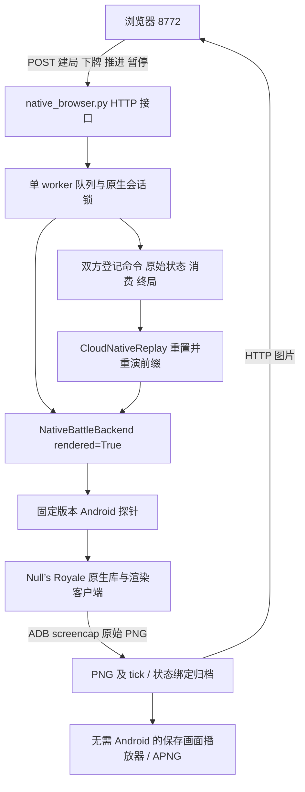

# 原生画面与回放实现、验证和剩余阻塞

**最新手动进展：** 16 GB／4 核升配生效后，06:27:20 UTC 的准备报告已通过内容与身份检查；但 PID 1978 于 06:27:36 因 Android ANR 退出，VM 3394 仍运行。浏览器 06:31:06 的首次建局只尝试了 `status`，并未调用 `configure-native`。这次实际退出原因与之前宿主内存关联的 VM SIGTERM 不同。新[诊断报告](../outputs/cloud/native-render-diagnostic-20261024-001/report.json)包含只读 Android 退出信息与图形线程栈，支持单核软件图形编译／调度超过输入门限的解释；2 vCPU／倍率 20 的[恢复步骤](NATIVE_VISUAL_ZH.md#当前故障准备成功后游戏因-anr-退出)仍待用户手动实测。已增强传输错误阶段、页面错误提示及准备后的有限存活观察；这些实现检查不能替代视觉验收。下文首次实现的 VM 停止状态与测试计数按当时记录保留。

**后续手动诊断更新：** 用户上传 Codespaces 日志后，六次终止均与宿主低可用内存相关，宿主还存在 earlyoom；目前高度指向用户态内存保护，未直接确认发送者。已选择优先升至 16 GB 并新增 doctor 内存字段，详见[后续诊断](CODESPACES_MEMORY_DIAGNOSIS_20261024_ZH.md)。下面的五次尝试与测试计数保留为首次实现验收时的记录，不是手动诊断后的新实机结果。

本轮基于 `dev/main-start-20261020`、提交 `f2cdd1355f408d6e216799bc32ca7acd7d982291` 开发。远程 `main` 为 `2d4b0a6002be4bcb02c092290a03a08b4791517a`，与本地 `origin/main` 相同，且是当前 HEAD 的祖先。本轮没有重置、合并或推送分支。

**结论：浏览器控制、PNG 归档、离线播放器和原生动作重演代码已实现；用户要求的原版完整画面、实际浏览器下牌与原生视觉重演，尚未通过真实验收。** 本轮 Android 在内容就绪前被 SIGTERM 终止，实际截图为加载阶段全黑。历史六局是十月二十日的数值闭环证据，不能填补本轮视觉验收。完整逐步命令见[原生视觉指南](NATIVE_VISUAL_ZH.md)。

## 实现调用链



| 源码入口 | 输入 → 输出和行为 |
|---|---|
| [`native_prepare.prepare`](../tools/cloud/native_prepare.py) | 固定 manifest、明确 ADB/serial、新输出目录 → 启动检查、内容就绪、当前身份、connection；不建局。默认不重启，`--restart-app` 才显式结束当前游戏进程。失败保留阶段日志，不自动重试下牌或重启。 |
| [`native_browser.make_server`](../tools/cloud/native_browser.py) | JSON POST → `202 + job_id`；状态 GET 只读缓存，不推进游戏。会话令牌、同源和 Codespaces 转发主机检查。 |
| [`CloudNativeSession.submit/_worker`](../royale_phase2/cloud_native.py) | 建局／下牌／推进／回放任务 → 单线程 RPC、手牌与消费反馈、归档编号。旧 generation／过期手牌不得直接重新发送。终局、截断分别记录。 |
| [`NativeBattleBackend`](../royale_phase2/backend.py) | 固定 match、原生整数坐标、指定 tick 命令 → 探针状态、原始事件、journal；新增入口复用该后端，不引入另一套战斗物理。 |
| [`CloudAndroidBridge.capture/frame_info`](../royale_phase2/cloud_frames.py) | 显式 `adb exec-out … screencap -p` → 未改动 PNG、CRC/SHA256、尺寸、像素诊断和耗时；非黑不能单独证明游戏内容正确。 |
| [`CloudNativeSession._capture/_save`](../royale_phase2/cloud_native.py) | 暂停后的原生状态与 PNG → 帧索引、语义状态哈希、双方命令、消费与终局。截图前后核对 tick/generation；该核对不能证明呈现延迟为零。封存索引与来源文件按哈希检查。 |
| [`NativeReplaySource.load/CloudNativeReplay.seek`](../royale_phase2/cloud_replay.py) | 同版本 journal、初始化、原始状态、feedback/result → 在原始登记 tick 注册命令，比较保存检查点；向过去跳转则 reset 后重演。仅归一化 generation 和事件序号起点。 |
| [`native.html`](../tools/cloud/native.html) | 当前状态、手牌与真实 PNG → 操作面板、落点输入盘、原生时间线及保存图片播放器。坐标盘不是游戏画面；截图没有标定时禁用截图点选下牌。 |
| [`validate_frame_index/export_apng`](../royale_phase2/cloud_frames.py) | 原始 PNG、帧索引及状态绑定 → 校验报告／无损 APNG，使用原 tick 间隔，不插值，不补造历史画面。 |
| [`native_visual_check.NativeVisualClient`](../tools/cloud/native_visual_check.py) | 已运行的本地服务 → 有预算的 smoke、完整采样 record、原生 replay 检查；每个变更 POST 只发一次，后续轮询 job，不因超时重发。 |

训练仍使用已有的阶段三 GRU／模仿学习链；本轮没有启动新训练，也没有把视觉代码的测试计入棋力提升。

## 本轮真实证据

| 检查 | 结果与证据 |
|---|---|
| 开发环境 | 仓库 Python 3.12.11；NumPy、Torch、PyArrow、Gymnasium 可用；572 个可移植资产哈希通过。[doctor](../outputs/native_visual_20261024/final-doctor.json)。 |
| 可移植回归 | 全部 305 项通过，0 失败／错误。[完整日志](../outputs/native_visual_20261024/final-portable-tests-002.stderr.log)。这些是实现契约和保存数据检查，不是新的原生对局。 |
| 回放／帧／会话／HTTP | 63 项通过，真实 Android/ADB/RPC 调用为 0。[范围与结果](../outputs/native_visual_20261024/final-contracts-002/report.json)。准备流程另外 10 项模拟检查通过，[结果](../outputs/native_visual_20261024/prepare-contracts-001/report.json)。 |
| 实际浏览器离线入口 | Chromium 134，4 项检查通过，0 页面 JS 错误。读取真实历史原生归档元数据、禁用引擎控制、明确拒绝缺失历史图片。[结果](../outputs/native_visual_20261024/offline-real-source-browser-001/report.json)。不属于真实对局画面验收。 |
| 历史数据兼容性 | 新加载器只读核验全部六局原始来源、初始化、动作时序、保存状态与自然终局，未连接引擎。[结果](../outputs/native_visual_20261024/historical-source-validation.json)。 |
| Android 与游戏启动 | 最后一次 BOOT=1，游戏启动命令成功；未等到新的内容就绪和身份验证。[准备报告](../outputs/native_visual_20261024/attempt-001/prepare-006/report.json)。报告最后的 KeyboardInterrupt 是 VM 已退出后主动停止无效等待，不能与之前 QEMU 收到的 SIGTERM 混为一谈。 |
| 实际 PNG 采集 | 360×640，1003 字节，CRC 正确，100% 黑色；单次采集约 20.87 秒。[回执](../outputs/native_visual_20261024/attempt-001/lowcache-system-capture.json)、[原始图片](../outputs/native_visual_20261024/attempt-001/lowcache-system.png)。它采于加载阶段，没有建立 rendered 对局，因此既不能证明渲染成功，也不能据此断言渲染引擎永久故障。 |
| 中断现场 | QEMU 收到 `SIGTERM / SI_USER / si_pid=0 / si_uid=61876`，[最后一次信号日志](../outputs/native_visual_20261024/attempt-001/vm-low-cache-signals.log)。容器内不能定位发送方，不能归因于某个具体服务。[内存采样](../outputs/native_visual_20261024/attempt-001/low-cache-resources.jsonl)末值约 1.49 GiB RSS，64 MiB TCG 缓存仍未避免中断。 |

本轮合计五次软件 VM 尝试，保留失败现场；最后两次直接捕获到上述终止信号。没有通过绕过终止信号继续运行。当前 VM 已退出，没有留下真实对局控制者或新的训练任务。

## 距离用户要求还差什么

1. **稳定的原生运行时。** 当前 Codespaces 没有宿主 Binder/KVM，软件 TCG VM 曾跑通数值闭环，但本轮不能稳定等到游戏内容就绪。优先定位外部 SIGTERM；没有新证据前不重复启动同样试验。
2. **实际对局画面。** 必须在 `rendered=True` 建局后看到可人工辨认的场景，并保存至少三张随局面变化的原始 PNG；黑屏和非黑加载界面都不达标。
3. **真实浏览器动作闭环。** 在真实页面选择手牌、提交合法坐标，拿到原生实际消费和后续画面变化。当前已实现对应接口与 UI，但本轮只能验证契约，不能计为已实机下牌。
4. **完整画面覆盖与原生重演。** 从初始化 tick 90 到自然终局保存指定密度 PNG，并将来源重演至终点、回退至初始化、再次重演至终点，核对状态、消费、终局。历史没有保存的图片不能补称“当时录像”。
5. **流畅录像与呈现标定。** 默认每 20 tick 保存一次，即每游戏秒约一张；当前 Android 显示参数约 1 FPS。`capture-ticks=1` 是逐逻辑 tick 采样，不能保证 20 张新画面。归档将 `full_20hz_samples` 与尚未验证的 `full_20hz_frames/fresh_frame_rate_verified` 分开。截图落点标定、稳定高帧率传输、音频和完整加载过程录像不在已交付范围。

“实时操作”在本实现中是持续推进期间接受人工动作，软件 TCG 不保证与现实时间同步。暂停画面逐张采集方式也不等同低延迟视频流。本轮已取样的 ADB 截图接近 21 秒，这个延迟必须在内容就绪后重新测量，不能承诺浏览器实时视频体验。

## 继续验收与替代运行位置

按照[逐步指南](NATIVE_VISUAL_ZH.md)准备到 `status=prepared` 并启动 8772 后，先只运行短检查：

```bash
.venv-cloud/bin/python tools/cloud/native_visual_check.py smoke \
  --base http://127.0.0.1:8772 \
  --output outputs/cloud/native-visual-smoke-001 --wall-seconds 600
```

短检查通过并人工查看 PNG 后，再按实际耗时选择完整局预算。以下命令必须各自使用新输出目录；它们不会启动大规模训练：

```bash
.venv-cloud/bin/python tools/cloud/native_visual_check.py record \
  --base http://127.0.0.1:8772 \
  --output outputs/cloud/native-visual-record-001 --wall-seconds 1800

.venv-cloud/bin/python tools/cloud/native_visual_check.py replay \
  --base http://127.0.0.1:8772 --archive 实际归档编号 \
  --output outputs/cloud/native-visual-replay-001 \
  --wall-seconds 1800 --job-seconds 1200
```

预算耗尽只表示本次未完成，不应改成自然终局成功；长局可先根据短检查实测耗时决定下一次预算。

如果本 Codespaces 的 VM 继续被终止，可把 Android 放到用户持有的稳定主机上，Codespaces 保留代码、训练和浏览器服务。这台主机需要：已安装且有 root 的兼容 Android、固定版本 APK／探针／更新资源、可运行的游戏渲染与明确 ADB 设备。普通最新版 Null’s APK 不能直接代替本项目已固定版本，因为 ABI、函数地址和版本指纹可能不同。现有安装工具和更新包入口见[安装参考](NATIVE_LOOP_ZH.md#重建环境时的安装与历史恢复参考)。

已有主机可使用[原生连接指南](NATIVE_CONNECTION_ZH.md)的 loopback／SSH 转发路线。视觉功能除探针端口外还需要明确设备的 ADB 截图通道；只转发 26789 无法得到图片。先保证 Codespaces 的显式 ADB 能访问该设备，再用相同 `--adb-port/--serial/--root-shell` 执行准备和浏览器服务，重新核对当前进程身份。外部主机也必须重新完成同一套视觉验收，不能继承本机历史成功标记。

本轮没有可用的外部 Android 主机连接，因此没有替用户声称已部署或已在另一台主机跑通。现有源码、资源和已安装磁盘均保留；源码可评审，原生视觉结果明确保持未验收。
