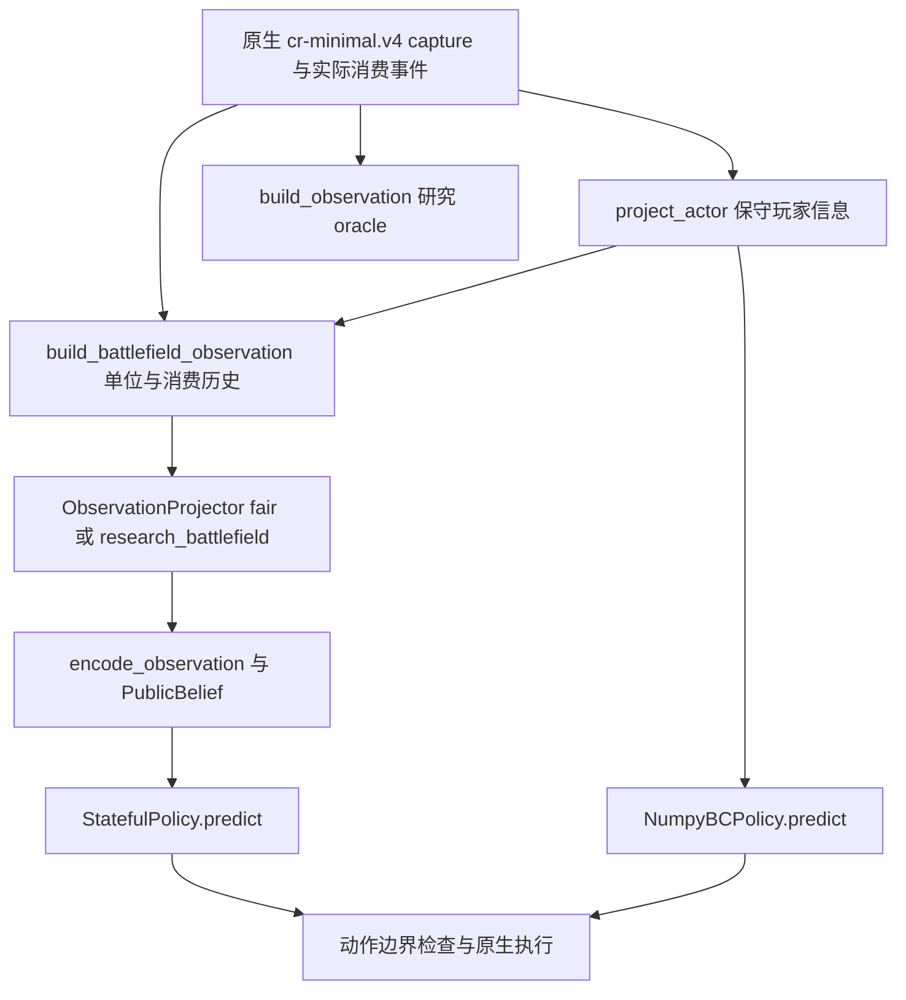

# Royale Lab 研究平台能力审计与开发建议

审计日期：2026 年 10 月 20 日（北京时间）。范围：当前 Codespace、当前源码、已迁移样例与小规模离线检查。目标是完善研究平台的数据与执行可信度，不评价或优化 AI 棋力。

当前可以独立运行的是保存数据检查、便携契约测试、NumPy 和 GRU 保存模型推理、离线研究页面，以及旧 MVP 近似模拟器。固定版本原生平台已有较完整的适配、日志和界面代码，但当前 Codespace 缺少运行资产、部分证据样例和跨平台运行适配，不能据此宣布原生闭环通过。默认 56 项测试通过，也不代表阶段二和阶段三全部测试通过。

## 1 基线与证据口径

本次实际执行 `git fetch origin`，退出码为 0。工作目录为 `/workspaces/Game-AI-for-Clash-Royale`，分支为 `dev/main-start-20261020`；`HEAD` 与刷新后的 `origin/main` 均为 `2d4b0a6002be4bcb02c092290a03a08b4791517a`，`HEAD...origin/main` 为 `0 0`。本地 `main` 仍停在 `850e52b`；无需切分支或合并即可继续开发。开始审计时工作区干净。

全文使用以下口径：**已实现**指存在可追踪的代码路径；**本次验证**指在当前 Codespace 实际执行得到结果；**历史保存证据**指迁移进来的结果，不能充当本次原生重跑。未通过、缺失与不支持分别记录，不互相替代。

可纳入版本管理的精简证据索引见 [platform_audit_20261020.json](audits/platform_audit_20261020.json)。详细命令、退出码、日志 SHA256 和失败现场位于 [checks.json](../outputs/platform_audit_20261020/checks.json) 及同目录文件；`outputs/` 按仓库规则被 Git 忽略。源码行号以本次提交为准。

| 层次 | 代码与引擎 | 当前定位 |
|---|---|---|
| 旧 MVP | `royale_ai`，Python `Arena` | 12 卡近似教学模拟器；不能验证固定版本原生机制 |
| 第一阶段基线 | `royale_lab`，`clash_royale_env` 扩展 | 独立社区近似引擎；当前解释器缺少对应编译产物，不能直接启动 |
| 第二阶段平台 | `royale_phase2`，`cr-minimal.v4` RPC | 固定 Android 运行时适配、重建、执行反馈、人机与研究界面 |
| 第三阶段研究层 | `royale_phase3` | 复用第二阶段后端，增加观测投影、八卡动作、序列数据与模型；代码存在不等于全任务验收 |

旧文档中的数百项引擎测试、700 局策略比较、正式 100 局等历史数字，不作为本次平台通过依据。

## 2 实际调用链与输入输出

### 2.1 来源数据与原生重建

| 环节 | 真实入口 | 输入 | 输出与条件 |
|---|---|---|---|
| 来源读取 | [dataset.py](../royale_phase2/dataset.py#L47) `load_source_shard`；[replays.py](../royale_phase2/replays.py#L87) `parse_payload` | 本地 Parquet、`payload_json`、来源标识 | 来源配置、动作 journal、结构问题；保留原时间、原坐标、同 tick 顺序。读取 Parquet 需要 PyArrow 与原始分片 |
| 去重和划分 | [replays.py](../royale_phase2/replays.py#L74) `content_fingerprints`；[dataset.py](../royale_phase2/dataset.py#L64) `group_episodes`、`select_frozen` | 对局、换边不变签名、近重复签名 | 按对局及其派生关系分组的冻结清单；不是逐帧随机切分 |
| 重建 | [reconstruction.py](../royale_phase2/reconstruction.py)；[backend.py](../royale_phase2/backend.py#L245) `NativeBattleBackend.reset`、`schedule_journal`、`advance_exact_ticks` | 初始化配置、版本资产、来源动作与重建假设 | 实际原生状态、请求与反馈；解析成功不代表重建成功，重演一致不代表官方轨迹一致 |
| 外部适配 | [sources.py](../royale_phase3/sources.py) `cochon_record`、`tv_record`、`wty_records`；[phase3_sources.py](../tools/phase3_sources.py) `convert` | 各来源原始记录、来源指纹与语义 | 统一来源记录、质量理由、时间和坐标 mask。TV 无时间戳时不把帧号换成精确时间；wty 文件末尾不自动作为自然终局 |

当前 `pyarrow` 未安装，来源 Parquet 与完整重建材料也未齐备；云端 NumPy 缓存和阶段三 JSONL 路线绕开了该依赖，不能据此说来源到原生重建全链已运行。

### 2.2 原生状态到策略输入



| 环节 | 函数与文件 | 输入 → 输出 | 信息边界 |
|---|---|---|---|
| 保守 actor | [visibility.py](../royale_phase2/visibility.py#L80) `project_actor(state, owner, towers)` | `cr-minimal.v4`、玩家侧、reset 塔身份 → 己方手牌/费用/圣水、时钟、皇冠、已认证塔 HP | 不含普通单位、敌方手牌/精确圣水、轮转、目标与冷却。没有塔认证时不猜塔身份；塔缺失 HP 保持未知 |
| 研究 oracle | [observability.py](../royale_phase2/observability.py) `build_observation` | 原生 capture、累计事件、前状态 → 原始字段、字段来源、差分与未知项 | 可含双方私有状态，只供显式研究模式；不是公平 actor |
| 战场与历史 | [battlefield.py](../royale_phase2/battlefield.py#L139) `build_battlefield_observation` | raw、保守 actor、已发生事件、journal、前战场 → 非塔对象与已发生消费历史 | 剔除敌方私有状态、攻击目标和冷却；所有对象可见性仍未知。journal 只给唯一精确匹配事件补充“请求坐标” |
| 阶段三投影 | [observation.py](../royale_phase3/observation.py#L70) `ObservationProjector.project` | 战场记录、profile、局内状态 → 版本化玩家观测、实体/历史、dt 与未知 mask | `fair` 排除全部非塔实体；`research_battlefield` 才保留未证可见性实体；不能靠调用方自称可见来开闸 |
| 数值编码 | [observation.py](../royale_phase3/observation.py#L230) `encode_observation` | 玩家观测、词表、实体与历史开关 → 定长 float 向量 | 不编码原生 ID、路径、质量标识、未来命令与请求落点；缺失值配 mask |
| 公开 belief | [belief.py](../royale_phase3/belief.py#L73) `PublicBelief.update`、`encode_belief` | 过去公开消费事件、版本化圣水时间表 → 圣水区间、已见牌频率等 | 不读取敌方真手牌和精确圣水；默认未知资源机制时区间保持宽泛。当前在线构建依赖未迁移的 CSV |

保存 pilot 的维度为 `hud=96`、`observation=464`、`history=688`、`belief=15`、`feedback=4`。本次读回 1,618 行，全部 `observation` 实体块为零；因此不能把 A 到 B 的维度扩展解释为已增加有效单位信息。证据：[state_actions_saved_rows.json](../outputs/platform_audit_20261020/state_actions_saved_rows.json)。

### 2.3 策略到动作执行

| 路线 | 函数与文件 | 输入 → 输出 | 实际执行条件 |
|---|---|---|---|
| 第二阶段 BC | [learning.py](../royale_phase2/learning.py#L345) `NumpyBCPolicy.predict_many`、`predict`、`decode_policy_output`、`action_from_index` | actor、合法子空间 mask、模型参数、play bias → WAIT 或 `slot/card/x/y` | 正式 hard-E 子空间是 WAIT 与普通火球/箭雨；云端 `infer` 使用保存 mask，不重新证明当前合法性 |
| 规则插件 | [platform.py](../royale_phase2/platform.py#L282) `LiveSession._decide`；[human_ai_policy.py](../examples/human_ai_policy.py) | 明确选定的 player/battlefield/oracle 信息 → 动作字典 | 不同信息模式权限不同；人机规则策略不能当作 BC 或已训练 RL |
| 序列策略 | [learning.py](../royale_phase3/learning.py#L308) `StatefulPolicy.load/predict`、`decode` | 当前局/玩家/tick 的数值行、mask、GRU 隐状态 → `action_index`、`xy_native`、位置 log 概率 | 按局与玩家清隐状态；同 tick 重复输入幂等，输入变动拒绝。0 为 WAIT，1 到 4 为当前卡槽 |
| 八卡动作边界 | [actions.py](../royale_phase3/actions.py#L23) `mask`、`position_mask`、`validate` | 当前手牌、己方费用/圣水、玩家侧、请求坐标 → 校验后的请求 | 8 普通卡固定词表；18×32 网格；普通牌半场、法术全场是声明的部署假设，不是完整引擎合法性 oracle |
| 在线环境 | [native_env.py](../royale_phase3/native_env.py#L48) `NativePhase3Env.step` | 提议动作与规则对手 → 下一观测、reward、terminated、truncated、info | 提议转请求，通常在 `before_tick+1` 调度，再推进剩余控制 tick；边界拒绝保留记录并转 WAIT |
| 原生执行 | [backend.py](../royale_phase2/backend.py#L314) `schedule_card`、`advance_exact_ticks`、`execution_feedback` | owner/card/坐标/执行 tick/request_id → 调度回执、capture、实际消费证明 | 20 Hz；通过原生 RPC。入队、注入、消费分别记录；只有唯一事件及所需边界证据才标记 `card_consumed` |

`backend.execution_feedback` 输出 `native_injected`、`card_consumed`、`consumption_status`、`actual_execution_tick`、匹配事件与 `full_placement_legality_oracle=False`。没有消费证据不能直接归类成明确拒绝；能力按钮可调度，但 minimal 协议缺少完整技能消费证明。

### 2.4 轨迹到训练与评估

| 环节 | 入口 | 输入 → 输出 | 已有保护与限制 |
|---|---|---|---|
| 原生规则自采 | [collection.py](../royale_phase3/collection.py#L16) `collect`；[phase3_collect.py](../tools/phase3_collect.py) | 固定 seeds、卡组、双方规则策略、max_tick → 每局 states/decisions/journal/feedback/result 和批次报告 | 单控制者串行；保留失败，区分自然终局和截断；当前不能在此 Codespace 重采 |
| 第二阶段轨迹 | [trajectories.py](../royale_phase2/trajectories.py#L205) `adapt_native_reconstruction`、`convert_episode`、`export_episodes`、`load_export` | 重建证据、冻结分组、子空间证明 → 动作前 actor、标签、mask、质量、终止信息与 Parquet | 严格证据引用和版本检查；完整原始证据未迁移，当前无法全量复核 |
| 阶段三导出 | [data.py](../royale_phase3/data.py#L19) `audit_collection`、`export` | 每局状态、决策、回执和配置 → `rows.jsonl`、metadata、样例、读回校验 | 两侧同局同 split；包含时间、上次动作/反馈、消费标签、位置监督、loss mask、terminated/truncated、未来辅助目标。未确认请求通过 loss mask 排除普通 WAIT 监督；未来目标不进入 actor |
| 数据加载 | [learning.py](../royale_phase3/learning.py#L27) `load_dataset` | metadata 与引用 JSONL → 校验后的 rows/meta | 检查哈希、维度、组划分、tick/时间与动作；不重新验证消费或 loss mask 的原始证据 |
| 序列训练 | [learning.py](../royale_phase3/learning.py#L146) `sequence_windows`、`loss`、`train` | 整局训练行、variant、seed、序列长度等 → 曲线、逐 epoch checkpoint、训练报告 | padding 与 burn-in mask；按局/玩家成窗；验证集选模型；保存优化器/RNG，支持续训；测试含短训及恢复一致性 |
| 云端数值训练 | [train_cache.py](../tools/cloud/train_cache.py#L6) `train` | 已保存 train/validation NumPy 数组 → `weights.npz`、progress、report | 可执行优化代码；不读取 test。产物不是完整原生部署 checkpoint；本次未单独发起训练任务 |
| 离线评估 | [learning.py](../royale_phase2/learning.py#L432) `evaluate_checkpoint`；[evaluation.py](../royale_phase3/evaluation.py#L38) `event_metrics`；[learning.py](../royale_phase3/learning.py#L340) `evaluate` | 冻结输入、模型、split、时间容差 → 动作/事件 PR、位置/时间误差、NLL、推理延迟等 | 当前第二阶段评估已共用解码路径，不能继续沿用“play bias 必然不一致”的旧结论；本次只做推理一致性与契约检查，没有重评 test |
| 原生评估 | [phase3_native_evaluate.py](../tools/phase3_native_evaluate.py#L12) `evaluate` | 冻结 seeds/换边/对手、策略和原生环境 → 胜负、实际消费、unknown、拒绝、时延及失败分母 | 需要原生条件；`aligned_bc` 调用存在确定的参数错误，见第 5 节；当前未运行原生评估 |

阶段三学习行目前不是完整通用 RL transition：有终止标识和下一状态辅助监督，但没有统一的奖励/折扣/下一 actor 序列化契约。在线 `NativePhase3Env.step` 则返回终局 ±1 奖励和按 dt 换算的 discount。离线 BC 可用，不应直接宣称标准 PPO/世界模型训练数据已经完整。当前 `load_dataset` 也不核验终止标志语义、完整原始 artifact 或 metadata 中的源码指纹。

阶段三 `evaluate` 按时间配对后报告的是 `slot_correct_on_time_match`，不是跨 tick 的真实卡牌 ID 正确率；轮转可能使同槽位对应不同牌。“所有真实出牌的位置误差”字段同时记录两个分母，但距离只在也预测出牌的子集计算，漏下牌仍需通过事件 recall 表达。已有 [world.py](../royale_phase3/world.py#L29) 是九维公开聚合状态预测原型，未实现对象死亡/生成、奖励与真实终止预测；正式想象训练门槛明确保持 `formal_imagination_authorized=False`。

## 3 六项重点能力的当前条件

| 能力 | 已实现 | 本次实际验证 | 缺口与验收边界 |
|---|---|---|---|
| 单位状态 | raw 对象身份、归属、卡 ID、位置、HP/maxHP、类别等；oracle 保留原始列，battlefield 去掉私有运行字段；研究 profile 可跟踪对象 | synthetic 观测契约、保存数值行、字段屏蔽通过 | 所有非塔可见性未知；fair 无普通单位。对象消失不等于死亡；采样可能漏瞬态，攻击/伤害因果与完整内部状态未具备 |
| 下牌历史 | 当前 generation 的原生消费事件累积、sequence 去重、未来事件拒绝、换局清理；公开历史可用于 GRU | 默认测试覆盖未来不变性、reset 隔离与历史正控制；pilot 有真实保存的历史编码 | 历史卡身份可能 opaque；只有唯一 journal 对应请求坐标，最终落点为 `None`。历史事件本身无 generation 列，需要调用方正确隔离 |
| 动作合法性 | affordability、严格法术子空间、八卡普通部署边界、原生反馈判定 | mask/坐标 roundtrip、选择与后处理契约、保存推理通过 | 无全卡/全机制/全落点合法性 oracle；没有证明技能、进化等全部可执行；不能将调度成功当下牌成功 |
| 训练轨迹 | 整局分组、动作前输入、时间、反馈、标签质量、loss mask、哈希与 checkpoint | `load_dataset` 成功读回 pilot 1,618 行/5 局；序列与恢复契约通过 | 完整原始 states/wire/决策证据部分缺失；从 raw 重新导出尚未复现；导出子集和源批次报告分母不相等 |
| 终止与重置 | 后端 `finalized/result`；环境分别返回 terminated/truncated；projector/belief/policy 有清理 | 便携策略与投影 reset 测试通过；重复 reset 缺口以 mock 复现 | 环境输出目录与累计反馈未逐局隔离；导出截断阈值写死 7200；自然终局/reset/恢复没有在当前原生运行时验收 |
| 可视化 | 云端样例页面；原生 archive/live/human UI、帧状态哈希绑定与控制接口代码 | 云端 `/`、status、NumPy/GRU HTTP 均成功；原生 archive 初始化因缺素材失败 | 云端没有战场/时间轴/单位查看页；archive 缺 PNG/index/states；实时画面还需要 AndroidBridge、游戏素材和跨平台适配；人机页截断状态显示存在缺口 |

### 数据分母必须按实际文件区分

| 数据范围 | train | validation | test | 本次可证明的范围 |
|---|---|---|---|---|
| 迁移 NumPy 历史 hard-E 摘要 | 9 局/13,431 行/31 出牌 | 2 局/3,348 行/12 出牌 | 1 局/1,661 行/9 出牌 | manifest 的历史分母；实际检查资产哈希、3 个保存样例解码。没有重审全部 18,440 行的原始证据 |
| 阶段三 pilot JSONL | 3 局/654 行/43 出牌 | 1 局/260 行/17 出牌 | 1 局/704 行/51 出牌 | 本次加载读回：5 个整局 episode 组、双方视角共 1,618 行、111 个保存的确认出牌标签、1,507 WAIT。10 条双方终止标记不代表 10 局 |

上表 pilot 的整局组划分与标签来自保存的派生数据；历史采集声明独立，但本次未通过缺失的 raw 再次核验局间独立性或消费事实。

pilot 的 `data_audit.json` 保存的是来源批次 **17 局/410 出牌**摘要，`export(limit=5)` 另生成 5 局学习数据；不能把 17 局当成当前导出的训练集。本次检查该历史审计中的 119 个 artifact 引用，51 个文件缺失，另有 34 个现存 initialization/journal 文件与历史引用的字节哈希不匹配；后者与便携 `MANIFEST` 中的对应哈希一致，说明“便携资产完整”与“原始历史证据引用一致”是两种检查，差异原因尚未确证。源码分母原因在 [data.py](../royale_phase3/data.py#L56)：写整批 audit 后才截取 qualified。

另有一项重导出风险：metadata 中 `royale_phase3/belief.py` 的保存指纹与当前源码不一致，其他三项 feature source 指纹一致。当前加载成功只说明派生 JSONL 的哈希和行契约通过，不能证明当前代码能重新生成同一组 belief。详见 [contract-probes.json](../outputs/platform_audit_20261020/contract-probes.json)。应先定位版本差异，保留旧证据和指纹，不能批量更新历史哈希来掩盖问题。

现有 [bounded-v1/report.json](../outputs/phase3/baseline/bounded-v1/report.json) 明确只有 109 行严格证据抽样，`whole_export_strict_evidence_audit_complete=false`。它不能替代整表严格验收。该历史文件本次只读，没有重跑或调参。

## 4 Codespaces 与原生运行边界

**Codespaces 已实跑：** Linux x86_64、Python 3.12.11、NumPy、Torch 2.6.0 CPU；572 个审查资产哈希通过；保存 NumPy/GRU 推理；便携观测/动作/学习契约；离线页面。`pyarrow`、`gymnasium` 未安装，CUDA 不可用。阶段三 doctor 在 Linux 输出 `memory.available=false`，其零内存字段不能解读为主机没有内存。

**代码可离线执行但材料不齐：** 完整 Parquet 源数据审计、原始轨迹重导出、belief 在线构建、原生 archive 回放与多数扩展测试。补齐合法可分发的输入/依赖和明确测试分组后，部分功能无需 Android。保存 belief 向量可用于 GRU 推理，不等于可以从 raw 在当前环境重建 belief。

**原生 Android 路线：** 当前 `/dev/binder`、`/dev/binderfs/binder-control`、`/dev/ashmem` 均不存在，`docker` 命令不存在。除此之外还缺 APK/libg/资源、实际身份回执、probe/RPC 和单控制者运行条件。[NativeBattleBackend.__init__](../royale_phase2/backend.py#L128) 先校验全部版本资产和运行身份；不能用更弱的检查绕过。固定清单记录 `15.535.13` 客户端与 `15.535.86` 内容版本，只能代表该清单目标。

**跨平台适配仍未完成：** [platform.py](../royale_phase2/platform.py#L372) `LiveSession._worker` 使用 `msvcrt`；[viewer.py](../royale_phase2/viewer.py#L64) `AndroidBridge` 使用 Windows `ssh.exe`；[phase3.py](../tools/phase3.py#L21) 的 `baseline-audit` 指向 `.venv-phase2-data/Scripts/python.exe`，`play` 调用 `powershell.exe`。即便 Binder 存在，也不能直接宣布这些入口能在 Linux 工作。

**第一阶段基线：** `royale_ai` 纯 Python 近似模拟器可以独立运行；`royale_lab` 缺当前解释器的 `clash_royale_env` 编译产物，本次加载失败。其 [snapshot/restore](../royale_lab/backend.py#L266) 与第二阶段原生后端无关；第二阶段 [snapshot](../royale_phase2/backend.py#L439) 明确抛不支持，只能 reset 后 journal 重演，不能提供廉价分叉。

## 5 本次发现的具体平台问题

1. **完整测试集在当前工作区未通过。** 便携入口选择有限模块。阶段二扩展测试报告 `Ran 128`、1 failure、87 errors、1 skipped，错误数含 `setUpClass`；阶段三额外测试 `Ran 36`、1 failure、14 errors、1 skipped。主要缺失原生 fixture、game_modes CSV、原始对局和视频；另有 `C:/Windows/win.ini` 在 Linux 被当作仓库相对路径的测试兼容问题。不能把缺材料导致的错误都说成代码逻辑失败，也不能把它们当作已验证。
2. **阶段三统一验收入口未实现。** `tools/phase3.py acceptance` 实际抛 `Implementation not available: tools/phase3_acceptance.py`。`baseline-audit` 则因 Windows 解释器路径不存在失败。外层 `--help` 会提前返回统一帮助，单看 help 成功不能证明子命令存在。
3. **原生对齐 BC 评估接线错误。** [phase3_native_evaluate.py 第 46 行](../tools/phase3_native_evaluate.py#L46) 用第二位置参数传 mask；[NumpyBCPolicy.predict](../royale_phase2/learning.py#L366) 将 `legal_mask` 声明为 keyword-only。离线签名绑定已复现 `TypeError`，尚未修复，不应安排长评估后才发现。
4. **重复 reset 可能混写跨局证据。** [NativePhase3Env.reset](../royale_phase3/native_env.py#L41) 清观测器与上一动作，但不清构造时的 `feedback/decisions`；相同目录继续追加 states/decisions，覆盖 initialization，save 再保存当前 journal 和累计反馈。两次 mock reset 已复现。当前每局新建环境的评估路径规避部分影响，但环境本身不是完整的可复用多局契约。
5. **截断语义尚未统一。** [data.py 第 123 行](../royale_phase3/data.py#L123) 写死 `next_tick>=7200`，而采集和在线环境支持不同 `max_tick`；当前导出先排除非自然终局，因此这是潜在契约缺口，不是已证明五局 pilot 存在错误截断标签。[human_ui.html](../royale_phase2/human_ui.html#L63) 的 `isHumanReady` 和终局文字只看 terminal/error，不排除 truncated。后端已拒绝截断后出牌，页面仍可能提示可出牌。
6. **导出子集、版本与来源审计需要拆分。** 5 局 pilot 与 17 局批次摘要共同保存，但没有同层命名分隔；存在上文列明的缺失引用、历史哈希差异与 belief 源码指纹差异。`audit_collection` 遇缺失 artifact 直接读取 SHA，不能把迁移后缺失状态作为完整诊断报告返回。
7. **观测与可视化之间缺少云端审查入口。** 云端页面没有 `/api/state` 和战场时间轴；研究 oracle/battlefield 字段投影也不等于玩家可见性验证。模型文件存在、单位数组存在或界面能打开，都不足以证明研究输入可信。

复现细节与 mock 范围见 [training_evaluation_notes.md](../outputs/platform_audit_20261020/training_evaluation_notes.md)、[state_actions_notes.md](../outputs/platform_audit_20261020/state_actions_notes.md)、[visualization_runtime_notes.md](../outputs/platform_audit_20261020/visualization_runtime_notes.md)。mock 只证明适配层问题，不是原生对局证据。

## 6 优先平台任务与验收方法

以下是后续开发建议，本次没有自动实施这些修复，也不启动阶段三任务书中的全量实验。

| 优先级 | 平台任务 | 验收方法 | 所需环境 |
|---|---|---|---|
| P0 | 建立明确的便携/原生/历史证据测试清单，检查所需文件和可选依赖；修复 Windows 路径用例；补齐最小可审查 fixture 或给出明确 unavailable 原因 | 干净 Codespace 单命令报告每组通过、失败、缺依赖、跳过原因；基础组覆盖状态/历史/动作/终止/reset/HTTP；缺证据不产生 passed；必要原始值和哈希可追溯 | Codespaces；原生组按条件启用 |
| P0 | 修复统一 CLI 与验收结果生成，消除写死解释器；修复 `aligned_bc` mask 参数接线 | 逐个执行受支持的子命令，小输入读回真实输出；unsupported 返回明确非成功状态；同批 actor/mask 单条、批量和评估动作逐项一致；验收读取实际日志和哈希，不能只检查文件存在 | Codespaces 即可完成入口与调用契约 |
| P0 | 统一局生命周期与逐局输出：reset 新 generation/episode，输出独立不可变目录，清理反馈/决策；保留失败现场 | 同实例连续两局、换边、同 tick 重复输入、自然终局和截断后 step 拒绝；上一局 ID/事件/反馈不进下一局；journal、states、decision、终止标记逐局匹配。先离线故障注入，再做原生 reset smoke | 离线先行；原生验证另行 |
| P0 | 建立可重导出的轨迹证据契约，区分源批次/筛选子集/学习行，统一 max_tick 与终止语义 | 小样本 raw→导出→load→逐行核对；消费回执绑定请求和前观测；dt 正确；双方同局同 split；缺失资产、哈希与源码版本差异分别报告；子集 counts 独立；截断、失败、重试不丢分母；如需 RL，再定义 reward/discount/next actor | Codespaces 可验证便携子集；完整链需原生原始记录 |
| P1 | 增加云端保存状态审查页：单位/塔、历史、mask、动作请求和反馈、自然终止/截断时间轴；明确 oracle/research/fair | 使用真实保存 capture 小样例，任意前后 seek 显示同 tick 状态；历史不含未来；unknown 与 0 区分；请求位置与实际位置分列；显示数据哈希和 profile。没有 PNG 时只显示明确标注的结构化示意，不冒充原生画面 | Codespaces；原生 PNG 对齐另验 |
| P1 | 为单位可见性建立受支持范围与证据，维持 fair 默认拒绝未知对象 | 挑普通单位/建筑/法术、隐身/地下/生成/瞬态夹具；动作前画面与 raw 同 tick 核对；变动敌私有状态与未来后缀不变 actor/mask；消失不猜死亡。只有通过的范围才进入公平输入 | 代码边界可离线；画面及原生状态需原生环境 |
| P1 | 固定普通八卡执行契约，完善 readiness/费用/区域/反馈分类与 UI 截断状态 | 每张牌少量请求，覆盖连续轮转、费用不足、缺槽、非法区域、同 tick 竞争、unknown；证明 planned/queued/injected/consumed 各自分母；未支持技能和进化明确拒绝；两侧坐标及回执一致 | 离线边界检查；实际消费需原生 |
| P2 | 参数化传输与渲染依赖，准备独立原生运行验收 | 验证资产与实际运行身份、单控制者排他；reset→普通下牌→确认消费→自然终局→再 reset→journal 恢复，保存时钟/结果/画面对齐与失败日志。先少量完整 smoke，不扩成强度评测 | 有权限且具备资源的独立 Android/Binder 主机或现有本地环境 |
| P2 | 平台级评估报告：冻结输入、精确解码、时间容差与失败口径 | 同一小数据重复报告可复现；逐项比较部署/离线解码；跨 tick 核验实际 card ID，明确漏出牌及位置误差分母；只按实际消费计数；超时/故障/截断保留；确认 test 未用于调参；报告不把 WAIT 准确率或训练成功写成棋力提升 | Codespaces 离线；执行指标需原生 |

前四项完成后，研究者应能回答“这行观测来自哪一局哪一 tick、为什么允许这个动作、实际消费是否被证明、怎样结束和恢复、如何重现同一数据”。随后再讨论扩数据、模型和长训练。实体动力学、RSSM、Dreamer 想象 actor–critic、全量 A—E 强度消融以及官方全交互等价都不列为本次已完成能力。

## 7 本次运行证据与继续命令

| 实际检查 | 本次结果 | 详细证据 |
|---|---|---|
| `git fetch origin` 与分支比较 | 成功；远程无新增差异 | [checks.json](../outputs/platform_audit_20261020/checks.json) |
| cloud doctor | 572 资产通过，NumPy/Torch 可用；native 未验收 | [doctor.log](../outputs/platform_audit_20261020/doctor.log) |
| cloud test | 56 项，0 失败/错误/跳过 | [portable_tests.log](../outputs/platform_audit_20261020/portable_tests.log) |
| 阶段二扩展离线测试 | 128 项；1 failure、87 errors、1 skipped；未通过 | [phase2_tests.log](../outputs/platform_audit_20261020/phase2_tests.log) |
| 阶段三 evaluation/belief/sources | 36 项；1 failure、14 errors、1 skipped；未通过 | [phase3_extra_tests.log](../outputs/platform_audit_20261020/phase3_extra_tests.log) |
| 旧阶段三 observation 测试 | 26 项；25 errors；未通过，主要缺输入 | [state_actions_contract_tests.log](../outputs/platform_audit_20261020/state_actions_contract_tests.log) |
| 保存模型推理 | NumPy 3/3 与保存解码一致；GRU 8 条成功；RPC 0 | [numeric_infer.log](../outputs/platform_audit_20261020/numeric_infer.log)、[gru_infer.log](../outputs/platform_audit_20261020/gru_infer.log) |
| HTTP、archive、基线扩展与旧 MVP | 4 路由 200、`/api/state` 404；默认 archive/扩展不可用；MVP 1 秒/1 决策成功，仅近似沙盒 | [workbench-http.json](../outputs/platform_audit_20261020/workbench-http.json)、[visualization-capabilities.json](../outputs/platform_audit_20261020/visualization-capabilities.json)、[mvp-smoke.json](../outputs/platform_audit_20261020/mvp-smoke.json) |
| 逐局契约与来源引用 | 复现 mask 参数错误、reset 混局；119 引用中 51 缺失、34 与历史哈希不同；belief 源码指纹不同 | [contract-probes.json](../outputs/platform_audit_20261020/contract-probes.json) |
| 阶段三统一 CLI | acceptance 与 baseline-audit 实际失败；外层 help 成功不足以验收 | [acceptance_execution.log](../outputs/platform_audit_20261020/acceptance_execution.log)、[baseline_execution.log](../outputs/platform_audit_20261020/baseline_execution.log) |

本次没有启动原生控制者、独立训练任务、大规模采集或 test 模型调参；测试自身包含合成小样本训练与恢复用例。

以下可在仓库根目录继续运行；扩展测试当前预期仍会暴露上面的缺口，不应将失败隐去。

```bash
.venv-cloud/bin/python tools/cloud/workspace.py doctor
.venv-cloud/bin/python tools/cloud/workspace.py test
.venv-cloud/bin/python tools/cloud/workspace.py infer
.venv-cloud/bin/python tools/cloud/workspace.py infer-gru
.venv-cloud/bin/python -B -m unittest discover -s tests_phase2 -v
.venv-cloud/bin/python -B -m unittest -v tests_phase3.test_evaluation tests_phase3.test_belief tests_phase3.test_sources
.venv-cloud/bin/python tools/cloud/workspace.py serve --host 127.0.0.1 --port 8770
```

研究页面通过 Codespaces 私有端口访问。保存推理页面不连接原生对局；完整原生入口仍按现有 Windows 启动器和固定资源验收条件保留。
