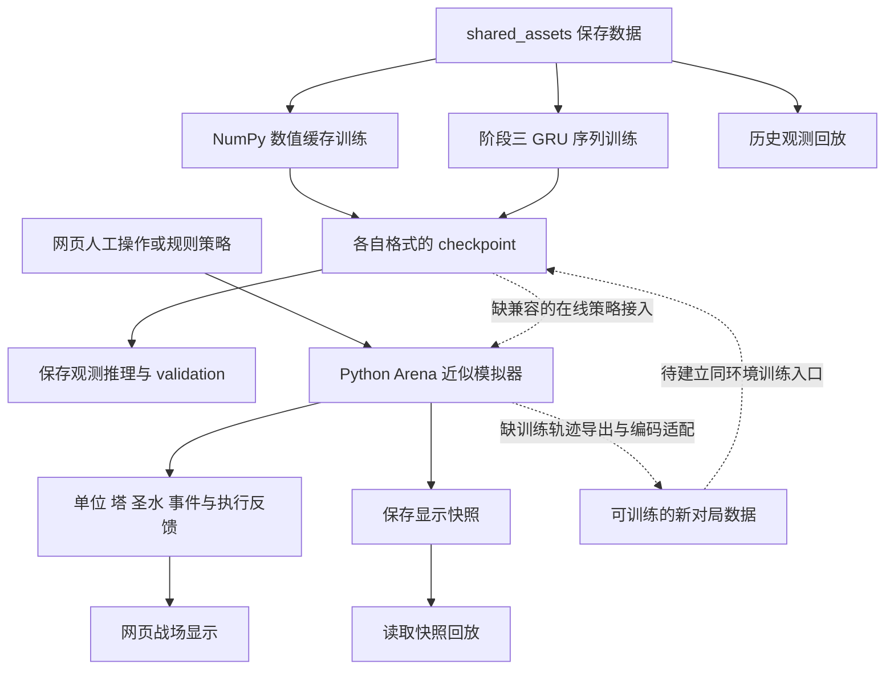
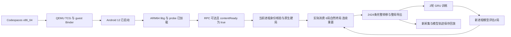
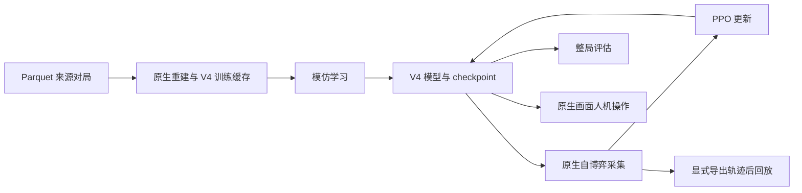
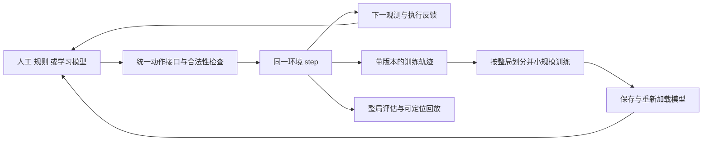

# 当前系统结构与研究闭环差距

2026 年 10 月 20 日，开发分支 `dev/main-start-20261020`。当前已有两条独立路线：网页可人工操作 Python 近似 Arena；原生路线在 Codespaces 软件 Android 内真实运行 ARM64 libg，并完成 **4 场采集→2 轮 GRU 训练→新进程 2 场评估→新轨迹导出／回放**。6/6 自然终局，2424 条转移、202 次控制方消费。网页 Arena 本身仍由规则策略控制，不会因原生 GRU 训练而自动换成学习模型。

这里将“闭环”定义为：同一环境产生观测，学习策略提出动作，环境校验并执行，保存实际转移，用新轨迹训练，重新加载模型回到同一环境，完成整局评估并能回放。人工、规则和模型应能作为同一个环境的可选控制者。

原生资源、严格连接与每一步命令见 [原生闭环指南](NATIVE_LOOP_ZH.md)。[原始报告](../outputs/native_loop_20261020/native-run-002/report.json)的 native_closed_loop_verified=true，[独立验收](../outputs/native_loop_20261020/native-run-002-acceptance/report.json)核对真实状态、终局、重置与新模型身份。当前已停止 VM 降低负载，保存模型与回放可继续使用。普通单位公平可见性、原生画面／浏览器实时控制和棋力提升仍需另验。

两次整个窗口中断后已保留[核查与恢复说明](WINDOW_RESTART_20261020_ZH.md)。现有证据确认远程环境重启，尚不能确定根因，也不能据恢复后的内存采样宣称问题已经修复。

## 当前 Codespaces 连接关系

图中实线表示当前工作台已连接的路径；虚线表示仍需开发的连接。保存样例来自固定版本原生研究路线，网页活动战场来自独立 Python 近似引擎。



原生后端本轮已按以下实线完成小规模运行；保存回放为公开数值示意，原生像素与网页实时原生控制尚未验收。



关键调用及输入输出如下。源码链接对应当前工作区；后续修改可能改变行号。

| 环节 | 文件与函数 | 实际输入与输出 |
|---|---|---|
| 云端入口 | [workspace.py](../tools/cloud/workspace.py#L136) `make_server` | HTTP 请求 → 独立的保存推理、历史回放或模拟器会话；没有给模拟器选择训练 checkpoint 的接口 |
| 数值训练 | [train_cache.py](../tools/cloud/train_cache.py#L65) `train` | 清单指向的 NPZ train/validation 数组 → 新数值 checkpoint、优化与校验报告 |
| 序列训练 | [learning.py](../royale_phase3/learning.py#L372) `train` | 阶段三 metadata/rows、整局分组、编码向量 → GRU 参数、优化器及恢复状态 |
| 保存模型推理 | [workspace.py](../tools/cloud/workspace.py#L76) `infer`、`infer_gru` | checkpoint + 保存的 actor／序列行 → 动作提案；不推进活动对局 |
| 近似环境初始化 | [simulator.py](../tools/cloud/simulator.py#L24) `SimulatorSession.reset` | seed、时限 → `Arena`、新的逐局状态、`GreedyPolicy` |
| 人工动作 | 同文件 `play` | `slot=-1 或 0..3`、tile 坐标、推进秒数 → 本引擎合法性判断、扣费／消费反馈、下一显示状态 |
| 规则对局 | 同文件 `_advance` | 秒数、autoplay → 红方规则行动；autoplay 时蓝方也用规则策略；推进单位战斗 |
| 保存与回放 | 同文件 `save`、`replay` | 活动快照 → 带哈希的 JSONL；run_id/index → 保存显示状态；不能据此恢复或分叉内部引擎 |
| 历史观测回放 | [replay.py](../tools/cloud/replay.py) `ReplaySession` | 既有阶段三行、对局和 owner/index → 塔、手牌、公开历史及未知字段示意 |

当前网页模拟器在 `reset` 中固定创建 `GreedyPolicy`，`_advance` 也只调用它。训练并重新加载新模型的流程真实存在，但它没有改变网页战场的控制策略。

## 仓库中并存的引擎和学习路线

| 目录 | 作用与已有代码 | 当前云端验收边界 |
|---|---|---|
| `royale_ai/` | 12 卡 Python 近似 Arena；旧 [experiments.py](../royale_ai/experiments.py#L12) 能加载 [LinearPolicy](../royale_ai/learning.py#L34)，执行观测→决策→下牌→推进→日志；另有线性模仿训练 | 网页复用 Arena，但没有暴露旧学习策略选择；本轮未新验收旧线性模型训练再对局 |
| `royale_lab/` | 社区 C++ 近似引擎；[CandidateGym 与 train_ppo](../royale_lab/learning.py#L107) 已有交互采样、GAE 和 PPO 更新 | `.venv-cloud` 缺 `clash_royale_env` 编译扩展，不能把历史 PPO 结果写成当前运行成功 |
| `royale_phase2/` | 固定版本 Android 原生 RPC、重建、数值 BC、动作消费证据、人机界面 | 独立离线 APK 与 828 项运行资产已准备，安装已验证；Android、ARM64 库与探针实际运行，内容就绪；实际进程身份、建局、消费、终局与连续重置已验收 |
| `royale_phase3/` | 复用 phase2 后端；公平观测、下牌历史、GRU、规则采集和原生评估 | [native_env.py](../royale_phase3/native_env.py) 与 [native_loop.py](../royale_phase3/native_loop.py) 已连接模型→原生动作→轨迹→训练→新进程评估；本次已完成新模型原生整局评估两场并重新导出 |

不能把新云端工作台的断点推广成“整个仓库没有学习控制代码”，也不能把其他路线中的实现或历史结果算作新工作台已经验收。

原生 GRU 不能直接套到网页 Arena：两者的卡牌 ID、物理和费用版本、坐标方向、时间单位、动作类别及输入向量不同。Arena 为 18×32 tile、蓝方在下；原生路线是 18000×32000 坐标、owner 0 在另一方向，并按 tick 推进。只缩放坐标无法解决这些差异。

## 操作 模拟 训练和回放目前具备的条件

| 能力 | 当前已经可以做 | 还缺的关键条件 |
|---|---|---|
| 操作 | 浏览器选择手牌与落点、等待、检查费用／区域／消费反馈；规则对手推进 | 同界面选择学习模型与实时原生控制仍缺；原生脚本／规则／GRU 动作链已有实际消费证据 |
| 模拟 | Arena 内的单位位置和 HP、移动战斗、塔、圣水、下牌事件与终局／重置 | 近似与原生机制分别记录；固定八卡原生六局已验收，画面／全机制覆盖仍缺 |
| 单位与历史 | 近似战场有本引擎状态；本次原生数据可回看公开消费历史，raw 实体最多 72 个 | 阶段三 fair 当前排除全部非塔实体；unknown 不能补成真实单位或“场上无人” |
| 训练 | CPU 上真实优化 NumPy／GRU，保存、重新加载、validation、GRU 恢复；新增 native-loop 采集→训练→新进程原生评估编排 | 新 native-loop 已实机完成 4+2 有限闭环；网页 Arena 仍未接学习策略，原生 PPO 尚未验收 |
| 轨迹 | 阶段三 native-loop 已实现逐步 action/feedback/next observation、结束语义、整局导出及模型引用；接口测试通过 | 本次新原生轨迹 2424 条；网页快照仍不满足 [data_contract.py](../royale_phase3/data_contract.py#L6)，不能冒充学习转移 |
| 回放 | 历史观测 seek、切视角、快照哈希检查、服务重启后读回 | 不是原生渲染，也不是活动对局 rollback；需将模型、可训练轨迹、整局结果和回放关联 |
| 评估 | 保存观测的 validation 与规则近似对局 | 已完成新模型配对换边两局；更广的配置／对手／失败覆盖与棋力对照仍需专项实验 |

## FirstLight_CR 的结构为什么更接近统一闭环

对照固定提交 [3ade158c](https://github.com/Jaasssoooonnnnn/FirstLight_CR/commit/3ade158c52bf33de3ffcea600ce380946b7de0d8)。以下是源码连接关系；其原生运行、训练和模型强度没有在本 Codespace 复测。



它将初始化和动作推进集中在 [BattleEnvV1.reset/step](https://github.com/Jaasssoooonnnnn/FirstLight_CR/blob/3ade158c52bf33de3ffcea600ce380946b7de0d8/native_runner/battle_env.py#L2341)，把观测／动作集中在 [contracts.py](https://github.com/Jaasssoooonnnnn/FirstLight_CR/blob/3ade158c52bf33de3ffcea600ce380946b7de0d8/native_runner/contracts.py#L2664)，由 [PolicySessionV4.decide](https://github.com/Jaasssoooonnnnn/FirstLight_CR/blob/3ade158c52bf33de3ffcea600ce380946b7de0d8/native_runner/training/v4/policy_session.py#L274) 将统一模型输出解码为可执行动作。实体、历史和循环记忆通过同一张量接口进入模型。

[原生重建 producer](https://github.com/Jaasssoooonnnnn/FirstLight_CR/blob/3ade158c52bf33de3ffcea600ce380946b7de0d8/native_runner/training/v4/producer.py#L295) 生成 IL 序列；[resident 采集后端](https://github.com/Jaasssoooonnnnn/FirstLight_CR/blob/3ade158c52bf33de3ffcea600ce380946b7de0d8/native_runner/training/v4/cluster_self_play.py#L239) 继续使用 BattleEnv；[PPO 训练](https://github.com/Jaasssoooonnnnn/FirstLight_CR/blob/3ade158c52bf33de3ffcea600ce380946b7de0d8/native_runner/training/v4/train_ppo_self_play_cluster.py#L1729) 消费交互 rollout 并保存后续可加载模型。这是当前工作台应学习的接口连接方式。

[整局评估](https://github.com/Jaasssoooonnnnn/FirstLight_CR/blob/3ade158c52bf33de3ffcea600ce380946b7de0d8/native_runner/training/v4/evaluate.py#L20) 和 [人机操作](https://github.com/Jaasssoooonnnnn/FirstLight_CR/blob/3ade158c52bf33de3ffcea600ce380946b7de0d8/native_runner/training/v4/offline_agent.py#L29) 共用模型和环境接口。不过人机渲染会修改下牌执行偏移，不能由接口共用推出逐 tick 时序严格等价。训练轨迹有 [归档接口](https://github.com/Jaasssoooonnnnn/FirstLight_CR/blob/3ade158c52bf33de3ffcea600ce380946b7de0d8/native_runner/training/replay_archive.py#L42)，但 [训练说明](https://github.com/Jaasssoooonnnnn/FirstLight_CR/blob/3ade158c52bf33de3ffcea600ce380946b7de0d8/docs/training.md) 明确训练器不自动为每局保存视觉回放。

这套原生模拟不能直接等同于纯 Python Codespaces 沙盒。[安装条件](https://github.com/Jaasssoooonnnnn/FirstLight_CR/blob/3ade158c52bf33de3ffcea600ce380946b7de0d8/docs/getting_started.md) 包括 Android／MuMu 或具备 KVM 等条件的 AVD、root／ARM64、指定 APK 与游戏更新资源；正式 V4 训练启动器还要求 CUDA／NCCL。当前仓库保留的 FirstLight 固定来源片段也不代表已经集成该提交的整个 V4 平台。

## 当前优先验收的原生闭环

用户后续明确要求原生引擎，因此本轮优先推进项目内软件 Android 后端。门槛依次为：当前进程与全部安装资源的身份回执；同一原生后端建局→动作消费→自然终局→再次 reset；有限采集、整局划分、小规模训练；新进程加载该 checkpoint 后完成原生整局并关联轨迹／回放。命令、预算和每一步回执见 [原生闭环指南](NATIVE_LOOP_ZH.md)。这些门槛本次有限运行已通过；不推广为原生像素、自博弈 PPO 或官方全交互等价。

以下图与任务表保留原审查时对近似 Arena 的备选建议。它可以独立完善网页操作与学习，但不是本轮原生目标的验收替代物；旧 LinearPolicy 只能作为这条近似路线的复用起点。



| 顺序 | 交付内容 | 验收门槛 |
|---|---|---|
| 1 | 统一 Arena 的 reset/observe/step，与人工／规则／兼容学习策略入口 | 同 seed 与动作前缀可复现；合法／拒绝／等待有明确反馈；自然终止和时间截断分开；结束后拒绝继续行动；重复 reset 无跨局状态 |
| 2 | 人工和规则操作同时输出可训练轨迹与可视化快照 | 至少两局不同来源可导出并读回；有 observation、proposed/executed action、feedback、next observation、reward、dt、terminated/truncated、episode/engine/model/version；同局双方不跨 split |
| 3 | 一次小规模同环境模仿学习迭代 | 采集→训练→新进程加载→模型完整自动对局→再采集→validation；日志证明实际控制者是该 checkpoint，动作消费与模型版本能关联；不要求胜率提升 |
| 4 | 网页模型选择及可重复整局评估 | 人工／规则／模型共用接口；固定 seed、换边和对手；每局记录完成／失败／超时及非法动作，结果可定位到轨迹和回放 |

完成以上门槛，才可以称为 Arena 路线的最小研究闭环。若继续对齐 FirstLight 的自博弈训练，还要接入当前可运行后端的 rollout、动作概率、value、reward、GAE、循环状态和终止／截断处理，再建立对手池与恢复机制；不能用离线 BC 的损失下降替代这项验收。

原生路线另需三个门槛：在具备资源的主机验证建局→实际消费→自然终局→再次建局；证明公平单位观测及支持动作范围；统一原生在线轨迹导出和训练。原生数值 RPC 跑通之后，画面渲染或真实设备视觉输入仍需分别验收。

差距应以这些连接和验收门槛衡量，现阶段没有可支持完成百分比或工期承诺的估算。增加 epoch 不能修复接口断点，也不能补齐运行时与观测证据。

## 实际运行证据和当前使用入口

| 证据 | 结果及证明范围 |
|---|---|
| [早期便携测试](../outputs/cloud/tests.json) | 当次保存结果 96 项通过；覆盖已实现的便携功能，不代表当前全部新增代码或原生对局 |
| [11 步 smoke](../outputs/cloud/runs/20261020T100921.745225Z-development-smoke/report.json) | 训练、保存推理、validation、历史回放、独立规则模拟通过；本轮复核 22 个日志哈希均匹配；未证明新模型接管模拟器 |
| [真实浏览器检查](../outputs/cloud/runs/20261020T101021.969322Z-browser-check/report.json) | 5 项通过，页面错误 0；包括人工下牌、终局重置、回放和重启后读回；不含学习模型在线对局 |
| [本轮轻量运行与模块核查](../outputs/architecture_comparison_20261020/local_loop_evidence.json) | status 与 simulator/state 均 HTTP 200，`native_connected=false`，引擎为 Python Arena；Torch/Gymnasium 可用，C++ 扩展缺失 |
| [FirstLight 源码审查](../outputs/architecture_comparison_20261020/firstlight_notes.md) | 固定提交和源码哈希；该次审查未运行其原生引擎、训练或下载模型／APK。本轮后续实际资源配置另见原生指南 |
| [离线候选包实际安装](../outputs/native_loop_20261020/android-install-001/report.json) | `installed_verified=true`；安装身份与内容校验不等于已完成对局 |
| [恢复后 Android 与游戏日志](../outputs/native_loop_20261020/android-display-002/report.json) | Android、ARM64 bridge、libg 与探针实际运行；保留显示焦点和 EGL 异常线索 |
| [原生内容就绪状态](../outputs/native_loop_20261020/android-window-after-confirm-001/report.json) | 12:53 UTC `coldReady/contentReady=true`，`configured=false`、`steps=0`；没有据此宣称提示框因果或对局成功 |
| [窗口中断核查](../outputs/native_loop_20261020/window-restart-audit-001/report.json) | 远程环境重启已观察到，根因未确认；恢复措施不等于崩溃修复验收 |

完整逐步操作见 [远程开发指南](REMOTE_DEVELOPMENT_ZH.md)。当前可在仓库根目录打开已有功能：

```bash
.venv-cloud/bin/python tools/cloud/workspace.py doctor
.venv-cloud/bin/python tools/cloud/workspace.py serve --host 127.0.0.1 --port 8770
```

如果服务已在 8770 运行，直接通过 Codespaces 的 Ports 打开其私有转发地址；进入 `/research` 操作与回放。网页中的活动战场仍为近似 Arena；原生运行、已完成的保存 pilot 训练与本次已验收的原生采集／训练闭环分别见原生指南，不能混用结果。

本次模型轨迹回放服务为 8771，使用 `native-run-002/recollected_dataset/metadata.json`（959 行）；近似 Arena 不等于该原生模型的活动对局。5 类真实浏览器流程在新采集和模型评估两种数据源上通过，见 [模型回放回执](../outputs/native_loop_20261020/browser-model-native-001/report.json)。
