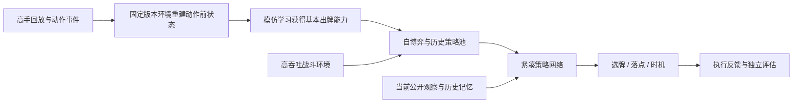

# 2026-11-13：皇室战争 AI 20 胜、榜首事件与实现路线

核查日期为 2026-11-13，结论只覆盖当时能读取的公开材料。已有作者发布以 AI 20 胜为题的视频，Clasher 账号也引发登顶讨论；但账号成绩、实际操作者、模型实现和公开代码的可复现性是不同问题。目前没有足够证据把这些材料拼成同一团队的完整训练与部署方案。

本次没有登录游戏账号、运行在线自动操作、训练新模型或取得本项目的新棋力成绩。来源证据摘要见 [claims 审计](../audits/clash_ai_claims_20261113.json)；上游版本同步见 [同步说明](../UPSTREAM_SYNC_20261113_ZH.md)。

## 事件究竟证明了什么

| 材料 | 能支持的结论 | 仍不能据此确认 |
| --- | --- | --- |
| _水母Jellyfish_ 10 月 30 日 [20 胜最后三把](https://www.bilibili.com/video/BV1XZxi6tEkz/)；11 月 1 日 [38:35 第一视角](https://www.bilibili.com/video/BV1Dxx468ESe/) | 原作者确实以 AI 20 胜为题投稿，并自述短时训练。后者标题称唯一一次输局为断网 | 未独立核对账号挑战胜场、具体模式、完整比赛与后台决策日志，不能认定全程无人接管、完整 20–1，更不能称 20–0 |
| Clasher，标签 `#PLPJP9Y88`；[Boss 视频](https://youtu.be/7AYl-F9OTm8)与社区讨论 | 热议指向这个排位账号；公开统计索引也能交叉确认账号及其当期排位前列记录 | 尚未取得带时间的历史榜首记录或赛季结算第一证据，也未取得可归属号主的完整技术报告与独立操作审计。须按标签匹配，不能只凭同名 Clasher 判断 |
| 小汐酱_ 11 月 10 日 [Clasher 回放](https://www.bilibili.com/video/BV18CWu6MEXf/) | 投稿者说明从 RoyaleAPI 取下牌数据，接入本地回放工具；可用于观察对局决策 | 这是重建回放，不能据画面判断部署端是视觉识别、读内存还是其他接口；投稿者不是由此就成为模型开发者 |
| Vegetable Leaf，标签 `#VPJJYPUJL`；11 月 12 日 [回放](https://www.bilibili.com/video/BV1y9WX6JEFu/) | 是另一个应单列核对的账号；投稿者说明保存了 12 局本地重建回放，部分倍速 | 作者明确不知道该 AI 是否提前读到出牌信息。账号不同不证明团队一定不同；也不能把它和 Clasher 的成绩、源码自动合并 |

今年 20 胜挑战为 10 月 26 日至 11 月 2 日。RoyaleAPI 说明 **17 胜就能获得外观相同的挑战徽章**，真实胜场需另查，不能把一个徽章截图当作 20 胜证据。[挑战说明](https://royaleapi.com/blog/crl-2026-20-win-challenge-details?lang=en)

本次核查了视频元数据、作者简介与文字来源，没有完成全部视频逐帧审查。“尚未独立验证”也不等于判定作者造假。

截至本次核查，未找到针对此事件的可核实 Supercell 个案公告；社区同时存在“已封禁”和“仍在榜上、只是换了部落”的相反说法。[相关讨论](https://www.reddit.com/r/ClashRoyale/comments/1xtytap/the_top_1_player_in_ranked_is_a_ai_account/)

同期流传的 Counterpush 演示也要单列：开发者明确说明它运行在自建版本和网站，不在官方天梯、也不使用真实账号。这些演示不能为 Clasher 的榜首宣称提供身份或成绩证明。[作者说明](https://www.reddit.com/r/ClashRoyale/comments/1xqgs5q/day_7_of_training_my_clash_royale_ai_a_top_200/)

## 公开材料里，他们怎样做 AI

### ClashAI：专家模仿、自博弈与卡牌条件动作

[vegetableleaf/ClashAI 的 README](https://github.com/vegetableleaf/ClashAI/blob/21e28ae2b101a70e7f3a1218d149d343b860b49d/README.md)固定到 `21e28ae2`（11 月 6 日）。作者介绍冰弩控制卡组的训练路线：专家回放模仿学习，再用自博弈强化学习改进。当前公开代码使用 RoyaleSim；部分历史模型使用的其他引擎未随仓库发布。仓库不含训练权重与数据，作者也注明全新安装尚未测试。

模型源码把单位、空间区域和全局信息编码成 token；卡牌身份参与手牌指针和落点预测，落点分布取决于选中的卡，而非所有卡共用一个平均坐标。这解释了专用模型怎样表达“选哪张牌、下在哪里”。不能由一个文件推断所有历史模型均采用同一结构。[model_gen.py](https://github.com/vegetableleaf/ClashAI/blob/21e28ae2b101a70e7f3a1218d149d343b860b49d/pipeline/model_gen.py)

当前 README 声明策略不接收对手真实手牌、下一张牌和精确圣水，圣水来自公开事件估计。这是该公开版本的输入约定，不能替所有历史模型、训练阶段或其他团队背书。

其 [RESULTS.md](https://github.com/vegetableleaf/ClashAI/blob/21e28ae2b101a70e7f3a1218d149d343b860b49d/RESULTS.md)截至 11 月 1 日自报 CLXVI 的 Ranked 为 **64/150，42.7%**；相对上一代提升点估计为 8 个百分点，但区间为 −3 至 +19 个百分点，尚不能确认提升成立。这份公开结果不是 Clasher 榜首或 20 胜的证明，也不能外推为某个新版本的胜率。

### Lvx_Seraph：原生无头环境与专用时序网络

另一位作者在 [10 月 19 日原帖](https://linux.do/t/topic/3046165)自述：从 4B Qwen 加决策头转向 CNN 空间编码、Entity Attention、Temporal Transformer 和自回归动作头；约 2.95 亿有效状态帧做模仿学习，随后 PPO＋GAE，通过自对战、交叉对战和困难局采样训练。环境通过 ARM64 `libg.so` 战斗逻辑接入无头宿主，按 tick 推进并行采样。

这些是作者的技术自述，本次没有源码、权重或独立运行结果来复现其规模和效果；状态帧数也不等于独立对局数。作者链接的 [实战视频](https://www.bilibili.com/video/BV1SZnJ6oEi3/)与水母投稿账号不同，尚无证据把它归为 Clasher 团队。使用原生库本身也不能证明不同版本、宿主和官方在线战斗完全一致。

### 为什么这种路线可能比直接让通用模型看屏幕有效

以下是对上述不同材料的工程归纳，**不是已核实的 Clasher 内部方案**：

1. **环境决定练习速度和学到的规则。** 无头环境可以省去画面渲染与等待真实时间的成本；但若机制错了，策略可能只是学会利用模拟器偏差。
2. **模仿学习减少从零摸索。** 先学习合理出牌，再通过对战调整。回放必须在动作发生前形成输入，不能偷看未来命令。
3. **专用动作空间减少无效选择。** 模型直接输出手牌、位置和时机；历史记忆用于估计敌方轮转和资源，而不是假定未知信息已知。
4. **卡组专精降低任务难度。** 一套牌的优秀表现不能自动扩展为全卡组通用能力，评估要写清卡组、对手和版本。
5. **执行快只是其中一环。** 胜负还取决于策略质量、环境一致性、延迟及动作是否实际被消费；视频里的快速连续下牌不能单独证明作弊或超人策略。

## 对当前仓库的含义

本项目已有三个不能混用结论的层次：`royale_ai/royale_lab` 近似基线、`royale_phase2` 固定版本原生平台、`royale_phase3` 研究代码。当前科研工作台注册的是 **GRU C 小样本序列行为克隆**，不是已完成大规模自博弈的在线 RL 系统。11 月 7 日两局原生模型评估的自然终局和 90 次消费只证明执行链可用，不能当作竞技强度。[当前研究指南](../../research/README.md)

最值得吸收的是训练与证据链，而非直接复制一个网络名称：

- 先补足固定版本的整局动作与战场状态，保留来源和质量标签，按整局划分训练、验证、测试。
- 在已有公开观测、belief、GRU 和卡牌条件落点上做共同数据对照，再判断实体注意力和 Transformer 是否值得增加。
- 环境吞吐、卡牌兼容、动作消费和重建误差通过后，再接 PPO 与历史策略池；近似引擎实验仍单列。
- 独立对局评估记录胜负、无效动作、未知反馈、延迟与置信区间。没有官方 20 胜或榜首验收，就继续报告未知。

这些是本次分析提出的后续方向，本轮只完成上游同步审查与资料核查，没有把路线建议记作已实现功能。
