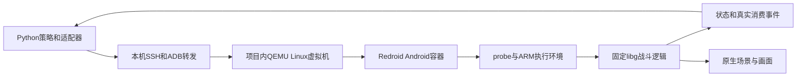

# 皇室战争项目零基础学习与讨论指南

今晚的目标是能解释一次真实下牌从哪里来、怎样执行、凭什么相信数据，以及下一步应该改善什么。先掌握这条链，再读论文和全部源码。项目目前的主要价值是搭起固定版本原生环境与可追溯学习闭环；策略强度仍处于很早的阶段。

本指南依据2026年10月15日保存的验收产物、10月18日实际源码与报告回读。今天执行的是只读核对，没有重新启动原生对局或重跑全部A–I。可运行的摘要工具是 `tools/phase2_discussion.py`，新生成的证据摘要在 `outputs/discussion/2026-10-18/evidence_summary.json`。

## 你首先要能说出的项目定位

可以这样介绍：

> 我想研究皇室战争中根据局势自动决策的AI。现在先搭建了一个固定版本的离线原生战斗研究平台：把公开回放动作转换成原生命令，记录执行结果，筛选训练轨迹，再训练一个最小策略并让它实际下牌。当前策略只允许等待、火球和万箭，主要验证数据和执行闭环。下一步重点是恢复可见单位、扩大到完整卡组、改进等待与出牌的不平衡，最后评价真正的对战能力。

用这四个问题组织讨论：为什么需要可靠环境；环境如何产生可信数据；策略如何从观测输出动作；目前哪里不足、准备怎样验证改进。

## 两小时学习顺序

| 时间 | 实际做什么 | 完成标准 |
| --- | --- | --- |
| 0至15分钟 | 阅读本指南的项目定位和三套代码，运行摘要工具 | 能说出第二阶段入口以及引擎和策略的区别 |
| 15至35分钟 | 阅读原理与两条闭环，把调用链画在纸上 | 能说出观测、动作、原生推进、反馈四步 |
| 35至55分钟 | 跟随真实万箭例子，对照源码和证据 | 能解释注册成功为什么不等于下牌成功 |
| 55至75分钟 | 看训练原理、样本分布和实际结果 | 能解释99%准确率为什么仍可能完全不会出牌 |
| 75至95分钟 | 播放现有录像，运行只读操作命令 | 能展示画面、一条实际动作和结果范围 |
| 95至110分钟 | 挑选一个下一阶段问题与对照实验 | 能说明改哪里、测什么、怎样判定改善 |
| 110至120分钟 | 不看文档口头讲一遍讲稿，回答自测 | 能在8分钟内说清项目，不把未知说成已实现 |

只有30分钟时：先读定位、结果表、万箭例子和未来优先级；运行摘要；看两段录像的一小段；练习30秒简介和常见追问。不要在临近讨论时开始重装运行环境或长时间训练。

## 三套代码分别代表哪一阶段

| 目录 | 定位 | 今晚怎么使用 |
| --- | --- | --- |
| `royale_ai` 与 `baseline/mvp_v0_1` | 最初MVP与保留基线 | 了解项目演进即可 |
| `royale_lab` 与根目录 `README.md`、`docs` | 第一阶段研究平台，社区C++近似引擎，已有规则、搜索、BC、PPO等实验 | 可讨论算法原型，但其胜率与规则不能移植为第二阶段结果 |
| `royale_phase2` 与 `phase2`、`phase2.ps1` | 本轮固定版本原生路线，公开回放重建、证据筛选、受限BC、原生画面 | 今晚的主线 |

`start_demo.ps1` 和端口18765指向第一阶段近似平台；`phase2.ps1 view serve` 和端口8766指向第二阶段原生画面。两者都能演示，但要先说清是哪一个。

研究资料目录 `docs/research` 跨阶段可用；其中旧代码学习路径主要介绍 `royale_lab`，阅读时不要把它当第二阶段源码地图。

## 原理从状态和动作讲起

### 游戏引擎负责世界如何变化

引擎接收当前状态和双方动作，计算下一个状态。状态包含单位位置、血量、目标、攻击冷却、双方手牌与费用、塔和终局等。

可以写成 `s(t+1) = T(s(t), a我(t), a对手(t))`。`T`就是游戏转移规则。兵种如何移动、目标如何切换、伤害如何结算都在这里发生。AI策略负责选择动作，引擎负责执行并计算后果。

第二阶段没有用Python重写全部卡牌交互。它运行固定第三方Android客户端内的ARM64 `libg.so` 战斗逻辑，由probe调用其建局、下牌和推进接口。客户端build为15.535.13，content为15.535.86。

实际运行关系：



这里的QEMU提供Linux环境，Redroid提供Android环境，ARM翻译层让ARM64库在当前主机路径中执行，SSH和ADB转发只负责本机通信。probe是接入原生函数的桥梁。它们都不是策略网络。

本地库来自固定第三方客户端，probe存在hook和适配补丁。文件身份和内部机制测试为可复现提供基础，但没有独立官方逐帧对照，所以不能据此声称与官方服务器所有交互完全相同。

### AI看到的观测少于引擎掌握的状态

实际策略接收 `o(t) = O(s(t), 玩家视角)`。对手手牌、精确费用和未来动作属于隐藏信息。皇室战争因此适合用部分可观测决策过程POMDP理解：策略应根据当前可见信息和历史来判断隐藏状态。

当前代码里的actor仅包含：己方当前手牌和费用、己方圣水、公开tick与皇冠、经初始化确认的六塔状态。它没有接入非塔战场单位的位置和种类，也没有历史记忆网络。

这意味着，当前模型还不能完整理解“对手桥头下了一只野猪，该用哪张兵种防守”。引擎里有单位，画面里也能显示单位，但策略没有读取这些可见单位。这是下一阶段的核心缺口。

原生回放画面可能展示双方手牌，这属于观看或调试视图；模型输入来自独立的白名单投影，当前没有把整张屏幕交给视觉模型。

### 动作包括选牌和坐标

完整目标可以表示为 `a = WAIT` 或 `(卡牌/槽位, x, y, 出牌时机)`，技能另有准备条件。

目前严格策略只允许WAIT与普通火球、万箭；普通卡ID分别为28000000和28000001。内部可重放更多卡，但它们没有全部进入策略的合法动作空间。

决策头有5个类别：0为WAIT，1至4为四个手牌槽。法术落点由两个连续输出给出，再映射到原生请求坐标：x为0至17999，y为0至31999。这个坐标是引擎世界中的请求位置，不是截图像素，也不一定等于最终命中点。

合法动作mask会屏蔽当前不能选择的槽。它结合己方手牌、费用、命令准备状态与已核验的两类法术规则。付得起只是一项条件，不能自动证明所有建筑、兵种和技能的落点都合法。

一次tick是50ms，即引擎20Hz。当前G评估每20tick决策一次，即每1秒原生时间决策；训练记录采用grid5，即0.25秒采样。tick速率与AI决策频率要分开解释；训练和执行频率不同也是后续要控制的实验变量。

## 项目有两条闭环

### 回放重建闭环

```text
公开回放动作和可用配置
→ 转换owner、卡牌ID、时间和坐标
→ 选择明确记录的初始化假设
→ 重置固定原生环境并按时提交动作
→ 获取原生状态、消费事件和终局
→ 比较并筛选轨迹
```

公开回放不一定带原始build、隐藏seed或准确初始牌序。项目用公开动作序列约束一组可运行的初始配置，而不是找回了原始服务器内存。不能利用最终输赢反向调参后再宣称独立复现；未知字段应保留未知。

所谓离线重建，是在本机固定环境中重新执行动作，并检查它是否完整执行、结果是否与来源可用字段一致。播放已有视频本身不会产生可用于训练的动作反馈。

### AI决策闭环

```text
reset得到己方观测
→ 重新计算合法mask
→ 保存的策略根据观测预测动作
→ backend调度原生命令
→ libg推进并产生消费事件
→ 新观测、奖励和终局反馈
→ 下一次决策
```

伪代码：

```python
observation, info = env.reset(seed=seed)
while True:
    actor = env.actor_observation()
    mask = env.legal_mask()
    action = policy.predict(actor, legal_mask=mask)
    observation, reward, terminated, truncated, info = env.step(action)
    if terminated or truncated:
        break
```

`terminated`表示原生自然终局；`truncated`表示超过时间或步数等外部限制。后者不能算自然打完。这个接口支持未来RL接入，但第二阶段当前策略训练是BC，没有完成强自博弈RL。

本项目的执行策略是本地NumPy小网络，不是每秒调用一次GPT。Codex协助了工程构建；运行中的策略与写代码的助手是两个角色。

## 用一条真实万箭说明下牌过程

执行：

```powershell
Set-Location -LiteralPath 'D:\研究生\Clash Royal'
.\.venv-phase2-core\Scripts\python.exe -B tools/phase2_discussion.py --example
```

它只读取已保存证据，不连接原生服务。案例来自通过G的第0局：

1. 观测发生在tick90；owner0有7.602费，槽2是费用3的万箭。
2. 合法mask为`[true, false, false, true, false]`：允许WAIT或槽2。
3. 保存的策略variant选择万箭，请求坐标为`(8875, 18857)`。
4. tick90注册调度，安排tick91执行。
5. scheduler反馈注入成功；原生CardPlay事件为`[453, 91, 0, 28000001, 3]`，分别表示事件序号、tick、owner、卡牌ID、消费费用。
6. 反馈记录`card_consumed=true`，并在保存的raw states里找到同一事件。到tick110读取后续状态时，原万箭槽已换成另一张卡。

因此要区分三个阶段：请求已登记、命令已注入、卡牌实际消费。日志打印“我准备出万箭”只证明预测，不能证明游戏执行了它。

为什么费用前后差不是整3费？tick90费用raw为76020，tick110为49580；这20tick里同时有圣水回复。需要结合消费事件、时间与手牌变化判断，不能只用一次费用差作证据。

对应证据：`outputs/phase2/native/agent_eval/acceptance-008/game-000/decisions.jsonl`、`execution_feedback.json`、`states.jsonl`。完整摘要工具保留这些文件的SHA256以及真实事件查找结果。

## 数据何时可以用于学习

| 质量维度 | 它在检查什么 | 不能推出什么 |
| --- | --- | --- |
| parse_valid | 结构与事件能解析 | 引擎执行成功 |
| runtime_replayable | 全部输入有消费确认且自然终局 | 官方时序相同 |
| deterministic | 相同初始化与动作在多次独立reset后得到相同暴露语义 | 规则与官方一致 |
| outcome_consistent | 来源可用胜者、皇冠、塔血等结果吻合 | 所有中间位置和伤害吻合 |
| trajectory_validated | 有独立时序参考并完成比较 | 未覆盖组合也自动正确 |

当前独立官方时序参考为0，相关维度保持`not_available`。本项目中的hard-E是内部严格操作兼容门的名称，不能把它解释成官方黄金轨迹。

训练还要求源等级无损、版本锁相同、先观测后执行、标签与唯一原生消费对应、当前手牌完整、动作在已证明的子空间内。对不满足要求的行保留诊断用途，默认不纳入严格训练。

等待标签来自采样网格：这段时间来源没有本方动作，就生成sampled WAIT。它并不证明玩家明确选择了等待，也可能包含决策前延迟。其他不支持卡牌的动作不能改标为WAIT。

train、validation、test按整个来源局及其泄漏组切分；同局的切片、换边和重复执行不能跨集合。三次原生reset主要用来验证确定性，只取预声明的一轮训练，不能把三轮复制成三倍独立样本。

这里的formal100是固定回放重建审计分母，其中一份后来进入学习训练补充；不要把“formal”误解为从未参与任何开发或训练的纯策略测试集。

## BC模型到底学了什么

BC即行为克隆：给模型一个观测，要求它预测示范中的选牌和请求坐标。它没有通过终局奖励主动搜索最优策略。

当前模型：304维观测特征 → 64维tanh隐藏层 → 5类槽位头 + 2维sigmoid坐标头。输入包括手牌one-hot、费用、己方圣水、塔血、tick等。词表只来自训练来源，测试未知牌使用UNK。

损失由加权分类交叉熵、仅出牌样本上的坐标均方误差和L2正则组成，可概括为：

```text
损失 = 选牌分类误差 + 2 × 出牌落点误差 + 权重正则
```

模型参数不是伤害和费用规则；改变网络不会改变libg怎样计算万箭伤害。训练需要重新计算数据与版本指纹，不能把另一个引擎训练的权重直接当同版本验证结果。

原始训练数据严重偏向WAIT。标准checkpoint在测试集总准确率99.46%，但出牌召回率0；因为1661条测试记录里有1652条WAIT，只输出WAIT也能得到同一准确率。

后续候选提高了稀有出牌槽的损失权重。最终G使用variant，另外保存`inference_play_bias=4.0`：在合法出牌类别的log概率上加4，再做argmax；相对于WAIT，其排序分数乘上约`exp(4)=54.6`的因子，再比较。这是明确的推理先验，会促使出牌，但不说明落点或时机更优。

需要正确引用评估范围：`heldout_evaluation.json`属于原始checkpoint；variant元数据的metrics来自普通forward/argmax，代码中的`metrics()`没有套用这个bias。因此不能把它们直接描述为最终variant推理规则的独立留出指标。下一阶段应统一训练后推理、离线评估与原生评估的同一规则。

## 结果应该怎样向同学表述

| 已保存结果 | 正确解读 |
| --- | --- |
| A–I验收报告全部pass | 满足当前阶段定义的工程门；不是策略或官方忠实度的统一分数 |
| formal100全部记录，runtime pass10、fail90 | 100局都有成功或失败记录；完整重建确认率为10/100，失败仍是主要问题 |
| outcome pass63 | 与其他质量维度可重叠；不能算63局完整重建成功 |
| 学习cohort18来源各3轮，共54次尝试，16来源重复性pass | 重复确定性与完整复现是不同门 |
| 26,068条导出行，18,440条hard-E | 有诊断行与过滤行；合格行只来自12个来源局 |
| train/validation/test为13,431/3,348/1,661 | 合格来源为9/2/1局，样本行多不等于独立局数多 |
| 合格标签18,388 WAIT、52出牌 | 约99.72%是WAIT；52次出牌才是当前直接的选牌监督规模 |
| G有10局自然终局、14次真实模型消费 | 在选定seed、spell-first夹具、heuristic对手和带bias策略下，执行闭环成功 |
| 该G批次按当前winner-owner编码统计0胜10负 | 十局通过不代表赢了十局；当前棋力明显不足 |
| F有181帧、5个headless/rendered语义锚点相同、两段原生MP4 | 证明该场景的画面与同环境计算相互绑定，不是官方视频逐帧等价 |
| atomic约1.67倍加速 | 同一开发回放下完整管线的两种通信配置比较，不是多实例扩展结果 |

这张表适合今晚随身看。最有价值的结论是：平台能把策略动作连到真实计算和证据，但要提高策略，需要先解决观测、动作覆盖与数据分布。

## 操作先从已有证据开始

### 不启动虚拟机的十分钟演示

在PowerShell运行：

```powershell
Set-Location -LiteralPath 'D:\研究生\Clash Royal'
$env:PYTHONUTF8='1'
$env:PYTHONDONTWRITEBYTECODE='1'
.\.venv-phase2-core\Scripts\python.exe -B tools/phase2_discussion.py
.\.venv-phase2-core\Scripts\python.exe -B tools/phase2_discussion.py --example
.\phase2.ps1 doctor
.\phase2.ps1 view plan
```

10月18日已实际执行这些摘要/只读入口及evaluate帮助入口。`doctor`是环境清点，输出里的原生验证false不能覆盖旧实验，也不证明当前VM已运行。

用资源管理器打开以下文件：

- [原生录像第一段](<D:/研究生/Clash Royal/outputs/phase2/viewer/acceptance-001/rendered/part-001.mp4>)
- [原生录像第二段](<D:/研究生/Clash Royal/outputs/phase2/viewer/acceptance-001/rendered/part-002.mp4>)
- [一张原生战斗截图](<D:/研究生/Clash Royal/outputs/phase2/viewer/acceptance-001/rendered/frames/000098-tick002000.png>)
- [本轮验收报告](<D:/研究生/Clash Royal/outputs/phase2/acceptance.json>)

这两段录像来自43条来源动作的回放重建，是画面与控制证据；不要把它们称为刚刚展示的两法术AI自主作战录像。要证明AI实际下牌，用G的decisions和消费反馈。

推荐演示顺序：用半分钟介绍目标；播放20至40秒画面；运行摘要展示范围；展开万箭案例；最后用0胜10负与WAIT分布引出改进方向。

### 需要现场交互时的原生启动流程

下面是现有本机环境的恢复步骤。10月18日本次学习准备没有再次冷启VM；操作时以真实SSH、Android boot及probe结果为准。若准备时间紧，直接采用录像和证据演示。

先确认没有另一个viewer、batch或agent占用26789；一个原生实例只能有一个控制器。不能因为传了`--exclusive-runtime`就认为其他程序会自动退出。

```powershell
# 启动项目内隔离虚拟机；已有VM时不要重复启动。
.\.venv-audit\Scripts\python.exe tools/phase2_secondary_vm.py qemu-start --accel whpx --isolated

# 等SSH可用后启动Android，确认getprop输出为1。
.\.venv-audit\Scripts\python.exe tools/phase2_secondary_guest_probe.py --label discussion_android --command 'sudo phase2-android-start; adb connect 127.0.0.1:5555; adb -s 127.0.0.1:5555 shell getprop sys.boot_completed'

# Android就绪后启动现有App并建立ADB转发。
.\.venv-audit\Scripts\python.exe tools/phase2_secondary_guest_probe.py --label discussion_app --command 'adb -s 127.0.0.1:5555 shell am start -n nullsroyale.rel.free/com.supercell.clashroyale.GameApp; adb -s 127.0.0.1:5555 forward tcp:26789 tcp:26789'
.\.venv-phase2-core\Scripts\python.exe tools/phase2_secondary_guest_tunnel.py --port 26789
.\phase2.ps1 probe-status
```

`probe-status`需显示可达、内容就绪，headless用于非渲染回放。不可达时依次检查VM、SSH22225、Android5555、App和ADB转发、SSH26789隧道。不要因为没连上就重装依赖或修改已锁定的版本。

创建新输出目录名称后启动原生回放观看器：

```powershell
$discussionStamp=Get-Date -Format 'yyyyMMdd_HHmmss'
.\phase2.ps1 view serve --exclusive-runtime --restore-headless --record --output "outputs/phase2/viewer/discussion_$discussionStamp"
```

打开命令打印的本机URL，默认`http://127.0.0.1:8766/`。演示开始、暂停、单步+1tick、定量推进和旁路HUD。这个viewer回放模式预登记来源journal，生成0训练样本。关闭使用Ctrl+C；`--restore-headless`会重启App，原渲染对局不会保存为内存快照。

### 之后自己运行一次重建或模型闭环

以下命令需要先结束viewer并确认原生headless就绪，输出必须新命名：

```powershell
$discussionStamp=Get-Date -Format 'yyyyMMdd_HHmmss'
.\phase2.ps1 replay 85c0a48b6a1d47cc8057710e05bf7773 --grid-ticks 10 --output "outputs/phase2/manual/discussion_$discussionStamp"
```

看新目录 `episode.json` 的quality/failures，再查看actions、states、decisions、wire。同一场有错误时保留目录，使用新的attempt或名称，不覆盖旧证据。

复跑原G受限夹具，可使用：

```powershell
$discussionStamp=Get-Date -Format 'yyyyMMdd_HHmmss'
.\phase2.ps1 evaluate --checkpoint outputs/phase2/learning_pipeline/model_g_variant/checkpoint.json --episodes 10 --seed-list '20002,20001,20004,20005,20006,20007,20008,20009,20010,20011' --spell-first-deck --step-ticks 20 --opponent-interval 20 --max-tick 7200 --max-wall-seconds 180 --output "outputs/phase2/native/agent_eval/discussion_$discussionStamp"
```

这复核选定夹具的可重复执行，不产生新的无偏棋力结论。未来策略比较必须另用预先冻结且不按模型出牌结果筛选的测试来源和seed。

## 只读八个代码入口就能跟上原理

| 阅读顺序 | 文件和函数 | 看懂后应该能回答 |
| --- | --- | --- |
| 1 | `royale_phase2/agent_env.py` 的reset、step | 一次AI决策怎样推进引擎，谁控制对手，何时结束 |
| 2 | `royale_phase2/visibility.py` 的project_actor | 引擎知道什么、策略实际能看到什么 |
| 3 | `royale_phase2/learning.py` 的actor_features、forward、predict | 特征如何进入网络，mask和bias在哪里生效 |
| 4 | `royale_phase2/backend.py` 的reset、schedule_card、advance_exact_ticks、execution_feedback | 请求如何提交，真实消费怎样确认 |
| 5 | `royale_phase2/reconstruction.py` 的reconstruct、align_initial_deal | 公开回放怎样进入原生环境，初始化缺失怎样处理 |
| 6 | `royale_phase2/trajectories.py` 的adapt_native_reconstruction、convert_episode、export_episodes | 哪些行进入训练，哪些被隔离 |
| 7 | `tools/phase2_evaluate_native.py` 的evaluate | 十局通过判据与胜率为什么不同 |
| 8 | `royale_phase2/viewer.py` 的ViewerSession、validate_viewer_evidence | 画面、时钟和raw证据如何相互关联 |

今晚不必先读大型probe的全部C++偏移和hook。先从`NativeAgentEnv.step`向下跟一条动作，在万箭案例找到相同request ID，再向上看网络为什么输出这个动作。

## 未来改进先定实验再选算法

### 优先恢复可见单位并覆盖完整卡组

当前actor不含非塔单位，动作又只允许两法术，策略经常看不到威胁也没有完整反制手段。先选少量容易审计的兵种和建筑，核验实体原型、owner、位置、血量、可见性与部署规则，再扩大到固定8卡组。不能直接把debug_state全部接给模型，也不能仅用费用mask代替全部落点规则。

新验收应包括：可见单位字段与原生帧/原型对照；敌方私有字段扰动不改变观测和动作；兵种/建筑真实消费和部署确认；模型能连续出牌并完成至少一轮卡组循环。再比较塔血损失和真实胜率。

### 优先改正训练分布与决策时机

18,440行中只有52条出牌，直接增大模型会继续面对非常稀疏的监督。扩大合格独立来源、按source/group冻结切分，研究事件附近采样与WAIT降采样、分层“是否出牌→选牌→落点”、训练与执行网格一致性。降低WAIT数量时仍保留真实时间间隔，不把真实需要等待的情形全部删除。

比较四个模型：始终WAIT、当前BC、重新采样BC、重新采样加分层决策。保持同一卡组、观测、决策网格、训练来源和测试来源。报告play precision/recall、卡牌正确率、落点误差、每局真实消费、闲置/锁定比例和完整对战结果。

如果调整了推理bias，离线评估必须调用相同推理规则并使用验证集合定参数，最终test只报告一次；不能把对test的反复调参当独立验证。

### 加入历史和对手建模

先恢复公开出牌事件和可见单位，再维护已见卡牌、轮转候选和敌方费用区间。可用显式信念、GRU/LSTM或Transformer记录历史。敌方费用应是估计区间或分布；调试日志里的精确值只用于离线核验，不能成为策略输入。

实验可以比较同一可见观测下有无历史的策略；用oracle作上限时单独标注，不能与可部署策略混为一类。

### 环境和动作可靠后再做RL与搜索

BC提供初始策略，RL通过实际rollout和奖励改进。可先做固定卡组、终局胜负奖励的短实验，再研究塔伤等密集奖励的副作用；自博弈需要保留历史对手池，防止只会克制单一heuristic。

搜索需要能从同一状态分叉或恢复。当前原生路线没有通用snapshot/restore；可以按已验证初始化和journal重放，但应测量成本，不能直接假设已经能高效MCTS。第一阶段有搜索实现，也不能据此宣称第二阶段已经有同样能力。

### 独立忠实度与规模化另外立项

要证明更接近真实游戏，需要已知版本与可比初始条件的独立录像/状态锚点，比较时间、伤害、目标切换等。headless/rendered自对照只能证明当前两种运行模式一致。多实例则需要独立Android进程、端口、文件和资源隔离，不能给单个共享实例增加worker就称并行。

## 适合向同学提出的三个研究问题

1. **增加可见单位与完整8卡动作后，简单规则策略能否在相同固定原生环境中显著超过当前两法术BC？** 先检验观测和动作覆盖对性能的影响。
2. **在独立来源划分不变时，事件采样或分层决策能否提高出牌召回且减少空放？** 同时看precision、费用利用与完整局结果，不能只优化recall。
3. **在可见事件足够可靠时，历史记忆是否改善对手轮转与费用估计，并转化成更好的防守结果？** 用对照组和同种子换边比较，报告足够多独立局而不只报挑选的成功案例。

今晚建议聚焦第一个或第二个问题。它们都有明确缺口、改动入口和评价方法，比直接说“换一个更大的模型”更容易形成可验证项目。

## 常见追问和回答

**为什么不用直接自动操作官方账号？** 研究目标是本地可重复训练和批量数据生成；当前使用隔离的固定本地环境，不依赖线上账号或匹配。线上自动化并不是本阶段的运行路线。

**这算私服吗？** 可以说借鉴了固定第三方客户端与原生接入方式，但交付的核心是本地战斗研究环境，没有搭建完整账号、大厅、社交与线上匹配服务。私服能登录不代表战斗逻辑能用于训练，必须具体看谁负责计算。

**与官方是不是完全一样？** 当前运行固定客户端的原生逻辑和匹配资源，做了内部机制与重复性验证。来源版本与初始真值仍有缺失，也没有独立官方逐帧参考，因此目前不做完整等价声明。

**模型真的根据对手下牌判断局势了吗？** 当前actor尚缺非塔单位与历史事件表示，策略只用己方手牌/费用、塔血等保守特征，完整战场理解还没实现。这正是下一步的重点。

**为什么十局都通过却全输了？** G检查能否加载保存模型、合法提交、确认真实消费并自然结束；胜率不是它的通过条件。只会两法术也无法形成完整卡组攻防。

**为什么WAIT准确率这么高？** 采样间隔里无动作占99.72%，大多数标签就是WAIT；需要单独评价真实出牌，并用始终WAIT作为基线。

**网上大量回放可以直接拿来训练吗？** 动作序列不是完整训练轨迹。必须恢复对应观测、版本/配置，处理初始化未知，并用原生反馈核对标签。不能把未来信息或对手私有状态喂给actor。

**是不是已经实现强化学习？** 第一阶段近似平台有PPO等实验，第二阶段实现了可供未来RL调用的环境接口，当前正式学习是BC和显式推理先验。讲结果时要说明阶段。

**你做出的贡献在哪里？** 现阶段是固定原生环境、动作/状态/画面接入、回放重建、质量隔离和训练评估闭环的工程整合。更强策略和有外部效度的实验结论仍待研究；不把整合工程称为新算法。

**今后先改哪三个文件？** 单位观测先看`visibility.py`；动作与循环先看`agent_env.py`和`trajectories.py`的合法性契约；数据/网络/推理先看`learning.py`。每次变更都要检查来源切分、mask和原生反馈。

## 讨论前自测

合上文档，用自己的话回答下面八题。答不出就只重读对应部分，不急着继续看更多论文。

1. 引擎和策略各负责什么？第二阶段谁计算伤害？
2. 画面里有单位，为什么当前模型还不能完整判断野猪进攻？
3. WAIT、手牌槽、请求坐标与决策间隔分别是什么？
4. 一条动作从注册到消费要看到哪些证据？
5. 为什么回放初始化假设不能当作原始服务器真值？
6. 为什么18,440行不等于18,440次出牌或18,440个独立局？
7. 十局工程成功和0胜10负分别说明什么？
8. 你准备改哪个模块，用什么对照实验判断改善？

如果这八题能连续讲明白，今晚已足够开展有质量的项目讨论。

## 后续一周的学习与复核

| 阶段 | 动手任务 | 阅读 |
| --- | --- | --- |
| 第1天 | 跟踪真实万箭例子，从actor到CardPlay | 本指南、`agent_env.py`、`backend.py` |
| 第2天 | 列观测字段，写出哪些缺失单位信息必须补齐 | `visibility.py`，本地action masking论文 |
| 第3天 | 按来源统计WAIT/PLAY和合法机会，明确重新采样设计 | `trajectories.py`、`learning.py` |
| 第4天 | 统一bias前后评估规则，建立基线与实验表 | `metrics()`、`predict()`、评估脚本 |
| 第5天 | 核验一种兵种和一个部署区域，扩大动作空间 | 原生机制夹具与可见性反例 |
| 第6至7天 | 冻结新测试来源与seed，运行对照并整理失败局 | 本地DRQN/POMCP方法，研究是否确需记忆 |

论文今晚最多看三类：SEAT了解游戏AI问题背景；action masking理解合法动作；DRQN或POMCP理解隐藏信息和历史。项目文献导航在[研究索引](<D:/研究生/Clash Royal/docs/research/INDEX.md>)，先看方法与实验条件，不把论文效果当本项目已复现结果。

进一步操作查[快速入口](<D:/研究生/Clash Royal/phase2/QUICKSTART.md>)；原生实现查[原生指南](<D:/研究生/Clash Royal/phase2/NATIVE_ENGINE_GUIDE.md>)；资料质量查[数据审计](<D:/研究生/Clash Royal/phase2/DATA_AUDIT.md>)。部分早期专题文档保留“待运行”的历史文字，当前结论以具体实验产物和本轮证据摘要的范围为准。
