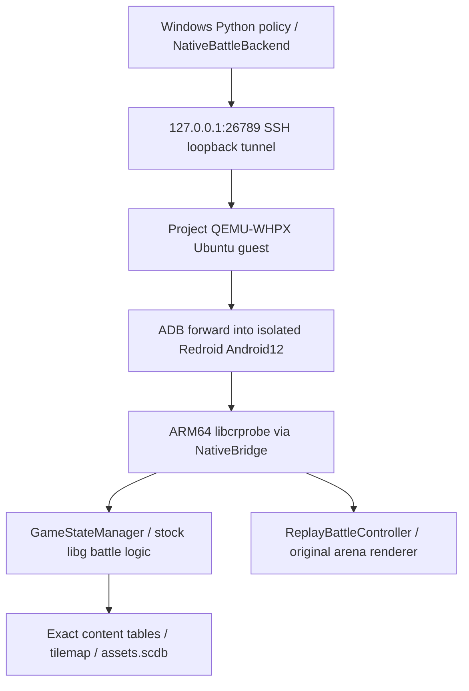

# 原生引擎从零阅读与故障定位

本章解释已经实际运行的固定原生路线。入口证据是`outputs/phase2/native/match_probe/runtime86_first`的逐条wire、完整state和终局；库文件存在、Android启动或端口连通都不能单独证明战斗成功。所有命令从项目根目录执行，项目内VM、缓存、签名和游戏资源不应混入对外分享包。

## 先分清各层做什么



Python适配器负责版本检查、动作排队、推进与证据，不重新实现移动或伤害。真正计算战斗的是APK内ARM64 `libg.so`。Windows不能直接加载该AArch64/Bionic ELF，所以使用项目内Linux VM和Android NativeBridge。第一阶段C++近似引擎没有参与此路线。

这是固定第三方客户端的本地研究构建，不表示官方线上版本已经得到验证。`libg.so`文件SHA精确匹配封装器支持值，但probe会在进程内安装hook/trampoline、render门和已审计的translated SHA兼容跳过点；不能把磁盘文件哈希相同描述成运行时内存完全未修改，更不能直接推出官方轨迹一致性。

## 版本由哪些东西共同决定

`data/phase2/version_manifest.json`锁定APK/逻辑库/probe、242项上游资源来源、完整651项更新delta、catalog和数据版本。当前client15.535.13、content15.535.86，native tick20Hz。准备环境、端口与隔离命令详见`SECONDARY_AUDIT.md`；实际组件身份见`outputs/phase2/native/runtime86_adb_identity.json`。

完整公开APK哈希与上游旧APK不同，但libg和159个基包组件分别精确匹配；更新83项也精确匹配。不能只把旧expected SHA换成下载到的SHA后说整包验证通过。fingerprint下载表示中的`\/`转义与原版表示不同，保留原件及严格JSON等价/精确e0cb重建证据后才使用支持的字节表示。assets.scdb的公共SHA1元数据有分歧，只因其SHA256与独立固定上游组件精确相同才采用显式例外；其他未知错误不得套用该例外。

更换APK、content、probe或卡牌数据时，应新建版本锁、重新做原生启动/动作/机制与轨迹测试，旧checkpoint不能默默继续使用。仅改Python策略或日志不应伪装成游戏数字平衡修改。

## 读一遍实际调用链

1. `tools/phase2_native_build_apk.py`验证组件，应用FirstLight离线smali补丁，嵌入固定probe，重建并用本地debug身份签名。既有JDK21、固定Apktool/apksig可重做；没有通过全局SDK安装或接受协议来完成此构建。
2. Android启动`nullsroyale.rel.free/com.supercell.clashroyale.GameApp`，Titan GameApp加载libg并显式调用probe bootstrap。probe的JNI_OnLoad自身不会创造游戏Content；它在libg可用后安装hook，并监听本机26789。
3. GameApp读取数据，建立Content root/context。`status.contentReady=true`只说明这个上下文可用。以基包15.535.3调用更新新增的location15000199时，即使contentReady也会失败；原始诊断在`match_probe/base_actual_1`。
4. `configure <native replay JSON>`在原生worker内解析battle/cmd/evt，按实际location预热tilemap，分配GameStateManager，调用constructor/setup/load。失败时看`configStage`、locationData/tilemap和logcat，不填造对象指针或缺失表格。
5. 适配器warmup到tick90，得到`cr-minimal.v4`。第一次正常下牌目标为tick91。`replay-schedule-card owner rootCardId x y executeTick`先注册意图，到目标前一个tick才解析当时的真实手牌和参数，编码并注入原生命令队列。
6. `advance_exact_ticks(N)`默认发送`minimal-transition generation cursor N 0`，仍由原生step推进并处理已注册动作，再返回capture。`advance_mode='two_rpc'`保留旧step+minimal路线；实际121点全字段对照已证明这两种通信方式在该fixture相同。
7. `configure-native`走GameApp/ReplayManager/ReplayBattleController创建原生场景。原生renderer会处理离线错误屏残留slot；实际tick90→下牌91→120和ADB截图已验证。它不是Python自绘战场。切回headless需重启App，不能悄悄在一个未同步manager中继续。

核心源文件从这里读：

- `royale_phase2/backend.py`：版本、reset、原子推进、排队、可见观测入口和实际消费归因。
- `third_party/phase2/jason/engine.py`：上游Engine/RenderedEngine接口、50ms tick及客户端便利方法。
- `third_party/phase2/jason/vendor/firstlight/probe/cr_replay_probe.cpp`：`inspect_content_runtime`、`native_controlled_worker_main`、`resolve_card_deploy_request`、`process_scheduled_replay_actions_locked`、`process_native_render_request_on_frame_thread`。
- 同目录`minimal_capture.inc`：`build_minimal_capture`、`handle_minimal_transition`、`handle_minimal_run`及原生消费事件hook。
- `third_party/phase2/runtime-assets/full-update/csv_logic`：真实版本化表格，很多.csv是SC-LZMA封装。`card_specs.json.gz`等是固定来源的静态提取物，并非独立官方真值。

## 一条动作什么时候才算执行

注册receipt说明调度器已接收请求；`schedule-status.state='succeeded'`说明已解析并注入原生命令；它们都不单独等于卡牌实际被消费。费用不足时，原生注入仍可能成功而战斗拒绝消费。

backend把`CardPlay(sequence,tick,owner,eventCard,cost)`作为另一个实际事件证据。普通卡要求唯一owner/tick及匹配card。evolution可能给出130000xx事件ID，需要精确源名称关联和本人边界证据。hero可能给出eventCard0：只有当t-1本人手牌、成本、packed选择参数与实际注入一致，并且t本人手牌/轮转变化、唯一消费事件都对应时，才确认root card已消费；effective form identity仍unknown。不能硬把0当Knight，更不能丢掉这些源动作。

同owner同tick多条、预先很早批量调度却没有t-1观测、原cmd与外部schedule混合，都可能无法唯一归因。适配器会保留歧义。ability当前通用反馈仍不声称独立消费确认；ArcherQueen夹具实测了注入及本人能力runtime从ready/charges1到不可用/charges0，但这不证明所有技能效果、隐身及目标可见性。

时间字段也必须区分：source replay时间、点击时间、注册时间、注入边界、费用消费tick和实体出现tick并不天然相同。原生坐标是18×32世界中的整数请求单位，范围x0..17999/y0..31999；不要复用第一阶段18×34。某些部署会由原生修正坐标，例如墓碑请求(3000,1000)实落(2500,2500)。

## 调试全状态与actor状态

`debug_state()`和wire中的minimal包含双方手牌、费用、cycle、target和cooldown，是oracle证据。模型只能接收`observe_visible(owner)`的本人HUD及初始化确认的公共六塔。对手heuristic也只能接收自己的独立白名单。日志、源结果、future commands、seed和packed参数都不能作为模型特征。

非塔实体原型尚有已知遥测歧义：墓碑父实体kind被minimal标成troop，子Skeleton的card沿用父root27000009；不能据此把每个实体的card解释为其真实单位种类。部署期cooldown可为null。当前保守actor完全省略非塔实体，因此没有把这些字段或不可见单位当作玩家知识；若以后开发单位防守策略，应先补可见性与实体原型的独立审计。

## 怎样新增一个有意义的机制夹具

`tools/phase2_native_fixtures.py`可先`--prepare`，此时全部状态not_run且不会连接RPC。新case应保存完整初始化、每条wire、状态序列与明确判据，然后独占运行时执行。成功不能只依据catalog有字段，失败也不能改成“符合预期”来涂绿。

可以使用native内部不变量，例如“同seed相同schedule状态一致”“费用控制/处理两局差额等于实际消耗”“已有单位死亡后出现新对象”。若判据只来自同一游戏版本的数据或内部状态，标internal/no_reference。要证明外部忠实度，需要额外客户端/原回放真值与版本对齐；20项内部夹具没有完成这一步。

目前20项最新内部回归通过，原首轮三处失败保留在`native-v1`，修复并真实重跑在`native-v2-repair`，合并索引`outputs/phase2/fixtures/mechanism_coverage.json`。19个新配置加1项实际已运行回放的evolution边界，独立官方对照数0。圣水的精确固定点增量由Default timeline推导：10费满条28000/14000/9300ms，对应每50ms整数178/357/537raw，不能把显示“3x”直接当连续实数3/2.8费每秒。

## Gym式接口与模型对战

`royale_phase2/agent_env.py`提供`reset()->(observation,info)`及`step()->(observation,reward,terminated,truncated,info)`，安装Gymnasium时提供实际Dict空间。观察数组全部从本人/公共白名单投影，reward版本为`native-terminal-owner-outcome.v1`：非终局0，已知原生winner-owner编码的终局±1；未知编码明确标记。watchdog是truncated，不伪装自然终局。

```powershell
.\.venv\Scripts\python.exe -X utf8 tools/phase2_evaluate_native.py --check-boundaries
# 下面命令需要完成训练并取得独占RPC窗口；不能与formal回放/renderer并发。
.\.venv\Scripts\python.exe -X utf8 tools/phase2_evaluate_native.py --checkpoint models/phase2/bc/checkpoint.json --episodes 10
```

离线13项边界/空间检查已通过且RPC0次；真实模型对战需后续窗口运行才算完成。工具新进程严格校验checkpoint/weights/proof/version，保存每局初始化、完整oracle审计states/wire、模型预测、消费反馈和终局；模型本身只使用独立actor。全WAIT或没有实际模型消费会失败，不会强制出牌冒充模型决策。`--episodes 1 --offline-smoke`专供另一次冷启单局，永远不计十局G。

当前动作子空间仅WAIT/普通火球/万箭。两张法术离手后，其余六张不可出就无法继续轮转，存在WAIT锁定；评估会报告锁定比例。这能检验有限动作的训练/执行闭环，不能作为完整卡组策略或强度通过证明。以后扩充动作空间，应先为新卡族证明部署/目标规则及本人可得合法性，再纳入训练，而不是把预算mask称为全卡合法性。

## 常见失败按什么顺序查

| 现象 | 首先看什么 | 处理边界 |
|---|---|---|
| Windows加载libg报193 | ELF机器183、Bionic依赖 | 不当成引擎损坏；启动受控Android路线 |
| TCP无响应 | VM/Android PID、adb forward、SSH隧道、26789监听 | 不自动改用近似引擎 |
| contentReady=false | 冷启动logcat、Content context、更新完整性 | 不填造context或强行置ready |
| configure拒绝，configStage6 | location/tilemap是否属于实际content版本 | 对齐完整资源；显式诊断variant不得冒充正式版本 |
| attest不支持 | 实际probe为minimal profile | 使用明确外部root SHA/maps证据，别虚构原生attest |
| schedule成功却无CardPlay | 当前手牌、预算、精确执行边界及反馈error | registration/injection/consumption分层记录 |
| 动作后连接断开 | wire中最后请求及未知结果 | 不重发变更；先reset后新episode |
| 真画面仍加载或错误框 | 是否真的configure-native并创建controller | 静态加载屏不算原生回放画面 |
| 训练后只WAIT | argmax、mask、手牌轮转锁定、数据分布 | 如实失败；不偷偷用heuristic强制模型出牌 |

运行失败应保留原目录、命令和日志，用新的attempt目录重试。正式队列锁定backend hash期间，只能只读分析或在其他未加载模块写代码，不能并行reset同一个manager。
