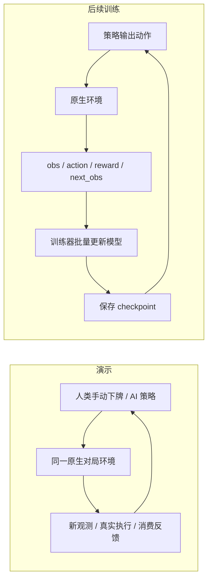

# 从零体验：你下牌，AI 来应对

先用这份教程。你不需要先理解私服、回放重建或训练代码。目标只有一个：启动本地对局，在下方手动出牌，看上方 AI 得到什么信息、采取什么动作，以及引擎是否真正消费了这张牌。

本入口默认 AI 是可以阅读和修改的 **Python 规则**。它没有经过强化学习训练，也没有调用语言模型。策略能力是后续研究内容；这里先展示可观察、可替换策略的人机闭环。

## 1. 只从一个入口开始

打开 PowerShell，依次执行：

```powershell
Set-Location -LiteralPath 'D:\研究生\Clash Royal'
.\run_play.ps1
```

也可以双击项目根目录的 `play.cmd`。保持它打开的终端开着。入口会准备项目内的本地运行时和 Android 场景，冷启动可能需要几分钟。它不会自动打开浏览器；手动访问终端打印的地址，默认是 `http://127.0.0.1:8770`。

看到标题“你来下牌，AI 来应对”，并且右上角变成“已暂停，可下牌”，才开始操作。上方红方是 AI（owner 0），下方蓝方是你（owner 1）。画面下方另外绘制的四张中文手牌按钮，是你的操作入口。

若 8770 仍被旧 Archive/Replay/Agent 控制台占用，先在旧页面点“关闭本次控制”，或在旧终端按 Ctrl+C 等待退出，然后重新运行。不要同时启动两场原生对局。每次新建对局都会重新准备 Android 容器，旧对局会被丢弃，已保存的宿主证据目录仍保留。

## 2. 第一次只做一个教学回合

页面默认“教学回合”，时间处于暂停状态。

1. 如果画面仍有 VS 开场遮挡，先点“不下牌，观察 1 秒”，直到战场可见。
2. 在画面下方四张手牌中，选一张圣水足够的普通部队。灰色按钮表示当前不能选；不要直接点游戏图片里的手牌 HUD。
3. 在图片里的**下半场战场**点击一个位置，也可以从中文手牌按钮拖到那里松手。提交后不用再点确认。
4. 等页面提示“本回合已结束并暂停”。一次教学回合共推进 20 个原生 tick，即 1 秒游戏时间；实际等待的墙钟时间可能更长。
5. 看右侧“AI 这次怎样回应”：它实际输入的 tick、敌方对象数、历史下牌数、规则走到的分支和选出的动作。AI 可能选择等待。
6. 再看“你的下牌是否执行”和“AI 最近一次已刷新执行反馈”。只有“已确认真实消费”表示有匹配的原生消费证据；登记成功并不等于消费成功。

普通部队在这个演示里限制放下半场；法术可以选上下两边。这个限制加上手牌、圣水和坐标边界检查，仍不能证明所有卡牌的完整合法部署规则。点击十字标记表示你的**请求点**，不能当成引擎最终部署位置。

可以反复“下牌 → 看 AI 回应 → 暂停比较”，也可以用“不下牌，观察 1 秒”观察移动、攻击与圣水恢复。页面展示的是引擎实际画面；目前日志没有恢复完整攻击、伤害和技能因果链，因此不能仅凭面板声称看见了全部游戏内部事件。

## 3. 熟悉后切换连续对战

点击“连续对战”，再点“开始连续运行”。这时游戏持续推进，你仍通过中文手牌按钮点选后点击战场，或拖动到落点。需要思考时点“暂停”；切回“教学回合”也会请求暂停。

游戏区优先显示实际 Android 实时画面，状态和策略决策另外更新。直播画面采用异步传输，能减少逐状态截屏带来的停顿；实际流畅度仍受本机运行速度影响，`Speed=1` 也不保证每秒能完成 20 个原生 tick。

画面条显示“截图回退”时，当前显示最近保存的 PNG。暂停、教学回合完成或保存截图后会更新；连续运行中它可能落后于最新状态。可以点“重试直播”。用于训练和审计的时序应以 raw state、决策 tick 与同步证据 PNG 为准，不能把异步直播中的某帧直接当作精确 tick 标签。

如果一次下牌的连接结果未知，先刷新状态并核对最近下牌反馈。页面不会自动重发，避免重复操作。

## 4. AI 到底在哪，怎样替换

打开项目里的 `examples/human_ai_policy.py`。核心入口就是：

```python
def decide(observation):
    # 读取当前观测，返回等待或下牌。
    return {'kind': 'wait', 'reason': '先观察局势。'}
```

当前默认规则大致是：刚出过牌先等两秒；没有足够圣水就等；出现敌方非塔对象且有法术时，向较靠近己方的对象施法；否则选择当前最便宜的部队部署。右侧说明来自这个函数实际返回的 `reason`，便于检查走了哪一条规则分支。

AI 收到的 `battlefield` 是结构化数据，包含己方当前手牌与圣水、六塔信息、采集到的非塔实体，以及已发生的双方下牌历史。它没有读取图片来识别单位，也没有默认获得对手手牌和精确圣水。实体的隐身、地下等可见性还没有独立核验，不能把当前输入宣称为已经证明公平的玩家视角。

下牌输出合约：

```python
return {
    'kind': 'play_card',
    'slot': 0,       # 当前手牌槽位，0..3；不是固定卡牌编号
    'x': 3500,      # 原生请求坐标，0..17999
    'y': 11000,     # 原生请求坐标，0..31999；上方 AI 在较小 y 一侧
    'reason': '选择这张牌和这个请求点的简短规则说明。'
}
```

先从“何时出牌、用哪一张牌、选哪一路”三个问题改起。编辑后结束演示并重新启动，插件才会重新加载。建议另存自己的策略，例如 `examples/my_ai.py`，然后启动：

```powershell
.\run_play.ps1 -PolicyFile examples/my_ai.py
```

策略只负责返回动作。调度、推进时间、原生执行、消费反馈和存证由平台负责；不要在 `decide()` 中自行连接 RPC、reset 对局或推进时间。

## 5. 手动演示、BC 和 RL 分别是什么

| 路线 | 动作怎样产生 | 当前项目中的位置 |
|---|---|---|
| 人工规则 | 你写 `if/else`，按局势返回动作 | 本教程默认的 `examples/human_ai_policy.py`，修改后即可重新演示 |
| 行为克隆 BC | 从合格的“执行前观测 → 人类动作”样本学习模仿 | 已有独立数据导出、NumPy BC 和旧 Agent 基线；其输入更窄，严格动作子空间仍限 WAIT/普通火球/万箭 |
| 强化学习 RL | 策略与环境交互，依据奖励更新参数 | 已有受限 `NativeAgentEnv.reset()/step()` 与终局奖励；完整战场输入、全卡牌合法动作、训练器和新模型集成仍需继续实现 |

可以把整个平台理解成两个用途共用底层原生环境：



演示页面帮助人理解“发生了什么”；训练通常无需打开网页，也无需每一步截图，只循环采集状态转移并更新模型。现有 `NativeAgentEnv` 默认走 headless 原生环境，但仍使用保守输入和 WAIT/两法术的窄动作合约。新 Human 入口允许更广的手牌请求，只说明交互接口扩展了，不能据此称“完整八卡 RL 已可训练”；还需要把新输入、合法动作、奖励和训练器接好并逐项验证。

网上公开回放的作用是提供来源动作、卡组和可用结果等信息。它们必须先经过转换、固定环境重建、执行确认、重复性与质量筛选、整局训练/验证/测试切分，才能导出合格训练轨迹。公开视频、来源动作列表、一次胜负相同，都不能直接等价为当前固定版本的完整真实状态。来源版本、初始化或技能解释未知时应保留未知并隔离不合格数据。

现有 BC 的详细命令和质量门槛见 `phase2/TRAJECTORIES_AND_BC.md`。本次新的人机演示日志是研究存证，不会自动成为现有严格训练导出器的输入；还需要明确新增适配器与观测/动作合约。也不能把旧 BC checkpoint 直接塞进新的 battlefield 规则函数并声称完成了训练升级。

将来训练完整 AI 的路线是：先稳定观测与动作合约和版本证据，再把新策略接入环境；定义奖励，采集 `(observation, action, reward, next_observation, terminated)`；用训练器更新并保存 checkpoint；最后让 `decide()` 调用加载后的模型，并用独立种子、固定对手和多局结果评估。不要把“已经能调用 step”误写成“完整 RL 平台已训练可用”。

## 6. 到哪里看证据

展开右侧“研究信息与完整输入”，可看到本次目录和策略路径；文件位于 `outputs/platform_next/sessions/<时间戳>-human/`。

| 文件 | 回答什么问题 |
|---|---|
| `configuration.json`、`initialization.json` | 用了哪些参数、源码身份、随机种子与初始卡组 |
| `human_actions.jsonl` | 你在哪个 tick、以哪份 owner1 观测、哪张手牌和什么请求位置提交；没有人工下牌时文件可不存在 |
| `decisions.jsonl` | AI 实际收到的完整输入、规则说明、选出的动作和登记回执 |
| `states.jsonl`、`observations.jsonl`、`battlefield_observations.jsonl` | 原生状态、研究观测和可重建的策略战场输入 |
| `wire.jsonl`、`journal.json`、`execution_feedback.json` | 请求与回执、动作记录、原生消费确认或未确认状态 |
| `frames/index.jsonl`、`frames/*.png` | 初始化、暂停、教学回合、报告与结束等节点的同步截图及状态 hash 绑定 |
| `report.json`、`session.json` | 当前统计和最终封口；自然终局、手动结束和异常必须区分 |
| `timings.jsonl`、`stream/` | 运行耗时和异步画面传输诊断；直播不是精确训练标签 |

点击“保存报告”会刷新反馈和统计。结束后，离线审计可以在**不启动游戏**的情况下重建输入、核对请求与消费以及首末 PNG 绑定；结果是文件一致性核验，不是官方全交互真实性证明。使用本次实际目录替换下面的占位路径：

```powershell
& .\.venv-phase2-core\Scripts\python.exe -B tools/phase2_platform_audit.py 'outputs/platform_next/sessions/本次时间戳-human'
```

## 7. 怎样正常退出

先点“保存报告”，再点“结束本次演示”，等待终端退出并写完 `session.json`。这只结束本次控制；另在 PowerShell 关闭项目运行时：

```powershell
.\run_platform.ps1 -Mode Stop
```

再次体验从同一个 `run_play.ps1` 开始即可。需要研究来源回放、旧 BC、完整字段和历史验收时，再阅读 `phase2/PLATFORM_TUTORIAL_ZH.md`。

## 8. 本次验证状态

本教程的操作名称和合约已核对当前源码。证据目录为 `outputs/platform_next/fixes/20261018_manual_play/`。

**当前交付以 `human_acceptance_final.json` 为准：11项只读汇总核验通过。** 它重新读取并重建最终封口会话，核对当前13份运行源码、实际插件、20项UI合成检查、95项离线测试、PowerShell5中文路径回归、坐标证据、操作检查与编码进程清理；这些不同层次的证据分别记录，不合并成“运行了多少局”。

| 检查 | 实际结果与范围 |
|---|---|
| 最终同版原生人机短程 | `outputs/platform_next/sessions/20261018T060715.139286Z-human` 实际90→194，人工2次/AI2次消费全部确认，6次AI决策（2次下牌/4次等待），29份原生状态/研究观测/战场输入、3张绑定PNG；`human_artifact_audit_final.json` 独立离线重建通过。`human_live_final/report.json` 的10项端到端检查全部通过。此局手动结束，未到自然终局，不能据此报告完整局胜率 |
| 最终画面与退出 | HTTP收到145张真实变化JPEG，实测约7.0226fps；540×960源画面本次仅运行1段、约25秒，**没有实测证明60秒分段轮转**。最终 `stream/cleanup.json` 与封口状态的token一致，目标编码进程归属核验通过并在SIGINT后释放（本次约3.297秒）。异步JPEG没有原生tick绑定，不能当作逐帧训练标签 |
| 同场景显示吞吐对照 | `stream_rate_compare/report.json` 为暂停同一场景的一次顺序A/B：保留PTS帧率过滤约4.97JPEG/秒，移除该过滤约9.99JPEG/秒。它只说明该次显示编码吞吐变化，不证明物理模拟、游戏时间推进或训练速度翻倍，也不代表多轮性能评估；该旧对照自己的清理核验为false，最终会话的成功清理另有独立回执 |
| 离线审计正负控 | `artifact_audit_human_tests.log`：33 项通过，含人类/AI请求分离、未来输入、手牌/预算、原生请求位置、wire/journal、消费未知和首末PNG等检查；这些是显式文件测试，不是实际游戏局数 |
| 首次原生人机短程 | `outputs/platform_next/sessions/20261018T052524.594267Z-human` 实际 tick90→194，人类2次下牌、AI 6次决策（2次下牌/4次等待），双方4次消费均确认；29份状态/研究观测/战场观测、3张绑定PNG；`human_artifact_audit_001.json` 独立离线核验通过。手动结束，未到自然终局，不能用来报告完整局胜率 |
| 首次操作协议检查 | `human_live_001/report.json` 已记录教学回合精确20tick、AI输入包含先发生的人工下牌、规则说明、旧手牌拒绝、连续运行和连续人工下牌等8项检查；整体仍为 failed，测试线程反复覆盖JPEG遇到Windows文件锁，修复后必须另做新运行 |
| 实时画面与退出 | 首次保存状态记录约7.06fps（目标12fps），不是稳定12fps保证；首次退出另发现Android编码进程残留，清理修复与后续新验证需分开记录 |
| 第二次原生短程与画面失败 | `outputs/platform_next/sessions/20261018T054906.410998Z-human` 已正常封口，原生90→194、人工2次/AI2次消费、29份状态与3张PNG经 `human_artifact_audit_002.json` 核验通过；本次流传输因ADB双层引用得到空流，操作闭环与画面结果必须分别记录，不能算整体验收通过 |
| 第三次端到端人机验证 | `human_live_004/report.json` 的10项检查全部通过，并绑定 `outputs/platform_next/sessions/20261018T055331.578824Z-human`：教学回合、AI收到已发生人工下牌、实际规则说明、旧手牌拒绝、连续控制和H264到HTTP的真实变化画面均验证。独立 `human_artifact_audit_003.json` 核验90→194、人工2次/AI2次消费、6次AI决策（2次下牌/4次等待）、29份状态与3张PNG。手动结束、非自然终局 |
| 第三次画面与清理 | HTTP实际收到74张变化JPEG，约3.6269fps；不能写成12fps。该局 `stream/cleanup.json` 保存精确token/PID/启动时间/命令行核验及退出回执，确认目标Android编码进程通过SIGINT释放；此后画面吞吐优化还需新运行复核 |

最终同版已经验证短程操作、真实变化画面与有归属的编码进程清理。95项离线检查见 `release_tests.log`，UI20项是合成DOM/假fetch测试，实际操作另由原生HTTP检查证明。本轮没有浏览器自动化验收，没有长时间分段轮转实测，也没有新增完整局/多种卡组评估；首轮文件锁、提前连接、空流和编码进程残留等失败证据继续保留。

当前明确限制：固定原生版本和既定场景；请求位置采用上游测量的 HUD 网格映射，实际最终落点未知；完整攻击/伤害/投射物/技能消费因果、所有卡牌与模式交互、实体可见性和官方版本一致性均未全部证明。平台让这些限制能被观察和继续验证，不能把“有真实画面”当成“已穷举恢复真实游戏所有情况”。
