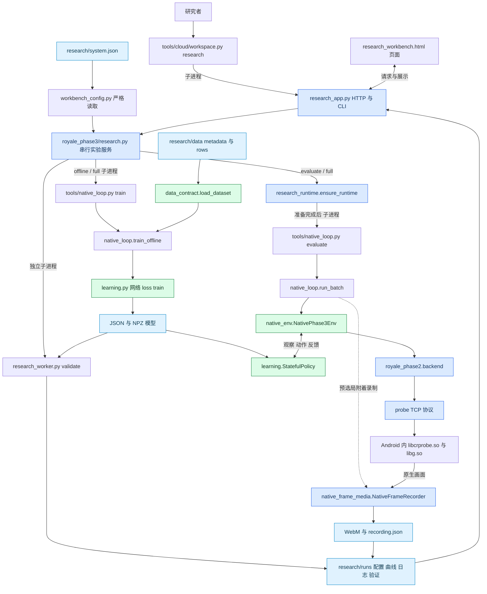
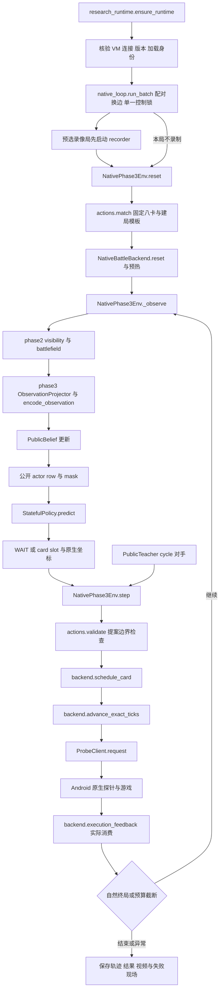
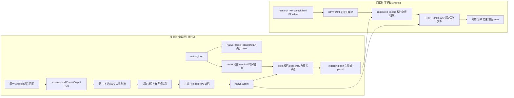
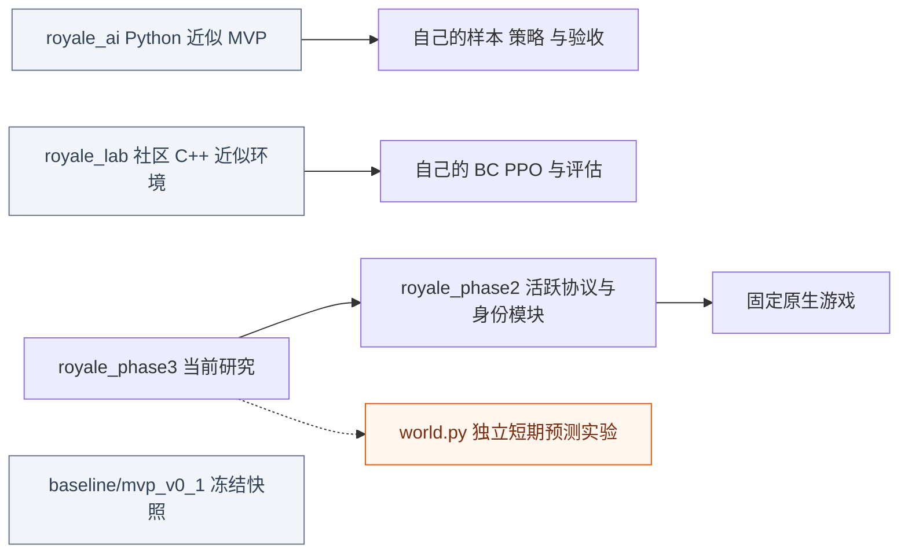

# 当前代码仓库框架与阅读地图

日期：2026-11-07，北京时间。对应当前工作区代码，包括未提交实现。

**科研主线是 `royale_phase3`；真实游戏接口复用 `royale_phase2`；`tools/cloud` 管理入口、运行端和视频；`royale_ai`、`royale_lab` 是保留的独立近似基线。** 研究网络先读 `learning.py`，研究 AI 能看到什么先读 `observation.py`，研究一次对局怎样运行先读 `native_env.py`。

本图以 `.venv-cloud/bin/python tools/cloud/workspace.py research` 为当前入口。实线表示调用或数据流，虚线表示条件启用、辅助依赖或独立研究分支；子进程在箭头上标明。图下文件表可直接点开源码。全仓静态清单为 390 个作者源文件、354 个 Python 文件、715 条本地导入边；这些数字不等于一次实验全部执行的代码。

[查看可缩放总图](CODE_MAP.svg) · [查看图片总图](CODE_MAP.png) · [当前系统操作](README.md) · [算法接入细节](MODEL_INTEGRATION_ZH.md) · [完整机器清单](dependency-map.json)

## 先点开哪些核心代码

| 阅读顺序 | 直接点开 | 回答什么问题 | 研究者通常是否修改 |
|---|---|---|---|
| 1 | [system.json](/workspaces/Game-AI-for-Clash-Royale/research/system.json:1) | 选哪份数据、默认模型、训练轮数、输出在哪里 | 经常 |
| 2 | [SmallPolicy 网络](/workspaces/Game-AI-for-Clash-Royale/royale_phase3/learning.py:78)、[loss](/workspaces/Game-AI-for-Clash-Royale/royale_phase3/learning.py:160)、[train](/workspaces/Game-AI-for-Clash-Royale/royale_phase3/learning.py:372) | 神经网络怎样搭建、怎样优化 | **算法最核心** |
| 3 | [ObservationProjector](/workspaces/Game-AI-for-Clash-Royale/royale_phase3/observation.py:43)、[encode_observation](/workspaces/Game-AI-for-Clash-Royale/royale_phase3/observation.py:230) | AI 能看见什么，公开信息如何编码 | 改模型输入时 |
| 4 | [PublicBelief.update](/workspaces/Game-AI-for-Clash-Royale/royale_phase3/belief.py:73) | 怎样从历史推断对手信息，怎样保留未知 | 改记忆与信息估计时 |
| 5 | [NativePhase3Env](/workspaces/Game-AI-for-Clash-Royale/royale_phase3/native_env.py:11)、[step](/workspaces/Game-AI-for-Clash-Royale/royale_phase3/native_env.py:77) | reset、出牌、推进、反馈、reward、终止怎样连接 | **环境接口最核心** |
| 6 | [actions.py](/workspaces/Game-AI-for-Clash-Royale/royale_phase3/actions.py:26) | 卡组、mask、落点、坐标与规则对手 | 改动作空间/环境设定时 |
| 7 | [load_dataset](/workspaces/Game-AI-for-Clash-Royale/royale_phase3/data_contract.py:6) | 样本格式、哈希、时间、维度和整局切分怎样检查 | 改数据或输入 schema 时 |
| 8 | [native_loop.py](/workspaces/Game-AI-for-Clash-Royale/royale_phase3/native_loop.py:177) | 怎样逐局评估、导出轨迹、接上训练与录像 | 改实验流程时 |
| 9 | [ResearchService._execute](/workspaces/Game-AI-for-Clash-Royale/royale_phase3/research.py:436) | 按钮怎样变成训练、验证和新局 | 改工作台编排时 |
| 10 | [NativeBattleBackend](/workspaces/Game-AI-for-Clash-Royale/royale_phase2/backend.py:125) | Python 怎样让真实游戏建局、推进、消费卡牌 | 排查底层执行时 |

前七项足以开始讨论输入、模型、loss、动作和环境。VM、ADB、HTTP 的代码可在需要排查工程问题时再读。

## 仓库总框架

三个模式共享同一实验服务：

| 页面模式 | 实际流程 | 是否需要 Android |
|---|---|---|
| `offline` 训练 | 读保存数据 → 训练 → 保存 → 新进程 validation → 结束 | 否 |
| `evaluate` 评估 | 加载选定 checkpoint → 新进程 validation → 准备运行端 → 配对新局 → 按配置录制 | 是 |
| `full` 完整实验 | 离线训练 → 新进程 validation → 准备运行端 → 配对新局与录像 | 是 |

当前工作台只注册 **GRU C**。`learning.py` 中存在 A–E 变体，不代表页面已支持任意架构；`world.py` 也没有自动进入上述主链。

## 离线训练和模型内部结构

```mermaid
flowchart LR
    META[metadata.json 与 rows.jsonl] --> CHECK[load_dataset 契约校验]
    CHECK --> SPLIT[train_validation_view 物理排除 test]
    SPLIT --> WINDOW[按 episode 与 owner 组织序列]
    WINDOW --> INPUT[actor_vector 713 维]
    INPUT --> ENC[Linear 713 到 32 与 tanh]
    ENC --> GRU[GRU 隐藏维度 32]
    GRU --> AH[动作头 5 个 logits]
    GRU --> PH[位置头 2 个 sigmoid 坐标]
    AH --> LOSS[loss 动作与位置监督]
    PH --> LOSS
    LOSS --> OPT[Adam 更新 仅 train]
    OPT --> VAL[validation 评价与选模型]
    VAL --> SAVE[JSON 配置与 NPZ 权重]
    SAVE --> FRESH[新进程 StatefulPolicy.load]
    FRESH --> DECODER[同一 decode 部署解码]
    DECODER --> REPORT[offline_validation.json]
```

输入是 `688 history + 15 belief + 5 上一动作 + 4 执行反馈 + 1 dt = 713`。当前默认为 hidden 32、序列长 32、burn-in 8、batch 8；10 tick 是 0.5 秒游戏时间。当前 C 的位置头是二维回归，D/E 才使用按卡槽划分的 18×32 网格头。

训练读取保存的编码行，不会在每次梯度更新时启动游戏或重新截图。当前 fair 排除全部非塔实体，包括己方单位；录像里有完整画面，不代表模型输入里有这些对象。

| 环节 | 直接点开 | 关键职责 |
|---|---|---|
| CLI 入口 | [tools/native_loop.py](/workspaces/Game-AI-for-Clash-Royale/tools/native_loop.py:14) | 解析 train/evaluate/collect/export 参数 |
| 排除 test | [train_validation_view](/workspaces/Game-AI-for-Clash-Royale/royale_phase3/native_loop.py:666) | 写独立 train/validation 输入，不把 test 交给 learner |
| 首版训练包装 | [train_offline](/workspaces/Game-AI-for-Clash-Royale/royale_phase3/native_loop.py:700) | 固定 C 契约、调用真实优化、记录数据来源 |
| 输入拼接 | [actor_vector](/workspaces/Game-AI-for-Clash-Royale/royale_phase3/learning.py:30) | 训练与部署共用的输入顺序 |
| 序列组织 | [sequence_windows](/workspaces/Game-AI-for-Clash-Royale/royale_phase3/learning.py:102) | 不跨 episode/owner，padding 不计 loss，burn-in 预热 |
| 保存和加载 | [save_checkpoint](/workspaces/Game-AI-for-Clash-Royale/royale_phase3/learning.py:234)、[StatefulPolicy.load](/workspaces/Game-AI-for-Clash-Royale/royale_phase3/learning.py:269) | 版本/profile 校验、严格加载 tensor 状态 |
| 部署解码 | [decode](/workspaces/Game-AI-for-Clash-Royale/royale_phase3/learning.py:186)、[predict](/workspaces/Game-AI-for-Clash-Royale/royale_phase3/learning.py:278) | mask、坐标、hidden、重复 tick 缓存与 reset |
| 独立验证 | [research_worker.validate](/workspaces/Game-AI-for-Clash-Royale/tools/cloud/research_worker.py:13) | 新进程重新读模型，验证部署解码一致 |

## 原生对局的控制闭环

`native_env.py` 是研究环境适配器，**不实现战斗物理**。真实战斗由固定版本 `libg.so` 执行，探针 `libcrprobe.so` 负责协议桥接。不要把 `world.py`、`royale_ai/simulator.py` 或 `royale_lab` 的社区引擎当成这条链的游戏物理。

| 层 | 直接点开 | 具体承担什么 |
|---|---|---|
| 自动准备 | [ensure_runtime](/workspaces/Game-AI-for-Clash-Royale/tools/cloud/research_runtime.py:301) | 复用核验已有安装；必要时恢复已有 VM 并准备连接 |
| VM 状态/进程 | [inspect_vm](/workspaces/Game-AI-for-Clash-Royale/tools/cloud/native_runtime_state.py:8)、[software_android_vm.start](/workspaces/Game-AI-for-Clash-Royale/tools/cloud/software_android_vm.py:483) | 防止误认 PID、磁盘链与运行状态，管理 QEMU |
| Android 准备 | [native_prepare.py](/workspaces/Game-AI-for-Clash-Royale/tools/cloud/native_prepare.py:18)、[native_identity.py](/workspaces/Game-AI-for-Clash-Royale/tools/cloud/native_identity.py:231) | boot、显示兼容、ADB 转发、APK/so/内容加载身份 |
| 批次实验 | [run_batch](/workspaces/Game-AI-for-Clash-Royale/royale_phase3/native_loop.py:471)、[_run_batch](/workspaces/Game-AI-for-Clash-Royale/royale_phase3/native_loop.py:177) | 单世界锁、换边、预算、逐局结果与 recorder 生命周期 |
| 研究观察 | [_observe](/workspaces/Game-AI-for-Clash-Royale/royale_phase3/native_env.py:31) | 当前公开状态 → 特征、历史、belief、反馈 |
| 研究动作与时间 | [step](/workspaces/Game-AI-for-Clash-Royale/royale_phase3/native_env.py:77) | 模型和对手动作、10 tick 推进、reward、dt、终止 |
| 游戏执行 | [NativeBattleBackend](/workspaces/Game-AI-for-Clash-Royale/royale_phase2/backend.py:125) | 建局、时钟、出牌注册、journal、消费确认 |
| 传输 | [ProbeClient.request](/workspaces/Game-AI-for-Clash-Royale/royale_phase2/probe.py:70) | TCP JSON 请求/响应，不是 Python 模拟战斗 |
| 版本和连接 | [verify_manifest](/workspaces/Game-AI-for-Clash-Royale/royale_phase2/versioning.py:33)、[load_connection](/workspaces/Game-AI-for-Clash-Royale/royale_phase2/connection.py:71) | 固定素材/库/探针版本与实际连接 |
| 信息边界 | [project_actor](/workspaces/Game-AI-for-Clash-Royale/royale_phase2/visibility.py:80)、[build_battlefield_observation](/workspaces/Game-AI-for-Clash-Royale/royale_phase2/battlefield.py:139) | 从底层状态整理可见字段与研究对象，交给 phase3 再投影 |
| 世界互斥 | [native_lock](/workspaces/Game-AI-for-Clash-Royale/royale_phase3/common.py:55) | 同一世界只允许一个推进控制者 |

“提出出牌”“注册成功”“实际卡牌消费”是不同状态；mask 不是完整引擎合法性证明。未知结果不应重发突变。模型、环境和后端三层分别控制决策、实验语义和真实执行。

## 录像和回看的两条流程

| 代码 | 当前作用 | 能否暂时不读 |
|---|---|---|
| [native_frame_media.py](/workspaces/Game-AI-for-Clash-Royale/tools/cloud/native_frame_media.py:60) | 默认连续原生帧录制器、队列、主机编码、时间锚点 | 做算法时可以；查视频时必读 |
| [native_media.py](/workspaces/Game-AI-for-Clash-Royale/tools/cloud/native_media.py:94) | 上述类的父类、FFmpeg/ffprobe/解码工具及备用 screenrecord 路径 | **不能当旧废代码删掉** |
| [registered_media](/workspaces/Game-AI-for-Clash-Royale/tools/cloud/research_app.py:115)、[byte_range](/workspaces/Game-AI-for-Clash-Royale/tools/cloud/research_app.py:96) | 读取该实验登记的保存媒体，支持拖动进度 | 查播放故障时读 |
| [ResearchService._media](/workspaces/Game-AI-for-Clash-Royale/royale_phase3/research.py:224)、[_actions](/workspaces/Game-AI-for-Clash-Royale/royale_phase3/research.py:249) | 暴露媒体与有证据的动作定位区间 | 查事件同步时读 |
| [research_workbench.html](/workspaces/Game-AI-for-Clash-Royale/tools/cloud/research_workbench.html:1) | 训练表单、曲线、实验列表、原生视频播放器 | 改页面时读 |
| [platform_stream.py](/workspaces/Game-AI-for-Clash-Royale/royale_phase2/platform_stream.py:1) | 旧直播设施；当前两个 recorder 仍借用 `_PROC_START` 身份脚本片段 | 全文件不用先读，但仍有当前依赖 |

当前主工作台看保存视频**不经过 `replay_app.py`，不重建原生局，也不使用旧简化棋盘重画视频**。游戏 tick 与视频秒数分开，只有实测锚点支持的位置才开放事件跳转。

## 有用代码和日常不用的代码怎样划分

没有证据支持把某个作者源码目录整体判为“无用、可直接删除”。更实用的判断是：当前主链必需、按需调用、兼容入口、独立基线和历史快照。无导入者也不等于无用，许多 `tools/*.py` 是从命令行或子进程启动。

| 分类 | 目录或文件 | 当前用途 | 你的阅读优先级 |
|---|---|---|---|
| **科研核心** | `royale_phase3/learning.py`、`observation.py`、`belief.py`、`native_env.py`、`actions.py`、`data_contract.py` | 模型、输入、训练、部署、动作与环境语义 | 第一批读 |
| **主链编排** | `royale_phase3/research.py`、`native_loop.py`、`common.py`、`workbench_config.py`；`tools/native_loop.py` | 配置、队列、文件/锁、批次评估和训练包装 | 理解整套流程时读 |
| **活跃底层设施** | `royale_phase2/backend.py`、`probe.py`、`connection.py`、`versioning.py`、`visibility.py`、`battlefield.py`、`runtime.py` | 固定版本真实游戏的协议、身份、可见性与执行 | 使用但通常少改；不可删 |
| **工作台与运行维护** | `tools/cloud/research_app.py`、`research_worker.py`、`research_runtime.py`、`native_runtime_state.py`、媒体模块 | 一键启动实验、独立验证、自动准备与回看 | 工程故障时读 |
| **原生资源准备工具** | `native_prepare.py`、`native_start.py`、`native_connection.py`、`native_identity.py`、`native_content.py`、`native_resources.py`、`native_payload.py`、`native_version.py`、`install_native_runtime.py`、`software_android.py`、`software_android_vm.py`、`build_native_apk.py` | 首次安装、版本固定、构建、恢复；部分仍由 prepare 调用 | 可暂时不读；不能按“只运行一次”判废弃 |
| **仍被复用的数据辅助** | `royale_phase3/data.py` 中 `split_for`、`world_target` 等 | 当前 `native_loop.py` 的轨迹导出仍使用这些函数；其它部分保留早期数据路径 | 改数据导出时读，不能整文件当废弃 |
| **可选研究扩展** | `royale_phase3/world.py`、`sources.py`、`collection.py`、`evaluation.py`、`doctor.py` | 独立世界预测、来源转换、早期采集、对照审计 | 研究对应问题时读 |
| **扩展 CLI** | `tools/phase3.py`、`tools/phase3_*.py`、`tools/phase2_*.py` | A–E 消融、来源、世界预测、平台与诊断工具 | 默认工作台未全部调用 |
| **旧云端兼容入口** | `workspace.py serve`、`workbench.html`、`research.html`、`replay.py`、`simulator.py`、`train_cache.py`、`workflow.py` | 旧保存观测/轻量数值训练/近似沙盒 | 当前科研工作台可先跳过；仍可显式运行 |
| **旧原生浏览与公开事件重演** | `replay_app.py`、`native_browser.py`、`native.html`、`tools/cloud/public_replay.py`；phase2 的 `cloud_native.py`、`cloud_replay.py`、`cloud_frames.py`、`cloud_source.py`、`public_replay.py` | 公开 JSON 导入、单步原生操作、来源重演与保存帧 | 与“播放已存 WebM”分开；按需读 |
| **旧平台和数据工具** | phase2 的 `platform.py`、`human.py`、`viewer.py`、`agent_env.py`、`learning.py`、`dataset.py`、`trajectories.py`、`reconstruction.py`、`replays.py`、`quality.py`、`determinism.py`、`observability.py` | 原平台、人机规则演示、数据/模型与重演质量审计；部分供扩展工具复用 | 不在当前默认 C 训练核心，不代表无效 |
| **Windows 兼容与规则演示** | `run_play.ps1`、`run_platform.ps1`、`run.ps1`、`phase2.ps1`；`examples/`；`android_mirror.py`、`tools/android_mirror.ps1` | 已有启动器、规则对手、镜像连接计划 | Windows 方向再读；不等于新 checkpoint 连续人机已实现 |
| **独立近似基线** | `royale_ai/`、`royale_lab/` | Python MVP、社区 C++ 环境及各自规则/BC/PPO 实验 | 当前原生研究可先不读；保留对照 |
| **冻结快照** | `baseline/mvp_v0_1/` | 不随当前主线改写的历史版本 | 日常不读，不修改 |
| **回归与审计** | `tests_cloud/`、`tests_phase3/`、`tests_phase2/`、其它 `tests*/`；`research_inventory.py`、`reorganize_research.py` | 防止契约回归，导出依赖清单与安全搬迁输入 | 修改相应层时使用；不是生产对局步骤 |
| **文档与任务书** | `docs/`、`research/*.md`、`CODEX_*.txt`、`phase2/`、`phase3/` | 解释、规格、分项验收、交接与历史决策 | 当前入口读 `research/README.md`，历史按需 |

### 独立基线与当前原生系统的关系

没有画从 `royale_ai` 或 `royale_lab` 到当前原生环境的战斗引擎依赖箭头，因为默认研究流程不靠它们计算真实对局。历史 PPO 的胜率不能当成当前 GRU C 的成绩。

## 数据和依赖在哪里

| 位置 | 它是什么 | 当前关系 |
|---|---|---|
| [research/system.json](/workspaces/Game-AI-for-Clash-Royale/research/system.json:1) | 当前资源注册和实验默认配置 | 主入口；修改后重启工作台 |
| `research/data/native/` | 当前原生样本 metadata + rows | 现有 3 train 整局、1 validation 整局、无 test |
| `research/data/portable-pilot/` | 另一版本的便携样本 | 只能显式用于离线，不能替代当前原生版本 |
| `research/models/gru-c/` | 已保存参考模型 | JSON 引用 NPZ；权重、版本与输入契约须匹配 |
| `research/runs/` | 每次新实验记录 | request/config/model/validation/logs/evaluation/media |
| `research/runtime/version.json` | 固定版本 manifest | 锁定 828 个资产；不是游戏引擎本体 |
| `.cache/native-tools/` | ADB、QEMU/工具、已有 VM 安装与磁盘链 | 本地生成依赖；VM 磁盘不能当普通缓存清理 |
| `third_party/`、历史资源目录 | 固定游戏/内容/源码等外部输入 | 有些路径被 manifest 引用，不能整目录删除 |
| `shared_assets/` | 经审查、哈希校验的小型可移植资产 | 恢复与旧命令使用；不是所有原生素材的完整包 |
| `data/`、`models/`、`outputs/` | 历史资产与证据，也有仍受版本引用的文件 | 新默认离线输入已迁移；整个目录仍不能判为无用 |
| `requirements-codespaces*.txt` | 云端基础、CPU Torch、研究工具、浏览器的固定环境 | 按用途安装；当前 C 核心为 NumPy + Torch |
| `requirements.lock`、Windows 启动器 | 历史 Windows 环境 | 保留，不与云端版本混装 |
| [pyproject.toml](/workspaces/Game-AI-for-Clash-Royale/pyproject.toml:1) | 包声明与可选依赖 | 当前以源码仓库运行；普通 wheel 不自带游戏和研究输入 |

**本轮没有删除候选清单。** 对“暂时不读”的代码，后续如需瘦身，应先列出 CLI、子进程、Windows、测试和 manifest 引用，再迁出而非直接删掉。尤其不能清理 VM 磁盘、固定资产、原数据、历史模型和验收证据来缩小目录。

## 改什么就沿哪条链阅读

| 你的研究目标 | 推荐阅读链 |
|---|---|
| 调轮数、hidden、出牌标签权重或换合格数据 | `system.json` → `research._resolve` → `native_loop.train_offline` → `learning.train` |
| 换神经网络、loss、记忆结构 | `learning.actor_vector` → `SmallPolicy` → `loss/train` → checkpoint → `StatefulPolicy` → worker；再更新工作台允许项 |
| 让 AI 看普通单位/来兵 | phase2 `visibility/battlefield` → phase3 `observation/belief` → `native_env._observe` → 数据重导出 → 新 checkpoint；保持公平信息边界 |
| 改卡组、落点、动作空间或控制间隔 | `actions` → `native_env.step` → 导出/数据契约 → `learning.decode` → 后端实际消费验证 |
| 做世界模型或想象训练 | [world.py](/workspaces/Game-AI-for-Clash-Royale/royale_phase3/world.py:29) → 明确状态/动作/dt/目标 → 独立预测训练与多步验证 → 再接规划/actor；当前 C 没有此闭环 |
| 排查一局为什么超时 | `research._execute` → `native_loop._run_batch` → `native_env.reset/step` → `backend` → `probe` → 对应 wire/进程/资源日志 |
| 查原生视频为什么不流畅 | `native_frame_media` 的读取/队列/编码与 PTS → `recording.json` → `research_app` Range → 浏览器；区分游戏推进慢和播放器问题 |
| 查网页按钮为何没启动实验 | HTML 表单 → HTTP POST → `research.submit/_resolve` → `_work/_execute` → 子进程日志 |

当前 `world.py` 是 9 维聚合状态的短期预测实验，不是完整战斗环境、RSSM/Dreamer 或已接通的在线 RL。`SmallPolicy` 的辅助 world/opponent/hazard heads 在当前 C 均关闭。

## 当前验收边界

离线训练、保存重载和独立 validation 已通过；最新完整录制评估在原生预热阶段超时，模型 0 决策、0 出牌、0 自然终局。真实初始化视频可在关闭 VM 后播放，但不是完整比赛。Windows 连续鼠标拖牌与同 checkpoint 对战尚未实现。

测试位于旁路契约层，不是每次对局都执行的模块。`workspace.py test` 默认覆盖 `tests_cloud` 与选定 phase3 契约；`--group extended` 才额外包含 phase3 belief/sources 和 phase2 测试。旧基线和其它平台测试有独立入口，不能把一次默认检查当成全仓所有系统实机验收。

源码定位以本图链接为准；实现状态与证据见 [STATUS.json](STATUS.json)，算法扩展细节见 [MODEL_INTEGRATION_ZH.md](MODEL_INTEGRATION_ZH.md)。本轮只补框架图和导航，不改变运行代码、算法、已有资源或验收状态。
