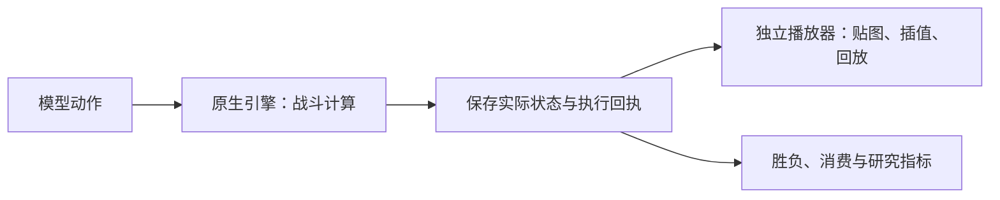

# 当前运行速度、资源与真实录像实测

这份报告对应 2026-11-07 的保存证据。**当前可以继续离线训练，也可以播放已保存的原生视频片段；完整自然对局录像和连续拖牌人机尚未交付。应分别讨论无画面计算、原生画面运行和启动故障，不能把一次渲染模式超时概括为所有原生计算都很慢。**

## 本轮修正：无画面评估与真实状态重绘

历史证据重新核查发现：10 月 20 日的两局原生模型评估采用 `rendered=false`，实际完成 959 次模型决策、90 次模型出牌消费，两局自然终局，分别耗时约 208 秒和 115 秒，一胜一负。当前参考模型和最新两轮训练的 NPZ 与该历史模型字节相同。这证明已有模型能在原生无画面模式下出牌，不证明棋力提升，也不能作为当前环境复测通过。[权重及逐局交叉审计](../outputs/cloud/model-diagnosis-20261107/saved-model-result-audit.json)

工作台此前即使关闭录像仍强制 `--rendered`。本轮已改为：评估时选择“快速无画面数值评估（不录像）”才使用 headless；录像评估仍使用原生渲染。已有、身份核验通过的渲染进程切换模式需明确重启应用；准备后再次检查 headless，就绪失败不提交模型对局。完整实验的录像验收要求没有取消。

本轮最初在 headless 模式等待内容准备的 180 秒预算耗尽；继续保留同一进程，在 08:10:56 UTC 首次只读观察到 `contentReady=true`。没有重启，也未跳过准备门槛。新建恢复记录、重新核验身份后，短 probe 确认两次规则出牌消费，再加载当前模型完成两局自然终局。**本轮 959 次模型决策、90 次模型出牌消费，一胜一负；不是仅引用历史结果。**

| 换边局 | 模型 owner | 模型实际消费 | 结果（模型:对手皇冠） | 该局报告墙钟时间 |
|---|---|---|---|---|
| 0 | 0 | 62 | 负，皇冠 1:2 | 179.609 秒 |
| 1 | 1 | 28 | 胜，皇冠 3:1 | 84.508 秒 |

上述墙钟时间不含 VM 冷启动和身份准备，不是同条件的渲染/无画面 A/B 加速倍数。两局只能证明执行有效，不能估计棋力提升。完整状态、逐条执行回执及消费交叉核验保存在[本轮对局证据](runs/headless-result-20261107t075733z/gameplay-proof.json)。第一次短预算失败仍保留在[初次结果](runs/headless-result-20261107t075733z/result.json)；[恢复结果](runs/headless-result-20261107t075733z/recovery-001/result.json)独立保存，未改写失败历史。

本轮真实对局通过独立 CLI 执行；工作台网页的无画面选择/提交通过隔离浏览器和 mock 检查，页面到原生新局的联合流程尚未重验。

初始化窗口的宿主连续采样和 guest 内存快照已保存；当时宿主最低可用约 7.22 GiB、guest 快照可用约 1.81 GiB，cgroup 未报告 OOM。现有证据不支持本次故障由内存耗尽引起；冷启动内容后处理为何耗时仍需单独定位。[资源窗口](runs/headless-result-20261107t075733z/resource-window-summary.json)、[自行就绪记录](runs/headless-result-20261107t075733z/readiness-continuation.jsonl)。测试结束已停止本轮 VM，保留原磁盘、模型和日志。

推荐的回放路线是**原生引擎无画面计算，播放器只读真实状态并绘图**，不是重新模拟战斗：



原始日志已有双方实体 ID、位置、血量、部分投射物和塔状态。历史一局模型对局有 1213 个状态快照，tick 90→6148，覆盖 302.9 秒游戏时间；采样间隔交替约 0.05/0.45 秒。采样点直接显示原始值，不重算伤害、寻路或胜负；中间位置、朝向与攻击特效只能插值或示意。可以做流畅播放器，但不能称为原版逐帧录像。字段与未导出项见 [`observability.py`](../royale_phase2/observability.py)；逐局统计及数据哈希见[状态重绘审计](../outputs/cloud/model-diagnosis-20261107/native-state-rendering-audit.json)。本轮尚未制作新的状态重绘播放器。

| 比较项 | 真实状态重绘的边界 |
|---|---|
| 已记录时刻的位置、血量、皇冠与终局 | 直接读原生值；绘图自身不改变这些结果 |
| 两个采样点之间的移动 | 可插值，不能保证转弯、碰撞、生成消失时刻准确 |
| 投射物 | 有位置快照；来源、速度、伤害及完整弹道未完整导出 |
| 攻击、命中、buff、隐身及地下状态 | 没有完整、已核验的事件与语义，不能从动画反推真值 |
| 原版材质、动作与特效 | 需要另做美术，不能由现有数值日志还原原版帧 |

目前没有当前 Codespaces 版本下渲染/无画面两模式同初始化、同动作逐状态对照，因此不能给“误差百分之几”或保证两种执行模式完全等价。若另用近似引擎重算战斗，寻路、索敌、碰撞、伤害时序都可能影响结局，其误差必须另测，不能以画面相似代替原生验证。研究播放器可用 raw/oracle 数据；公平模型输入仍遵循原有信息契约。

下面的短测数字均保留其具体运行条件：**未录像不等于无渲染**。原先约 0.04368 倍实时的测量使用了 `--rendered`，不能套用为 headless 的稳定吞吐量。

资源原始读数、事实与推断分别保存在[本轮只读运行审计](../outputs/cloud/system-consolidation-20261107/runtime-audit.json)。分项交付状态见[阶段 0–2 验收](../outputs/cloud/research-acceptance-20261107T054146Z/acceptance.json)与[仓库内验收摘要](../docs/audits/research_workbench_implementation_20261107.json)。`outputs/` 是当前工作区的原始结果，不保证随全新克隆提供；不能把历史成功当成本轮通过。

## 是否又缺内存，CPU 是否分配不合理

| 项目 | 实际看到的情况 | 能说明什么 |
|---|---|---|
| 宿主 CPU | 4 个逻辑核，x86_64；当前 cgroup 没有 CPU quota，throttling 计数为 0 | 没发现当前容器被额外限核；不能据此排除运行时 CPU 饱和 |
| 宿主内存 | 总计约 15.62 GiB，审计时可用约 12.49 GiB，无 swap | 这是 **VM 已停止后的空闲态**，不是失败时刻的内存余量 |
| cgroup 内存 | `memory.max=max`，`oom`/`oom_kill` 等事件计数为 0 | 没有当前 cgroup 内核 OOM 事件；不能排除宿主用户态保护或 Android guest 内部压力 |
| Android VM | 2 vCPU、3072 MiB、360×640、配置显示频率 5 FPS | 这是保护开发工作区的保守配置；尚未用对照实验验证最优值 |
| 调度优先级 | 启动命令使用 `nice -n 10` | CPU 争用时优先级较低；这个设置本身不证明 CPU 被错误分配 |
| 硬件加速 | 当前没有 `/dev/kvm`，保存命令采用 QEMU TCG，没有 GPU 设备透传 | 当前不是硬件加速 Android 路线 |

当前运行链路有三层值得重点调查：**QEMU TCG 软件执行 → ARM64 游戏/探针经 `libndk_translation.so` 在 x86_64 guest 转译 → guest 软件图形与原生帧输出**。这些配置及 ARM64 映射路径有保存证据；各层具体占了多少耗时，尚未采到线程热点，不能只凭链路图确定根因。[QEMU 官方介绍](https://www.qemu.org/docs/master/system/introduction.html)区分 TCG 软件执行与硬件虚拟化加速；这解释了调查方向，不是本项目已经测出的加速倍数。

先前渲染失败仍缺少**该次窗口的连续资源记录**：宿主/guest 可用内存、CPU 线程利用率、内存与 I/O pressure、磁盘等待，以及 Android ANR/图形等待。本轮 headless 已有宿主连续采样和 guest 单次快照，不能倒推此前渲染失败时的状态。停止后读到压力很低，不能证明运行时没有压力。增加内存、改 vCPU、取消 nice 或增加 TCG 缓存都需要单变量测试，不能承诺必然提速。

2026-10-24 曾有另一组故障：旧 2 核、约 7.76 GiB 宿主上的六次 VM SIGTERM 与低可用内存及 earlyoom 高度相关。那是[历史内存诊断](../docs/CODESPACES_MEMORY_DIAGNOSIS_20261024_ZH.md)，不能直接套用为本次的根因。本次保存的直接失败是 RPC 等待超时。

## 游戏内的 tick 为什么在现实中这么慢

本项目这个固定原生协议是 **20 tick/游戏秒**，所以：

- 1 tick = 0.05 秒游戏时间。
- 当前模型通常每 10 tick 决策一次，即每 0.5 秒游戏时间。
- “游戏时间”来自原生时钟；“墙钟时间”是电脑上真实经过的时间。

在未录视频的真实短检查中，tick 90→120 推进 30 tick，也就是 1.5 秒游戏时间，现实经过 **34.344 秒**，约 **0.04368 倍实时**。这个窗口中游戏 1 秒约需现实 22.90 秒，约 91.36% 时间花在原生推进 RPC。规则策略提出的两次出牌均确认被原生消费，但该测试在 tick 120 截断，没有自然终局。[短测性能与 wire 来源](../outputs/cloud/research-acceptance-20261107T054146Z/native/performance.json)

这确实属于严重的运行缓慢，不是网页播放器单独卡住。上述速度只来自 30 tick 短窗口；不能当成整局稳定基准。按它线性估计，180 秒游戏时间可能需要约 70 分钟/局，尚未计算录像额外成本，也没有实际跑出这样的完整局。

先前渲染模式评估请求两局，实际只尝试了第一局。场景建立后，系统在 tick 1 暂停，再请求 `advance-native 89` 进行预热；该 RPC 在 **180.074 秒**后超时。**该次模型决策为 0、模型实际出牌为 0、自然终局为 0。** 因此不能说模型已经输了一局，也不能说这次慢是神经网络推理造成的。[该次失败审计](../outputs/cloud/system-consolidation-20261107/runtime-audit.json)

页面配置的是每局 600 秒预算，连接文件配置的是单 RPC 180 秒超时，二者控制不同范围；单次等待限制先到达。代码中构造器表面上的 60 秒还会被连接文件中的 180 秒覆盖，见 [`NativeBattleBackend`](../royale_phase2/backend.py)。Android 的 timeout multiplier 20 调整的是 guest 看门狗，同样不是游戏加速器。**提高超时只能让系统多等，不能提高 tick 推进速度。** 已超时的推进可能已经执行了一部分，系统保留未知结果并停止，不自动重发同一个突变请求。

## 对后续训练和分析的影响

| 科研工作 | 当前影响 | 应怎样处理 |
|---|---|---|
| 已保存数据的监督训练、离线验证 | 不需要 Android；不会因为游戏慢就把一次张量优化变慢 23 倍 | 继续使用 Codespaces 工作台；按模型规模另测 CPU/GPU 训练需求 |
| 新数据采集、在线 RL、自博弈 | 每次交互都等待原生推进，吞吐量会直接降低 | 优先改善兼容运行端，再扩大交互预算 |
| checkpoint 原生配对评估 | 慢速和超时可能使请求局无法完成 | 完整保留请求数、尝试数、自然终局数、截断与基础设施失败；不把失败当输局 |
| 游戏时间、奖励与折扣分析 | 环境使用 `(after_tick-before_tick)/20` 的实际游戏时长 | 继续按原生 tick 分析；另报墙钟成本，不把两种时间混用 |
| 人类实时对战 | 人要等十几秒才看到少量游戏推进，当前不实用 | 更快运行端通过兼容与时延验收后再接连续控制 |

相关时序实现见 [`NativePhase3Env.step`](../royale_phase3/native_env.py)。墙钟慢本身不等于游戏动力学被加速或减速，但原生时序及可见性仍有独立验收边界，不能据此宣称完整官方交互等价。

离线训练跑通也不代表棋力提升。目前的小样本 GRU C 验证证明训练、保存、新进程加载和验证路径有效；上方新增两局 headless 结果又证明模型能实际出牌并自然终局。先前渲染尝试仍没有模型控制的新局结果，完整原版录像仍未通过。

## 真实视频现在究竟能不能看

**能看已保存的真实原生片段，不能提供已经通过验收的完整模型对局。**

最新文件来自 Android 连续 FrameOutput，经主机 FFmpeg 编码为 VP9/WebM，保存为约 **272.999 秒、360×640、72 帧**的初始化/预热片段，状态为 `partial`。这不是网页重新绘制的模拟棋盘，也不是一局完整比赛；录制没有到达模型决策和自然终局。

真实 Chromium 已验证以下操作：播放、暂停、2 倍速、向前与向后跳转；停止 Android 后重载页面，再次通过播放和跳转。保存视频播放期间没有重新启动 VM，原生 wire 文件前后哈希相同。完整记录见[原生视频浏览器实测](../outputs/cloud/research-acceptance-20261107T054146Z/browser/native-playback-report.json)。报告中的 `status=passed` 指这组**播放器操作**通过；同份报告明确 `native_C_status=failed`、`full_natural_game_acceptance=false`，不能解读为完整对局验收通过。

72 帧分布在约 273 秒时间轴上，帧间隔率约 0.26/秒，观感会明显停顿。它不是已验证的新鲜战场 FPS：源数据没有 Android 捕获 PTS，画面年龄和真实呈现延迟未知；解码后的像素变化还可能来自有损编码或 HUD。最大编码队列仅 1 帧、所有收到的帧均编码，现有证据不支持“主机 FFmpeg 大量积压”作为主要解释，也没有足够对照量化录制增加了多少负担。[资源与录像审计](../outputs/cloud/system-consolidation-20261107/runtime-audit.json)

已解决和仍未解决的问题分别是：

| 问题 | 当前处理与结果 |
|---|---|
| guest AVC 编码器无法创建 | 实际探测失败，受控兼容检查也失败，已恢复原设置；采用原生 FrameOutput 加主机编码 |
| 设备的 `exec-out` 脚本传输异常 | 改用无 PTY 的 `shell -T`，连续二进制帧解析已通过 |
| 首次视频含 Unix epoch PTS，浏览器时长错误 | 仅平移首帧时间原点，保留实测间隔；后续时间轴和浏览器检查通过 |
| 渲染模式推进慢、初始化 RPC 超时 | 该模式未解决；渲染模式完整模型对局及原版录像未完成 |
| 自然终局画面及出牌事件对应 | 未验证；当前片段没有可核验模型动作锚点，不生成虚假的事件定位 |
| 鼠标拖牌与 AI 连续对战 | 尚未交付，属于后续 Windows 阶段 |

录制器保留主机实际收到帧的时间，播放倍速只是加快看文件，不能补回没有采到的新鲜画面。以后完整录像还要覆盖建局前到自然终局、核验终局像素、保存动作与视频时间的误差区间，再通过关闭 Android 后回看。只收到一帧“终局之后的数据”并不足以证明画面已经展示终局。

## 下一次性能实验怎样做

下面保留前次只读审计提出的**一个世界、串行、短窗口的渲染模式性能对照**。本轮已补宿主连续资源采样及上方的实际 headless 对局，尚未完成这里提出的录制开关对照；避免同时开几台 VM 或边训练边测原生速度。

1. **固定身份和输入。** 记录 APK/libg/探针/内容版本指纹、连接文件哈希、宿主机型、VM 配置、seed、卡组、双方策略、渲染开关。先核验新连接的进程身份；不能直接复用一次超时前的旧连接来假定世界健康。
2. **先解决可观测性。** 开局前启动独立只读资源采样，每秒保存宿主 `/proc/meminfo`、CPU/memory/I/O pressure、cgroup 事件与 CPU 统计，QEMU 进程/线程 CPU、RSS、磁盘 I/O，以及 guest 内存、CPU、游戏/图形进程状态。采样器只读 `/proc`、系统日志，不发送原生世界 RPC；guest 采样宜在单个有归属的 shell 内循环，避免每秒启动大量 ADB 进程。当前尚无这一整套自动采样助手，应作为下一项窄实现。
3. **分别计时各阶段。** 区分冷启动、热复用、建场景、tick 1→90 预热、tick 90→120 推进、动作注册/消费、观测编码和模型推理。保存每条 RPC 起止、请求 tick 数、响应 tick、世代与结果；超时保留未知结果，不重试突变。
4. **录制开关对照。** 同版本、同 seed、同策略、同显示配置，先运行不录制条件 A，再显式新建运行执行录制条件 B；均只到 tick 120。每个条件先至少两个独立运行，交替顺序以观察启动/缓存差异，报告全部失败，不挑最快一次。录制时同步保存源帧接收、喂编码、PTS 与队列深度。
5. **同时核查其它假设。** 对齐 Android ANR/Watchdog、图形等待、进程退出、宿主和 guest 内存回收、CPU 饱和、I/O 等待及单 RPC deadline。它们是并列调查项，不预先把所有等待写成“算力不足”。
6. **只改变一个变量。** 在基线证据齐全后，再分别测试允许范围内的 vCPU、guest 内存、显示频率或 nice；不要同时升配、改渲染、改 timeout 再比较。headless 若作为独立吞吐量测试，必须单列运行配置和身份，不能替代原生视觉评估结果。

现有 CLI 可以承担第 4 步的两个短采集条件。以下须在运行端已明确恢复、资源采样已开始、工作台无原生任务且单世界租约空闲后执行；`RESEARCH_CONNECTION` 填本次新生成的健康连接。输出目录名每次更换，不能覆盖历史：

```bash
: "${RESEARCH_CONNECTION:?请先设置本次已核验的连接文件路径}"
export ROYALE_NATIVE_CONNECTION="$RESEARCH_CONNECTION"

.venv-cloud/bin/python -B tools/native_loop.py collect \
  --output research/runs/perf-next-A-no-recording \
  --games 1 --seed 715012 --max-tick 120 --wall-seconds 600 \
  --policy cycle --opponent wait --rendered
```

先检查 A 的结束状态与世界归属，再单独运行 B：

```bash
.venv-cloud/bin/python -B tools/native_loop.py collect \
  --output research/runs/perf-next-B-recording \
  --games 1 --seed 715012 --max-tick 120 --wall-seconds 600 \
  --policy cycle --opponent wait --rendered \
  --record-video --record-backend frameoutput --record-game-indices 0 \
  --record-adb .cache/native-tools/bin/adb --record-adb-port 5038 \
  --record-serial 127.0.0.1:15555 --record-root-shell su0
```

两个条件必须逐个检查结果后再继续。如果 A 出现未知推进超时，先保存现场并显式恢复，再提交新的 B，不能直接假定可继续。同样，`max_tick=120` 预计得到 `truncated` 和非零完成状态，这是预先设计的短性能实验，**不用于通过自然终局验收**。CLI 的 `--wall-seconds 600` 仍不会修改连接中的单 RPC timeout。

短测报告至少并列给出：游戏秒/现实秒、reset 与 advance 各自耗时、完整请求分母、异常与截断、实际消费、内存最低余量/压力、QEMU 与游戏线程 CPU、ANR、录制队列和原始帧到达间隔。单次超时阈值和每局总预算应分别显式保存；若增加等待时间，必须在报告中写明，不将“终于等到”称作性能提升。

## 更快运行端的可行路线

训练继续留在 Codespaces，原生交互优先评估 **Windows 上硬件加速的兼容 Android 运行端**，或 **真实 ARM64 设备**。Android 官方说明硬件加速需要处理器、虚拟化及 hypervisor 等条件，不能只改一个项目参数就获得；见[模拟器硬件加速说明](https://developer.android.com/studio/run/emulator-acceleration)。这只是候选方向，没有在本项目验收通过。

更换运行端前须验证固定版本 APK/资源、ARM64 ABI 与探针是否可加载、身份核验、reset、20 Hz 时钟、双方动作消费、fair 观测、自然终局和录像。某个 Windows 模拟器能打开游戏，不等于它支持当前探针、root/连接路径和原生闭环；真实 ARM64 设备也可能受权限与环境兼容性影响，不能承诺直接替换。

通过兼容短测后，再依次完成：同 checkpoint/同 seed 换边两局自然终局、预选局完整原生录像与关闭运行端后浏览器回看、Windows 连续拖牌人机。实时人机还需要同一个调度器同时归属人类和 AI 的输入、持续推进世界，并实测接近实时的游戏速度、新鲜画面更新率与输入延迟；仅把 Android 窗口镜像出来不能解决后台推进慢的问题。
