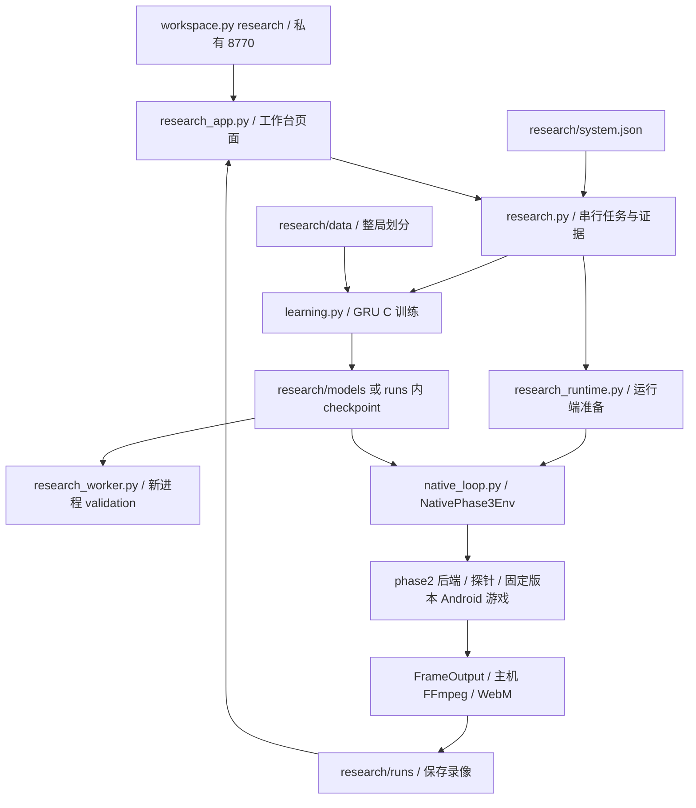

# 当前科研系统：运行、依赖与研究入口

当前日常工作收敛为：**Codespaces 训练，在同一个工作台查看配置、曲线和验证；原生运行端负责新对局与录像。** 主配置是 [`system.json`](system.json)，新实验写入 `research/runs/`。不需要日常在不同日期的 `outputs/` 中寻找数据或模型。

要直接读代码，打开[框架图与可点击源码地图](CODE_MAP_ZH.md)：包含总览、模型结构、训练、原生对局、录像/回看、历史代码用途和核心函数入口。另有[可缩放 SVG 总图](CODE_MAP.svg)与[图片总图](CODE_MAP.png)。

截至 2026-11-07，保存数据的 GRU C 训练、保存重载、独立 validation 已通过；本轮无画面原生模型评估两局均自然终局，959 次决策、确认出牌 90 次，对 cycle 规则对手一胜一负，每局约 180 秒和 85 秒。最初内容准备的 180 秒预算失败已保留；同进程继续等待后自行就绪，身份核验后完成上述评估。原生渲染评估曾超时，完整原版录像、Windows 连续鼠标拖牌人机尚未交付。详见[最新模式区分与状态重绘方案](PERFORMANCE_AND_MEDIA_ZH.md#本轮修正无画面评估与真实状态重绘)和[本轮原生对局证据](runs/headless-result-20261107t075733z/gameplay-proof.json)。这两局证明执行链可用，不证明棋力提升。

## 日常只需要这个入口

在仓库根目录执行：

```bash
.venv-cloud/bin/python tools/cloud/workspace.py research
```

打开 Codespaces 的私有 **8770**，路径 `/research`。选择“训练”、数据和模型，点击开始；配置、日志、曲线和独立验证结果都随实验保存。离线模式不启动 Android。关闭网页不取消任务；停止 Codespace 会中断进程，再启动时旧任务标记为中断，不自动重跑。

修改默认参数、登记数据或参考模型，编辑 `research/system.json` 后重启工作台。页面也可调整本次实验参数。配置错误或资源缺失会明示，不能自动用另一份数据冒充当前实验。当前只注册 GRU C；它是小样本序列行为克隆，不是任意模型插件或在线强化学习入口。

如需命令行提交，可在工作台运行期间执行：

```bash
.venv-cloud/bin/python tools/cloud/workspace.py research submit --request '{"mode":"offline","epochs":2}'
.venv-cloud/bin/python tools/cloud/workspace.py research list
```

新工作区首次准备 Python 环境使用现有统一脚本：

```bash
bash tools/cloud/bootstrap.sh --ml --research
.venv-cloud/bin/python tools/cloud/workspace.py doctor
```

当前已有环境不必重装。训练核心只需基础和 ML profile；`--research` 另安装 Parquet/Gymnasium 工具。浏览器验收、原生游戏和视频工具各有独立依赖，不要求每次实验安装。日常训练使用离线模式；原生运行端就绪后，评估可选择“快速无画面数值评估（不录像）”。它跳过原生渲染，但不能跳过 Android 启动与内容初始化，也不产生原版视频。

本机验证过的新实验是 `run-20261107t072813535902z-ec230e1e`：两轮训练、新进程 352 行 validation、零原生 RPC。查看现有真实片段，在“选择实验”选 `run-20261107t065103723813z-82e04899`；页面标注“历史失败归档 · 初始化片段”。这两个编号是本机交付记录，不要求研究者在日常手工填写。当前状态摘要见 [`STATUS.json`](STATUS.json)。

## 当前运行目录

```text
research/
  system.json                 当前配置：数据、模型、结果、原生版本、默认参数
  migration_sources.json      一次性重组来源；日常运行不读取
  dependency-map.json         全仓作者代码/导入/依赖/外部资产的审计清单
  README.md                   本指南
  MODEL_INTEGRATION_ZH.md      换模型、输入、loss、世界模型的接入说明
  PERFORMANCE_AND_MEDIA_ZH.md  实测性能、视频问题与后续对照实验
  data/native/               当前原生样本 metadata.json + rows.jsonl
  data/portable-pilot/        版本不同的离线样本，禁止替代原生评估输入
  models/gru-c/               reference.json + reference.npz
  runtime/version.json       字节保持不变的固定原生版本清单
  vm/                        原生启动诊断；短路径满足 QMP Unix socket 限制
  media/                     真实初始化视频及带来源哈希的说明
  runs/run-.../              新实验：请求、配置、模型、验证、日志、对局、录像
```

数据、权重、运行时与结果是生成的本地资产，已加入 Git 忽略；**只克隆源码不会自动得到它们**。当前工作区已用迁移工具生成；新机器需提供经审查的对应资产。已有目标文件如果不同，工具拒绝覆盖；原数据、原模型和旧 `outputs/` 保留。

这次迁移复制原 rows/NPZ 原字节，只在派生 metadata/checkpoint 中重定位路径并重算相应元数据指纹，原始文件不改。参考模型是先前已训练的两轮 C，重定位不代表重新训练或策略提升。`metadata` 中的历史 `source` 是可追溯来源，不是每次训练需要加载的旧文件。

一次性迁移可先预览再执行，`--receipt` 使用新的仓库内路径：

```bash
.venv-cloud/bin/python tools/cloud/reorganize_research.py --receipt outputs/cloud/reorganization-plan-next.json
.venv-cloud/bin/python tools/cloud/reorganize_research.py --apply --receipt outputs/cloud/reorganization-apply-next.json
```

**仍保留的外部依赖：**原生版本清单锁定 828 个资产，约 1.78 GB，部分物理位置仍在历史资源目录；路径本身参与版本指纹。Android 的可变磁盘与安装回执继续位于 `.cache/native-tools/android-recovery-001`。本次不搬移或伪造它们的版本身份。因此，离线运行已摆脱旧日期数据/模型路径，原生运行尚不是一个可随意移动的独立目录。不能删除清单引用的 APK、libg、探针、内容或磁盘链。

## 代码分层与实际调用关系



| 层级 | 职责 | 是否当前主流程 |
|---|---|---|
| `tools/cloud/workspace.py` | 单一开发入口、环境检查、测试 | 是；旧子命令仍保留 |
| `tools/cloud/research_app.py`、`research_workbench.html` | HTTP 与页面，展示真实结果、只读播放文件 | 是，无 Node 构建步骤 |
| `royale_phase3/research.py`、`workbench_config.py` | 当前配置、注册资源、队列、子进程与实验状态 | 是 |
| `royale_phase3/learning.py`、`observation.py`、`belief.py`、`data_contract.py` | 算法、公开输入、数据与模型契约 | 是，科研主要改动处 |
| `royale_phase3/native_env.py`、`native_loop.py`、`actions.py` | 真实环境、数据导出、部署、动作与消费 | 新原生实验需要 |
| `tools/cloud/research_runtime.py`、`native_runtime_state.py` | 准备/识别/停止已有运行端，状态检查与旧页面解耦 | 原生实验需要 |
| `royale_phase2` 的 backend/probe/connection/versioning/visibility/battlefield/runtime | 当前仍复用的固定版本协议、身份与可见性设施 | 是，目录名不代表废弃 |
| `tools/cloud/native_frame_media.py`、`native_media.py` | 连续原生帧、主机编码、时间轴、媒体回执 | 录制需要 |
| `royale_ai`、`baseline/mvp_v0_1` | 早期 12 卡近似模型与冻结对照 | 保留，不是当前原生引擎 |
| `royale_lab` | 社区 C++ 近似引擎、规则/BC/PPO 基线 | 保留，其胜率不代表当前原生 C |
| Windows `run_play.ps1`、`run_platform.ps1`、`run.ps1`、`phase2.ps1` | 已有本地演示、平台与历史入口 | 保留；不等于新的人机模型部署已完成 |

本次集中**当前运行目录和配置**，源码继续只有一份。没有为消除 `phase2` 这个名字而复制、分叉当前协议层，也没有把近似模拟器当成原生游戏。

## 依赖应怎样讲清楚

以下是当前已固定、已使用的环境版本，不是联网升级到每个库的最新发布版本。不同运行 profile 不能混成一份互相冲突的安装清单。

| 用途 | 依赖与权威清单 | 日常需要程度 |
|---|---|---|
| 基础 Python | `.venv-cloud/bin/python`，NumPy 2.2.6；`requirements-codespaces.txt` | 基础工具 |
| 当前 C 训练/部署 | Torch 2.6.0+cpu；`requirements-codespaces-ml.txt`，bootstrap 使用 CPU wheel 索引 | 训练与推理 |
| Parquet 与 Gym 接口 | PyArrow 19.0.1、Gymnasium 1.1.1；`requirements-codespaces-research.txt` | 转换/研究扩展；当前派生 JSONL BC 不直接需要 |
| 浏览器验收 | Playwright 1.51.0、对应 Chromium、Linux 库与字体；`requirements-codespaces-browser.txt` 和仓库内 `.cache/cloud` | 可选验收 |
| 当前页面 | Python 标准库 HTTP、原生 HTML/JS/SVG | 无 npm/前端服务器依赖 |
| 原生对局 | QEMU、qemu-img、内核/initrd/Android 磁盘、ADB、固定 APK/libg/探针/内容、回环连接 | 仅原生运行；锁在 `configs/native` 与 `requirements-codespaces-native-tools.json` |
| 原生视频 | Android FrameOutput、ADB、带 VP9 的 FFmpeg/ffprobe、WebM 浏览器 | 录制；播放已保存文件不需启动 Android |
| APK/探针重建 | JDK 17、apktool、apksig、Android NDK/C++ 工具 | 构建时可选，非每次训练步骤 |
| 历史社区引擎 | 兼容 Python ABI 的 C++ 扩展、CMake/编译器及对应社区源数据 | 独立基线 |
| 历史视觉与分析 | OpenCV/Ultralytics、ONNX/ONNXRuntime、Pillow、Androguard/Frida、绘图/PDF 等 | 按具体工具启用，详见机器清单 |
| Windows 环境 | 原 `requirements.lock`、`requirements-vision.txt`、`tools/*requirements*.txt`、PowerShell 启动器 | 完整保留，不用云端版本覆盖 |

`pyproject.toml` 现已列入当前 phase2/phase3/tools 包，并把重型研究依赖移入可选组。**当前支持的是源码仓库运行**；普通 wheel 不包含游戏、`research/system.json`、配置/数据/模型，不能当成自包含发行包。日常安装继续使用 bootstrap 的固定云端清单，勿用 `pip install .` 代替原生资源准备。根目录 Windows lock 未更改。

[`dependency-map.json`](dependency-map.json) 列出全仓作者代码的层级、SHA256、Python 静态导入边、依赖 profiles/已安装核心版本以及原生外部资产引用。AST 导入图不能完整证明动态加载和子进程的执行闭包；实际运行证据另保存。生成方式为：

```bash
.venv-cloud/bin/python tools/cloud/research_inventory.py --output research/dependency-map.json
```

代码变化后加 `--refresh` 更新此清单；工具只允许刷新自己的 schema，不覆盖其它 JSON。

## 算法、性能与验收下一步

- **加自己的模型：**按 [算法接入指南](MODEL_INTEGRATION_ZH.md)定位网络、loss、输入、模型工厂、checkpoint、独立验证和部署。当前只注册 C；改一个模型名不能加载新架构。
- **解释运行慢和视频状态：**看 [性能与媒体实测](PERFORMANCE_AND_MEDIA_ZH.md)。先前渲染失败缺少当时的连续内存采样；本轮 headless 已采样并完成两局。约 0.044 倍实时的旧 30 tick 短测使用渲染模式，不能作为无画面速度；TCG、ARM64 转译、软件图形和初始化等待仍需分别分析。
- **验证完整对局：**先采集短窗口性能与压力对照，改善兼容运行端；再同 checkpoint、同 seed 换边两局自然终局，预先固定录制局。请求数、超时、截断和消费证据都保留，不把故障记成输局。
- **验证视频：**真实画面从建局前覆盖自然终局，能够独立播放/倍速/前后跳转，动作按实测误差区间对应画面。目前保存的是初始化片段；新工作台中的“历史失败归档”供观看此片段，不是一场新跑成功的实验。
- **真人对战：**训练留在 Codespaces，Windows 兼容运行端先验证速度、身份、画面和消费；随后实现一个持续推进调度器接收鼠标拖牌与同一模型动作。目前尚未实现。

目标是让讨论集中于模型输入、算法、训练和验证协议；原生性能与 Windows 连续控制仍是必须完成的工程前置，不能以换目录或延长 timeout 代替验收。
